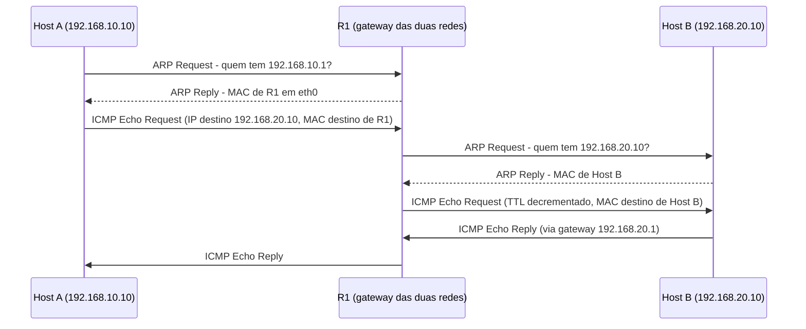
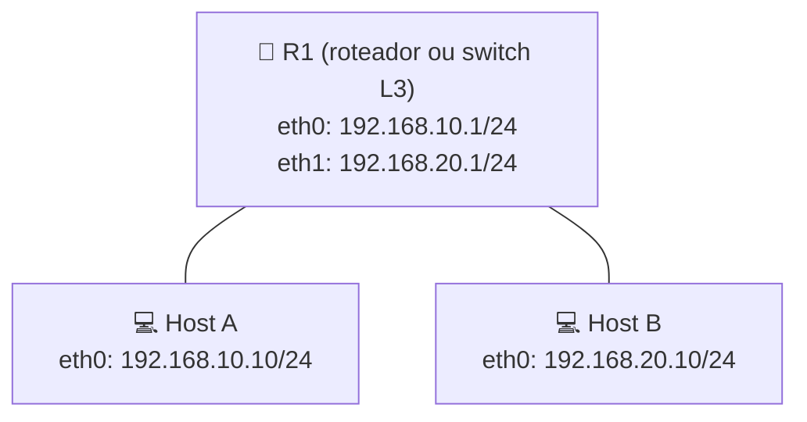

# Laboratório 01 - Fundamentos de Roteamento IP e Encaminhamento de Pacotes

- **Instituição:** Universidade de Brasília (UnB)
- **Departamento:** Departamento de Engenharia Elétrica (ENE)
- **Curso:** Engenharia de Redes de Comunicação
- **Disciplina:** ENE0025 - Protocolos de Transporte e Roteamento
- **Professor responsável:** Prof. Dr. Laerte Peotta de Melo
- **Tema:** Fundamentos de encaminhamento e decisão de roteamento IP

---

## 1. Objetivos

- Compreender que redes distintas **não se comunicam automaticamente**
    
- Identificar o **papel do roteador** como elemento lógico de interconexão
    
- Diferenciar falha de comunicação por ausência de roteamento de falha física
    
- Relacionar teoria de roteamento com comportamento real da rede
    
> **Dica:** execute o comando `setxkbmap -model pc105 -layout br -variant abnt2` e tente colar com Ctrl+Shift+V.

---

## 2. Introdução e Fundamentação Teórica

### 2.1 Conceito: encaminhamento e roteamento

Em redes IP (*Internet Protocol*), dois dispositivos só se comunicam diretamente quando pertencem ao mesmo segmento de camada 2 e à mesma sub-rede. Quando origem e destino estão em sub-redes distintas, a comunicação depende de um dispositivo de camada 3, o roteador, que interliga os segmentos e decide o próximo salto de cada datagrama. Dois conceitos precisam ser distinguidos:

- **Encaminhamento (*forwarding*):** ação executada pacote a pacote no plano de dados, que consiste em consultar a tabela de rotas e transmitir o datagrama pela interface de saída;
- **Roteamento (*routing*):** processo do plano de controle que constrói a tabela de rotas, a partir de redes diretamente conectadas, rotas estáticas ou protocolos dinâmicos.

### 2.2 Funcionamento interno

O host de origem aplica a máscara de sub-rede ao endereço de destino. Se o destino pertencer à mesma sub-rede, o host resolve o endereço de enlace (*Media Access Control* - MAC) por meio do *Address Resolution Protocol* (ARP) e entrega o quadro diretamente. Caso contrário, o datagrama é enviado ao gateway padrão, conforme a [**RFC 1122**](https://datatracker.ietf.org/doc/html/rfc1122). O roteador, por sua vez, seleciona a rota de prefixo mais específico (*longest prefix match*), decrementa o campo *Time to Live* (TTL) do cabeçalho IP e reescreve o cabeçalho de enlace para o próximo salto, conforme a [**RFC 791**](https://datatracker.ietf.org/doc/html/rfc791) e a [**RFC 1812**](https://datatracker.ietf.org/doc/html/rfc1812). Se o TTL chegar a zero, o pacote é descartado e o roteador emite uma mensagem *Internet Control Message Protocol* (ICMP) do tipo *Time Exceeded* ([**RFC 792**](https://datatracker.ietf.org/doc/html/rfc792)).



### 2.3 Exemplo concreto

No cenário deste laboratório, o Host A (`192.168.10.10/24`) deseja alcançar o Host B (`192.168.20.10/24`). A máscara `/24` indica que o destino está fora da sua sub-rede. Sem rota ou gateway padrão, o próprio sistema operacional do Host A rejeita o envio; com o gateway `192.168.10.1` configurado, o datagrama é entregue ao roteador, que o encaminha ao Host B.

### 2.4 Protocolos envolvidos

| Protocolo | Camada OSI | Camada TCP/IP | Encapsulamento | Especificação |
|---|---|---|---|---|
| IPv4 | 3 (Rede) | Internet | - | [**RFC 791**](https://datatracker.ietf.org/doc/html/rfc791) |
| ICMP | 3 (Rede) | Internet | IP protocolo 1 | [**RFC 792**](https://datatracker.ietf.org/doc/html/rfc792) |
| ARP | 2/3 (Enlace/Rede) | Acesso à rede | Direto sobre Ethernet (EtherType `0x0806`) | [**RFC 826**](https://datatracker.ietf.org/doc/html/rfc826) |

---

## 3. Topologia e Cenário

### 3.1 Cenário do laboratório

#### 3.1.1 Topologia lógica



### 3.2 Recursos no PNetLab

- Escolher entre um roteador ou um *switch* L3 (camada 3)

- 1 roteador (FRRouting - FRR, Cisco IOU - *IOS on Unix* - ou VyOS)
  
- 2 hosts Linux
    
- 2 segmentos Ethernet
    

---

## 4. Roteiro Prático Passo a Passo

### 4.1 Parte 1 - Montagem da topologia

#### 4.1.1 Passo 1 - Criar o laboratório

1. Acessar o PNetLab
    
2. Criar novo laboratório:  **Nome:** `Aula1_Conceitos_Roteamento`
    
3. Inserir os nós:
    
    - `Linux-PC-1` (Host A)
        
    - `Linux-PC-2` (Host B)
        
    - `R1` (roteador ou switch L3)
        

#### 4.1.2 Passo 2 - Conectar os dispositivos

- Host A → Interface 1 do Router
    
- Host B → Interface 2 do Router
    

### 4.2 Parte 2 - Configuração de endereçamento IP

#### 4.2.1 Endereçamento proposto

|Dispositivo|Interface|IP|Máscara|
|---|---|---|---|
|Host A|eth0|192.168.10.10|/24|
|R1|eth0|192.168.10.1|/24|
|R1|eth1|192.168.20.1|/24|
|Host B|eth0|192.168.20.10|/24|

#### 4.2.2 Passo 3 - Configurar os hosts

**Host A**

```bash
ip addr add 192.168.10.10/24 dev eth0
ip link set eth0 up
```

**Host B**

```bash
ip addr add 192.168.20.10/24 dev eth0
ip link set eth0 up
```

#### 4.2.3 Passo 4 - Configurar o roteador

```bash
ip addr add 192.168.10.1/24 dev eth0
ip addr add 192.168.20.1/24 dev eth1
ip link set eth0 up
ip link set eth1 up

# Habilita o encaminhamento IPv4 entre interfaces (Linux/FRR)
sysctl -w net.ipv4.ip_forward=1
```

> Os comandos acima pressupõem Linux (ou FRRouting sobre Linux). Em Cisco IOU ou VyOS, a sintaxe de configuração de interfaces é distinta e deve ser consultada na documentação da imagem escolhida.

### 4.3 Parte 3 - Testes de conectividade sem roteamento

#### 4.3.1 Passo 5 - Testes iniciais

1. Do Host A:
    

```bash
ping 192.168.20.10
```

**Resultado esperado:** falha. Em Linux, a mensagem típica é `Network is unreachable`, pois o Host A ainda não possui rota para `192.168.20.0/24` nem gateway padrão.

2. Do Host A para o roteador:
    

```bash
ping 192.168.10.1
```

**Resultado esperado:** sucesso

#### 4.3.2 Discussão orientada

- O enlace físico funciona?
    
- O IP está configurado corretamente?
    
- Por que o pacote não chega ao Host B?
    

**Conclusão:**  Sem uma decisão de encaminhamento, o pacote não sabe para onde ir.

### 4.4 Parte 4 - Introdução da decisão de roteamento

#### 4.4.1 Passo 6 - Configurar gateway padrão nos hosts

**Host A**

```bash
ip route add default via 192.168.10.1
```

**Host B**

```bash
ip route add default via 192.168.20.1
```

#### 4.4.2 Passo 7 - Novo teste de conectividade

```bash
ping 192.168.20.10
```

**Resultado esperado:** sucesso

---

## 5. Verificação e Diagnóstico

### 5.1 Parte 5 - Observação da tabela de rotas

#### 5.1.1 Passo 8 - Examinar tabelas

**Host A**

```bash
ip route
```

**Host B**

```bash
ip route
```

**Roteador**

```bash
ip route
```

Pontos a observar:

- Rotas diretamente conectadas
    
- Rota default nos hosts
    
- Decisão local em cada salto
    

### 5.2 Parte 6 - Amarração com a teoria

#### 5.2.1 Discussão final orientada

- O roteador conhece o caminho completo?
    
- Onde ocorreu a “inteligência” da rede?
    
- O que aconteceria com mais roteadores?
    

Relacionar explicitamente com:

- Encaminhamento × roteamento
    
- Plano de dados × plano de controle

### 5.3 Interpretação da saída de `ip route`

Cada linha da tabela de rotas de um host Linux segue o formato `<prefixo> via <próximo salto> dev <interface> ...`:

| Campo | Significado |
|---|---|
| `default` | Rota padrão (`0.0.0.0/0`), usada quando nenhum prefixo mais específico corresponde ao destino |
| `via 192.168.10.1` | Endereço do próximo salto (gateway); ausente em rotas de redes diretamente conectadas |
| `dev eth0` | Interface de saída |
| `proto kernel` / `scope link` | Rota criada automaticamente pelo núcleo ao atribuir o endereço à interface, válida no enlace local |
| `src 192.168.10.10` | Endereço de origem preferencial usado para pacotes gerados pelo host por essa rota |

O comando `ip route get 192.168.20.10` mostra qual rota seria efetivamente escolhida para um destino específico.

### 5.4 Metodologia de diagnóstico

Em caso de falha de comunicação, seguir a ordem das camadas:

1. **Enlace físico/lógico:** `ip link show eth0` deve indicar `UP` e `LOWER_UP`;
2. **Endereçamento e sub-rede:** `ip addr show`, conferindo endereço e máscara em cada nó;
3. **Resolução de vizinhos:** `ip neigh` deve listar o MAC do gateway após uma tentativa de comunicação;
4. **Tabela de rotas:** `ip route` e `ip route get <destino>` nos hosts e no roteador;
5. **Encaminhamento no roteador:** `sysctl net.ipv4.ip_forward` deve retornar `1`;
6. **Políticas:** `sudo iptables -S`, caso exista alguma regra de filtragem aplicada ao nó.

---

## 6. Segurança

### 6.1 Riscos associados

- **Roteador sem filtragem:** com o encaminhamento habilitado e nenhuma regra de filtragem, qualquer host de uma rede alcança qualquer host da outra. Controles de acesso entre segmentos são tratados nos Laboratórios 10 e 11.
- **Falsificação de endereço de origem (*spoofing*):** um host pode emitir pacotes com endereço de origem forjado. A mitigação de borda é descrita na [**RFC 2827**](https://datatracker.ietf.org/doc/html/rfc2827) (BCP 38).
- **Redirecionamentos ICMP:** um nó malicioso pode induzir um host a alterar sua rota por meio de mensagens ICMP *Redirect*.

### 6.2 Boas práticas (*hardening*)

Em um roteador Linux, recomenda-se habilitar a verificação de caminho reverso e desabilitar redirecionamentos:

```bash
sudo sysctl -w net.ipv4.conf.all.rp_filter=1          # verificação de caminho reverso (uRPF em modo estrito)
sudo sysctl -w net.ipv4.conf.all.accept_redirects=0   # ignora ICMP Redirect recebidos
sudo sysctl -w net.ipv4.conf.all.send_redirects=0     # não emite ICMP Redirect
```

O parâmetro `rp_filter` pode causar descartes legítimos em cenários de roteamento assimétrico; nesses casos, utiliza-se o modo frouxo (`2`), conforme a [**RFC 3704**](https://datatracker.ietf.org/doc/html/rfc3704) (BCP 84).

---

## 7. Questões para Análise e Discussão

1. No teste inicial, por que o Host A conseguiu alcançar a interface local do roteador (`192.168.10.1`), mas não conseguiu se comunicar com o Host B (`192.168.20.10`)?
2. Qual a função exata do comando de gateway padrão (`ip route add default via ...`) configurado nos hosts e o que ocorre na ausência dele?
3. O roteador intermediário precisa conhecer o caminho completo de ponta a ponta até a aplicação final para encaminhar os pacotes? Justifique com base no conceito de decisão salto a salto (*hop-by-hop*).
4. Explique a diferença prática observada neste laboratório entre **Encaminhamento (*Forwarding* - Plano de Dados)** e **Roteamento (*Routing* - Plano de Controle)**.

---

## 8. Critérios de Avaliação e Entregáveis

### 8.1 Critérios de avaliação

| Critério | Pontos |
|---|---:|
| Montagem correta da topologia e endereçamento IP das interfaces | 2,0 |
| Configuração do roteador (endereçamento e encaminhamento IPv4) e do gateway padrão nos hosts | 2,5 |
| Execução e validação dos testes de conectividade (`ping`) | 2,0 |
| Inspeção e interpretação das tabelas de rotas (`ip route`) | 1,5 |
| Respostas técnicas fundamentadas às questões para análise e discussão e síntese conclusiva | 2,0 |

**Total: 10,0**

### 8.2 Entregáveis

O relatório técnico é **individual** e deve ser entregue em **PDF**, contendo:

- captura de tela da topologia montada e ativa no PNetLab;
- evidência da configuração IP (`ip addr`) e da tabela de rotas (`ip route`) no Host A, no Host B e no Roteador, acompanhada da interpretação dos campos principais conforme a Seção 5.3;
- evidência do encaminhamento habilitado no Roteador (`sysctl net.ipv4.ip_forward` retornando `1`);
- evidência dos testes de conectividade: ping do Host A ao roteador (`192.168.10.1`), ping do Host A ao Host B antes do gateway padrão (falha) e após a configuração (sucesso);
- respostas completas e fundamentadas às questões da Seção 7;
- síntese conclusiva com objetivo, comandos utilizados e conclusão.

---

## 9. Referências

- [**RFC 791**](https://datatracker.ietf.org/doc/html/rfc791) - *Internet Protocol*.
- [**RFC 792**](https://datatracker.ietf.org/doc/html/rfc792) - *Internet Control Message Protocol*.
- [**RFC 826**](https://datatracker.ietf.org/doc/html/rfc826) - *An Ethernet Address Resolution Protocol*.
- [**RFC 1122**](https://datatracker.ietf.org/doc/html/rfc1122) - *Requirements for Internet Hosts - Communication Layers*.
- [**RFC 1812**](https://datatracker.ietf.org/doc/html/rfc1812) - *Requirements for IP Version 4 Routers*.
- [**RFC 2827**](https://datatracker.ietf.org/doc/html/rfc2827) - *Network Ingress Filtering* (BCP 38).
- [**RFC 3704**](https://datatracker.ietf.org/doc/html/rfc3704) - *Ingress Filtering for Multihomed Networks* (BCP 84).
- KUROSE, J. F.; ROSS, K. W. *Redes de Computadores e a Internet: uma abordagem top-down*. Pearson.
- TANENBAUM, A. S.; WETHERALL, D. *Redes de Computadores*. Pearson.
- COMER, D. E. *Interligação de Redes com TCP/IP*. Elsevier.

---

[Índice Geral (README)](../README.md) | [Próximo: Laboratório 02 →](lab02.md)
