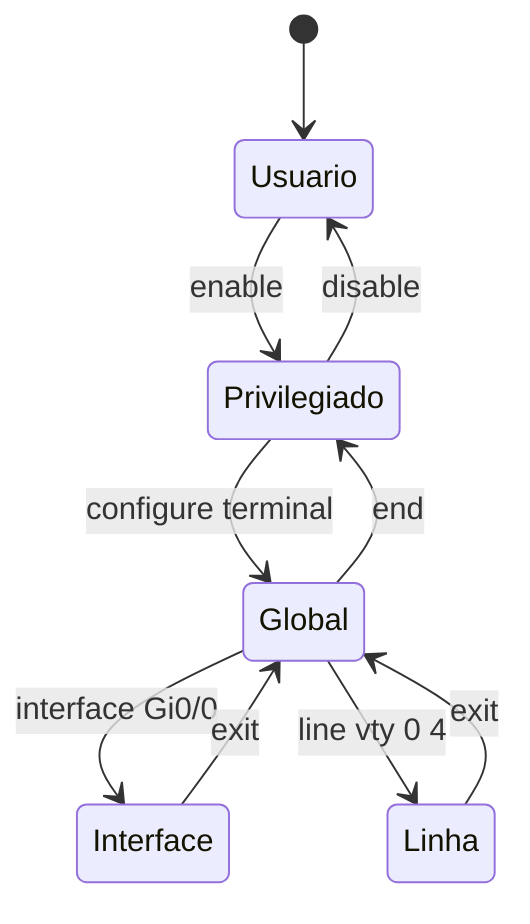
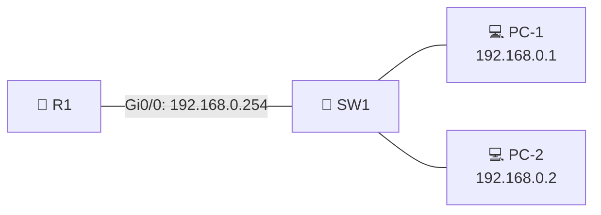

# Laboratório 02 - Configuração Básica de Roteadores no PNetLab

- **Instituição:** Universidade de Brasília (UnB)
- **Departamento:** Departamento de Engenharia Elétrica (ENE)
- **Curso:** Engenharia de Redes de Comunicação
- **Disciplina:** ENE0025 - Protocolos de Transporte e Roteamento
- **Professor responsável:** Prof. Dr. Laerte Peotta de Melo
- **Tema:** Acesso ao console do nó, configuração básica e gerência remota (SSH)

---

## 1. Objetivos

Ao final deste laboratório, o aluno deverá ser capaz de:

- montar uma topologia básica no PNetLab com roteador, switch e hosts;
- realizar o acesso inicial ao roteador pelo console do próprio nó no PNetLab, sem nó terminal nem cabo de console;
- compreender a função de cada elemento da topologia em uma rede local;
- configurar parâmetros básicos de administração no roteador;
- atribuir endereço IP à interface Gi0/0 (*GigabitEthernet*) do roteador;
- configurar o endereçamento IP dos hosts da LAN;
- identificar o papel do gateway padrão na comunicação da rede;
- testar a conectividade entre roteador e estações com comandos de verificação;
- salvar a configuração realizada no equipamento;
- preparar o ambiente para os próximos laboratórios de roteamento.

---

## 2. Introdução e Fundamentação Teórica

### 2.1 Visão geral

Este laboratório tem como objetivo introduzir o aluno à configuração inicial de roteadores Cisco em ambiente emulado no **PNetLab**. A prática cobre acesso à CLI, definição de parâmetros básicos de administração, configuração de interface IP, habilitação de acesso remoto seguro e testes de conectividade.

Este é o primeiro cenário prático da disciplina e serve como base para os laboratórios posteriores de roteamento estático e dinâmico.

### 2.2 Conceito: modos da CLI e planos de acesso

A *Command Line Interface* (CLI) do Cisco IOS é organizada em modos hierárquicos, identificados pelo prompt. O acesso ao equipamento pode ocorrer por duas vias:

- **Fora de banda (*out-of-band*):** pela porta de console, sem depender da pilha IP; é a via utilizada na configuração inicial. No PNetLab, esse acesso é obtido pela janela de console do próprio nó, sem necessidade de nó terminal ou cabo de console;
- **Em banda (*in-band*):** pela rede, por meio de sessões remotas nas linhas de terminal virtual (*Virtual Teletype* - VTY), preferencialmente com *Secure Shell* (SSH).

| Modo | Prompt | Como acessar | Finalidade |
|---|---|---|---|
| Usuário | `R1>` | Login inicial | Consultas limitadas |
| Privilegiado | `R1#` | `enable` | Comandos `show`, `copy`, `debug` |
| Configuração global | `R1(config)#` | `configure terminal` | Parâmetros globais do equipamento |
| Configuração de interface | `R1(config-if)#` | `interface Gi0/0` | Parâmetros de uma interface |
| Configuração de linha | `R1(config-line)#` | `line console 0` / `line vty 0 4` | Acesso por console e VTY |



### 2.3 Protocolos e serviços envolvidos

| Serviço | Camada OSI | Camada TCP/IP | Transporte / porta | Observação |
|---|---|---|---|---|
| SSH | 7 (Aplicação) | Aplicação | TCP 22 | Autenticação e canal cifrado; arquitetura na [**RFC 4251**](https://datatracker.ietf.org/doc/html/rfc4251) e transporte na [**RFC 4253**](https://datatracker.ietf.org/doc/html/rfc4253) |
| Telnet | 7 (Aplicação) | Aplicação | TCP 23 | Texto claro, desaconselhado ([**RFC 854**](https://datatracker.ietf.org/doc/html/rfc854)) |
| ICMP (`ping`) | 3 (Rede) | Internet | IP protocolo 1 | Teste de alcançabilidade ([**RFC 792**](https://datatracker.ietf.org/doc/html/rfc792)) |
| Console | 1 (Física) | - | Porta serial assíncrona (no PNetLab, emulada pela janela de console do nó) | Não depende de endereçamento IP |

O endereçamento `192.168.0.0/24` pertence à faixa privada definida na [**RFC 1918**](https://datatracker.ietf.org/doc/html/rfc1918).

---

## 3. Topologia e Cenário

### 3.1 Topologia

A topologia do laboratório é composta por:

- **1 roteador**
- **1 switch Ethernet**
- **2 PCs**
- enlaces Ethernet entre os dispositivos

#### 3.1.1 Diagrama lógico



### 3.2 Endereçamento IP

| Dispositivo | Interface        | Endereço IP   | Máscara           | Gateway Padrão | Observação                    |
|-------------|------------------|:---------------:|-------------------|:----------------:|-------------------------------|
| Router      | Gi0/0            | 192.168.0.254 | 255.255.255.0     | -              | Interface LAN do roteador     |
| PC 1        | eth0             | 192.168.0.1   | 255.255.255.0     | 192.168.0.254  | Host conectado ao switch      |
| PC 2        | eth0             | 192.168.0.2   | 255.255.255.0     | 192.168.0.254  | Host conectado ao switch      |

### 3.3 Requisitos

- Ambiente **PNetLab** operacional
- Imagem de **roteador Cisco IOSv** (*Virtual IOS*), com ao menos uma interface
- 1 nó **Ethernet Switch** compatível: **L2-ADVENTERPRISEK9-M-15.2-IRON-20151103.bin**
- 2 nós **VPCS**
- Acesso ao console do roteador pelo navegador

---

## 4. Roteiro Prático Passo a Passo

### 4.1 Montagem do cenário no PNetLab

Nesta atividade, o cenário deve reproduzir uma topologia simples de rede local com acesso inicial ao roteador pelo **console do nó no PNetLab** e comunicação dos hosts por meio de uma **LAN Ethernet**.

#### 4.1.1 Dispositivos necessários

Adicionar ao laboratório os seguintes nós no PNetLab conforme a Seção 3.3 (Requisitos):

- **1 roteador**
- **1 switch**
- **2 PCs** para a rede local

> Caso a imagem exata dos equipamentos não esteja disponível no PNetLab, podem ser utilizados dispositivos equivalentes, mantendo a mesma função lógica no cenário.

#### 4.1.2 Conexões da topologia

Realizar as conexões conforme abaixo:

- conectar a interface **Gi0/0** do **Router** ao **Switch**
- conectar o **PC 1** ao switch
- conectar o **PC 2** ao switch

#### 4.1.3 Organização lógica do cenário

A topologia final deverá representar:

- **acesso inicial ao roteador** pela janela de console do nó no PNetLab, sem nó terminal nem cabo de console;
- **rede LAN 192.168.0.0/24** interligando roteador, switch e hosts;
- **roteador como gateway padrão** da rede local.

#### 4.1.4 Passos de montagem

1. Criar um novo laboratório no PNetLab.
2. Inserir os dispositivos listados na topologia.
3. Renomear os nós para facilitar a identificação:
   - `R1`
   - `SW1`
   - `PC1`
   - `PC2`
4. Conectar os equipamentos conforme o diagrama da atividade.
5. Inicializar todos os nós.
6. Acessar o roteador inicialmente pelo **console do nó** (duplo clique sobre o nó no PNetLab).
7. Após a configuração da interface `Gi0/0`, validar a conectividade entre os hosts e o roteador.
   

### 4.2 Configuração do roteador

Acessar o console do roteador e executar os comandos abaixo.

#### 4.2.1 Configuração inicial

```cisco
enable
configure terminal
! Nome do equipamento
hostname R1
! Evita a resolução DNS de comandos digitados incorretamente
no ip domain-lookup
! Aviso legal exibido antes do login
banner motd #
Acesso restrito. Somente usuarios autorizados.
#
! Senha do modo privilegiado, armazenada como hash
enable secret unb123
! Cifra senhas em texto claro (tipo 7, reversível: não substitui o uso de secret)
service password-encryption
```

#### 4.2.2 Configuração da linha de console

```cisco
! Acesso local pela porta de console
line console 0
 password cisco
 login
 logging synchronous
 exec-timeout 10 0
 exit
```

#### 4.2.3 Criação de usuário local e habilitação de SSH

```cisco
! Usuário local com privilégio máximo e senha armazenada como hash
username admin privilege 15 secret Admin@123
! O nome de domínio é pré-requisito para gerar a chave RSA
ip domain-name unb.lab
! Gera o par de chaves RSA de 2048 bits usado pelo SSH
crypto key generate rsa modulus 2048
! Restringe o SSH à versão 2
ip ssh version 2
! Linhas de terminal virtual (acesso remoto): autenticação local e somente SSH
line vty 0 4
 login local
 transport input ssh
 exec-timeout 10 0
 logging synchronous
 exit
```

#### 4.2.4 Configuração da interface LAN

> Caso a interface disponível no seu roteador tenha outro nome, como `Ethernet0/0` (IOL) ou `Fa0/0` (Dynamips), adapte os comandos. O nome correto é exibido por `show ip interface brief`.

```cisco
interface Gi0/0
 description LAN-PNETLAB
 ip address 192.168.0.254 255.255.255.0
 no shutdown
 exit
end
! Salva a configuração na NVRAM
copy running-config startup-config
```

### 4.3 Configuração do host VPCS

No terminal do **PC1**, executar:

```text
ip 192.168.0.1/24 192.168.0.254
save
```
No terminal do **PC2**, executar:

```text
ip 192.168.0.2/24 192.168.0.254
save
```

---

## 5. Verificação e Diagnóstico

### 5.1 Comandos de verificação

#### 5.1.1 No roteador

```cisco
show ip interface brief
show running-config
show users
show ssh
```

#### 5.1.2 No PC1

```bash
ping 192.168.0.254
ping 192.168.0.2
```

#### 5.1.3 No PC2

```bash
ping 192.168.0.254
ping 192.168.0.1
```

### 5.2 Resultados esperados

Ao final da montagem, o laboratório deverá permitir:

- Acesso ao roteador pelo console do nó no PNetLab;
- Comunicação entre o roteador e os dois PCs da LAN;
- Testes de conectividade com `ping` entre hosts e gateway;
- Continuidade das configurações básicas de administração do roteador.

### 5.3 Interpretação da saída de `show ip interface brief`

Cada linha corresponde a uma interface e contém as colunas:

| Coluna | Significado |
|---|---|
| `Interface` | Nome da interface (por exemplo, `GigabitEthernet0/0`) |
| `IP-Address` | Endereço IP configurado (`unassigned` se não houver) |
| `OK?` | Indica se o endereço é válido para a interface |
| `Method` | Forma de obtenção do endereço (`manual`, `DHCP`, `unset`, entre outras) |
| `Status` | Estado da camada física: `up`, `down` ou `administratively down` (interface sem `no shutdown`) |
| `Protocol` | Estado da camada de enlace: `up` ou `down` |

Para a interface da LAN, o resultado esperado é `up/up`. A combinação `administratively down/down` indica ausência de `no shutdown`; `up/down` indica problema de enlace; `down/down` indica ausência de conexão física (cabo ou conexão no PNetLab).

### 5.4 Metodologia de diagnóstico

1. **Conectividade física/enlace:** estado `up/up` da interface e do `SW1` no PNetLab;
2. **Endereçamento e sub-redes:** `show ip interface brief` e `show running-config interface Gi0/0`; hosts na mesma sub-rede `/24` do gateway;
3. **Conectividade local:** `ping 192.168.0.254` a partir dos PCs; o roteador deve responder;
4. **Acesso remoto:** `show ip ssh` e `show ssh` confirmam a versão do SSH e as sessões ativas; verificar `transport input ssh` e `login local` nas linhas VTY;
5. **Políticas:** conferir a existência de `access-class` ou ACLs aplicadas às linhas VTY.

---

## 6. Segurança

### 6.1 Riscos associados

- **Credenciais fracas e reutilizadas:** `unb123`, `cisco` e `Admin@123` são valores exclusivamente didáticos e não devem ser reutilizados em ambientes reais.
- **Armazenamento de senhas:** o comando `service password-encryption` aplica cifra reversível (tipo 7), que não oferece proteção real; apenas `secret` armazena hash. Em versões que suportam, convém empregar algoritmos de hash mais robustos que o padrão.
- **Telnet:** transmite credenciais e comandos em texto claro; deve estar desabilitado (`transport input ssh`).
- **Chaves RSA curtas:** chaves de 1024 bits são consideradas insuficientes; o roteiro utiliza 2048 bits.
- **Força bruta nas linhas VTY:** sem limitação, o acesso remoto fica sujeito a tentativas repetidas de autenticação.

### 6.2 Boas práticas (*hardening*)

```cisco
! Restringe o acesso remoto a uma estação de gerência (exemplo: 192.168.0.100)
access-list 10 permit host 192.168.0.100
line vty 0 4
 access-class 10 in
 exit
! Bloqueia novos logins por 120 s após 3 falhas em 60 s
login block-for 120 attempts 3 within 60
! Limita o número de tentativas de autenticação por sessão SSH
ip ssh authentication-retries 3
```

Recomenda-se ainda desabilitar serviços desnecessários, manter o *banner* de aviso legal e registrar eventos de acesso em servidor de *log* centralizado.

---

## 7. Questões para Análise e Discussão

### 7.1 Questões para análise

1. Qual a diferença entre acesso **via console** e acesso **remoto pela rede**?
2. Qual a função do comando `no ip domain-lookup` em laboratório?
3. Por que o comando `enable secret` é preferível ao `enable password`?
4. Por que o protocolo SSH é mais seguro que o Telnet?
5. O que ocorre se a interface não receber o comando `no shutdown`?

### 7.2 Conclusão

Este laboratório introduz a configuração básica de roteadores no PNetLab e estabelece as competências mínimas necessárias para os próximos cenários da disciplina. Dominar CLI, interface IP, acesso remoto e testes de conectividade é essencial antes da evolução para protocolos de roteamento e atividades de diagnóstico mais avançadas.

---

## 8. Critérios de Avaliação e Entregáveis

### 8.1 Critérios de avaliação

| Critério | Pontos |
|---|---:|
| Configuração básica do roteador (hostname, senhas, console, domain-lookup) | 2,0 |
| Atribuição correta de IP na interface Gi0/0 e ativação (`no shutdown`) | 2,5 |
| Habilitação e teste do acesso remoto seguro (SSH nas linhas VTY) | 2,0 |
| Verificação com comandos CLI (`show ip int brief`, `show running-config`) e ping | 1,5 |
| Respostas técnicas fundamentadas às questões de análise | 2,0 |

**Total: 10,0**

### 8.2 Entregáveis

O aluno deverá entregar:
- captura de tela da topologia no PNetLab;
- saída do comando `show ip interface brief`;
- saída do comando `show running-config`;
- evidência do teste de `ping` entre PCs e roteador;
- evidência do acesso remoto via SSH;
- respostas completas às questões para análise;
- breve relatório síntese com objetivo e conclusão.

---

## 9. Referências

- [**RFC 854**](https://datatracker.ietf.org/doc/html/rfc854) - *Telnet Protocol Specification*.
- [**RFC 792**](https://datatracker.ietf.org/doc/html/rfc792) - *Internet Control Message Protocol*.
- [**RFC 1918**](https://datatracker.ietf.org/doc/html/rfc1918) - *Address Allocation for Private Internets*.
- [**RFC 4251**](https://datatracker.ietf.org/doc/html/rfc4251) - *The Secure Shell (SSH) Protocol Architecture*.
- [**RFC 4253**](https://datatracker.ietf.org/doc/html/rfc4253) - *The Secure Shell (SSH) Transport Layer Protocol*.
- Cisco Systems. *Cisco IOS Configuration Fundamentals Configuration Guide* e *Cisco IOS Security Configuration Guide* (documentação oficial do fabricante).
- KUROSE, J. F.; ROSS, K. W. *Redes de Computadores e a Internet: uma abordagem top-down*. Pearson.
- TANENBAUM, A. S.; WETHERALL, D. *Redes de Computadores*. Pearson.

---

[← Anterior: Laboratório 01](lab01.md) | [Índice Geral (README)](../README.md) | [Próximo: Laboratório 03 →](lab03.md)
