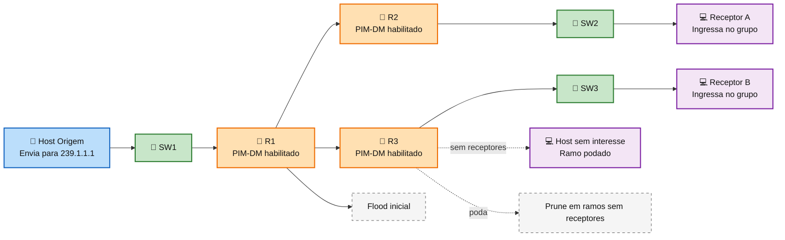
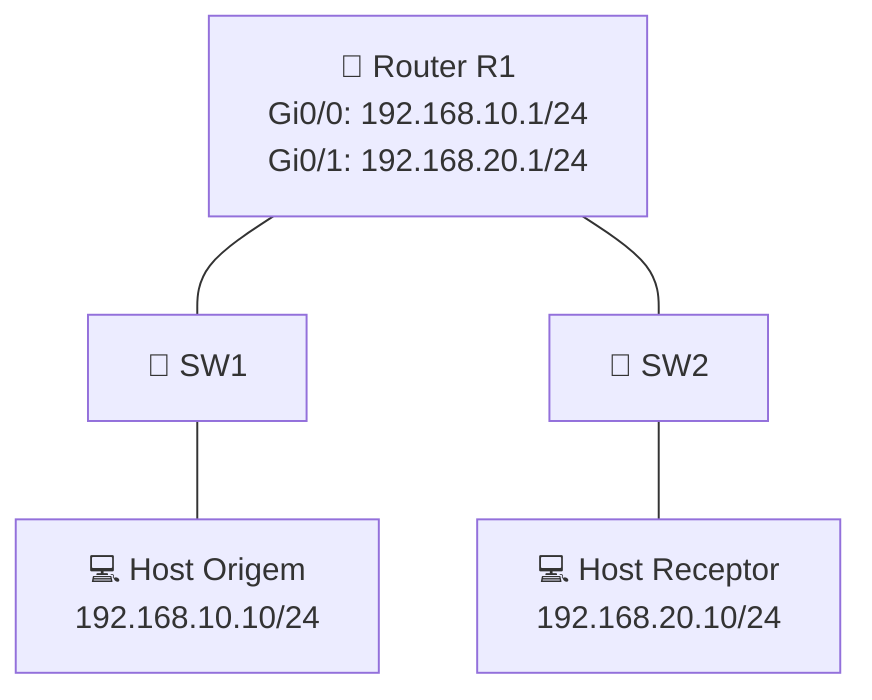

# Laboratório 03 - PIM-DM em Topologia Controlada

- **Instituição:** Universidade de Brasília (UnB)
- **Departamento:** Departamento de Engenharia Elétrica (ENE)
- **Curso:** Engenharia de Redes de Comunicação
- **Disciplina:** ENE0025 - Protocolos de Transporte e Roteamento
- **Professor responsável:** Prof. Dr. Laerte Peotta de Melo
- **Tema:** Roteamento multicast IP com PIM Dense Mode (PIM-DM)

---

### Material de Apoio: Podcast Latência Zero

<table>
  <tr>
    <td width="140" align="center">
      <a href="https://open.spotify.com/show/59S06LhFsKlyvfLFQCJ8fK">
        
      </a>
    </td>
    <td valign="top">
      O podcast <strong>Latência Zero</strong> apresenta discussões técnicas complementares sobre os temas da disciplina.<br><br>
      🎧 <strong>Episódio 1:</strong> <a href="https://open.spotify.com/episode/6autgkF6lifJAD8M3Xr0XR">Engenharia do Roteamento Multicast PIM-DM</a>
    </td>
  </tr>
</table>

---

## 1. Objetivos

Ao final desta atividade, o aluno deverá ser capaz de:

- montar uma topologia controlada de multicast no **PNetLab**;
- configurar interfaces IP em roteador e hosts;
- habilitar o roteamento multicast com `ip multicast-routing`;
- ativar o **PIM-DM** nas interfaces do roteador;
- gerar tráfego multicast de teste;
- verificar a operação básica do encaminhamento multicast;
- analisar a relação entre a tabela unicast e a tabela multicast;
- validar o funcionamento do grupo multicast configurado.

---

## 2. Introdução e Fundamentação Teórica

### 2.1 Tema

Implementação inicial de **multicast IP com PIM-DM** em uma topologia pequena e controlada no **PNetLab**, validando a formação básica do encaminhamento multicast entre uma origem e um receptor em duas LANs distintas.

### 2.2 Justificativa

Esta prática introduz o aluno ao roteamento multicast em ambiente controlado. Após a configuração básica de interfaces e conectividade IP em laboratório anterior, o estudante passa a observar:

- tráfego **unicast** como base para o funcionamento do multicast;
- habilitação de **multicast routing** no roteador;
- ativação do **PIM Dense Mode (PIM-DM)**;
- formação da tabela de rotas multicast;
- encaminhamento de tráfego multicast entre redes diferentes.

A atividade foi estruturada para simplificar o primeiro contato com multicast roteado.

### 2.3 Fundamentação teórica

Protocolos de roteamento tradicionais foram concebidos para comunicação **unicast**, em que um emissor envia pacotes para um único destino. Em aplicações como transmissão de vídeo, distribuição de conteúdo em tempo real, aulas ao vivo, monitoramento e replicação simultânea de dados, esse modelo pode ser ineficiente, pois obriga a origem a enviar múltiplas cópias do mesmo fluxo para diferentes receptores. Nesse contexto surge o **multicast IP**, cujo objetivo é permitir que um mesmo fluxo seja entregue a vários receptores interessados, reduzindo consumo de banda e processamento na origem.

#### 2.3.1 Diagrama explicativo do conceito de multicast com PIM-DM



No modelo multicast, os receptores passam a fazer parte de um **grupo multicast**, identificado por um endereço de classe D no IPv4, normalmente no intervalo de `224.0.0.0` a `239.255.255.255`. Um host emissor envia pacotes para o endereço do grupo, e a rede se encarrega de replicar esse tráfego apenas nos pontos necessários. Isso torna o encaminhamento mais eficiente do que no broadcast, que alcança todos os dispositivos do domínio, e mais escalável do que múltiplas transmissões unicast paralelas. Para que o roteamento multicast funcione, não basta apenas que a rede tenha conectividade IP entre as sub-redes. É necessário que os roteadores saibam **como encaminhar o tráfego multicast** e, principalmente, **por quais interfaces esse tráfego deve ser recebido e reenviado**. É nesse ponto que entra o **PIM - Protocol Independent Multicast**. O termo *independent* indica que o PIM não depende de um protocolo unicast específico, como RIP, OSPF ou EIGRP. Em vez disso, ele utiliza a tabela de roteamento unicast já existente para tomar decisões sobre o melhor caminho reverso até a origem do tráfego.

Entre os modos de operação do PIM, o **PIM Dense Mode (PIM-DM)** foi projetado para ambientes em que os receptores estão distribuídos de forma relativamente densa na rede, isto é, quando se supõe que muitos segmentos da topologia desejam receber o tráfego multicast. Seu funcionamento baseia-se na lógica de **flood and prune** (Inundar e Podar). Inicialmente, quando surge um fluxo multicast, o roteador propaga o tráfego para todas as interfaces habilitadas para PIM-DM, exceto aquela pela qual o pacote foi recebido. Em seguida, os roteadores que não possuem receptores interessados enviam mensagens de **prune**, interrompendo a distribuição naquele ramo da árvore multicast. Esse comportamento torna o PIM-DM adequado para laboratórios introdutórios, pois dispensa, em um primeiro momento, elementos adicionais como **Rendezvous Point (RP)**, exigidos em cenários com **PIM Sparse Mode (PIM-SM)**. Em compensação, o PIM-DM pode gerar envio desnecessário de tráfego em redes grandes, já que o fluxo é inicialmente inundado antes do processo de poda. Por isso, ele é mais apropriado em cenários controlados, pequenos e com elevada probabilidade de interesse pelo fluxo multicast. Outro conceito central para compreender o PIM-DM é o **RPF - Reverse Path Forwarding**. Esse mecanismo verifica se um pacote multicast chegou pela interface que corresponde ao melhor caminho de volta até a origem, segundo a tabela unicast. Se o pacote chega por essa interface esperada, ele pode ser encaminhado; caso contrário, é descartado. Essa regra ajuda a evitar loops e garante consistência na árvore de distribuição multicast. Assim, mesmo sendo um protocolo multicast, o PIM depende diretamente da qualidade da base unicast configurada na rede.


*Imagem gerada com uso de inteligência artificial (OpenAI, ChatGPT).*

>Na prática, o funcionamento multicast também envolve o comportamento dos hosts. Os receptores precisam manifestar interesse em participar de um grupo, normalmente por meio do **IGMP (Internet Group Management Protocol)** em redes IPv4. Em um laboratório simplificado, muitas vezes o foco recai sobre a ativação do multicast no roteador e a geração de tráfego para um endereço de grupo, mas é importante compreender que, em cenários reais, a adesão dos hosts ao grupo é fundamental para que a rede saiba onde o tráfego deve ser mantido ou podado.

### 2.4 Funcionamento interno do PIM-DM

O *Protocol Independent Multicast - Dense Mode* (PIM-DM) é especificado na [**RFC 3973**](https://datatracker.ietf.org/doc/html/rfc3973). Seu ciclo de operação compreende:

1. **Descoberta de vizinhos:** mensagens *Hello* enviadas ao endereço `224.0.0.13` (*ALL-PIM-ROUTERS*);
2. **Inundação (*flood*):** o primeiro pacote de uma origem é replicado em todas as interfaces PIM, exceto na de entrada, desde que aprovado pela verificação RPF;
3. **Poda (*prune*):** roteadores sem receptores nem vizinhos interessados enviam mensagens *Prune* a montante, interrompendo o fluxo no ramo;
4. **Reinserção (*graft*) e *assert*:** a adesão de um novo receptor em ramo podado gera mensagem *Graft*; a existência de caminhos paralelos é resolvida por mensagens *Assert*.

Os receptores informam o interesse em um grupo ao roteador da LAN por meio do *Internet Group Management Protocol* (IGMP), versão 2 neste cenário ([**RFC 2236**](https://datatracker.ietf.org/doc/html/rfc2236)). O mapeamento do endereço de grupo para o endereço MAC segue a [**RFC 1112**](https://datatracker.ietf.org/doc/html/rfc1112): os 23 bits menos significativos do endereço IP são copiados para o prefixo `01:00:5e`.

### 2.5 Exemplo concreto

Para o grupo `239.1.1.1` (hexadecimal `EF.01.01.01`), os 23 bits menos significativos resultam em `01.01.01`, e o endereço MAC de destino dos quadros Ethernet é `01:00:5e:01:01:01`. O endereço `239.1.1.1` pertence à faixa de escopo administrativo `239.0.0.0/8`, destinada a uso interno de organizações ([**RFC 2365**](https://datatracker.ietf.org/doc/html/rfc2365)).

### 2.6 Protocolos envolvidos

| Protocolo | Camada OSI | Camada TCP/IP | Encapsulamento | Endereço de destino típico |
|---|---|---|---|---|
| PIM | 3 (Rede) | Internet | IP protocolo 103 | `224.0.0.13` |
| IGMP | 3 (Rede) | Internet | IP protocolo 2 | Endereço do grupo ou `224.0.0.1` (consultas) |
| Tráfego de teste (`iperf`) | 4 (Transporte) | Transporte | UDP 5000 (porta configurada neste roteiro) | `239.1.1.1` |

---

## 3. Topologia e Cenário

### 3.1 Topologia proposta



### 3.2 Endereçamento IP

| Dispositivo   | Interface | Endereço IP   | Máscara           |Gateway          |
|---------------|-----------|---------------|-------------------|:-----------------:|
| R1            | Gi0/0     | 192.168.10.1  | 255.255.255.0     | -               |
| R1            | Gi0/1     | 192.168.20.1  | 255.255.255.0     | -               |
| Host Origem   | eth0      | 192.168.10.10 | 255.255.255.0     | 192.168.10.1    |
| Host Receptor | eth0      | 192.168.20.10 | 255.255.255.0     | 192.168.20.1    |

**Grupo multicast sugerido:** `239.1.1.1`  
**Porta UDP de teste:** `5000`

### 3.3 Montagem do cenário no PNetLab

#### 3.3.1 Dispositivos necessários

Adicionar ao laboratório os seguintes nós:

- Imagem de **roteador Cisco IOSv** (*Virtual IOS*), com ao menos duas interfaces
- 2 nós **Ethernet Switch** compatível: **L2-ADVENTERPRISEK9-M-15.2-IRON-20151103.bin**
- **2 hosts** Linux leves.

#### 3.3.2 Conexões da topologia

Realizar as conexões conforme abaixo:

- conectar o **Host Origem** ao **SW1**;
- conectar o **SW1** à interface **Gi0/0** do **R1**;
- conectar o **Host Receptor** ao **SW2**;
- conectar o **SW2** à interface **Gi0/1** do **R1**.

#### 3.3.3 Resultado esperado da montagem

Ao final da montagem, o cenário deverá permitir:

- comunicação unicast entre cada host e sua interface de gateway;
- ativação do multicast no roteador;
- encaminhamento multicast entre as duas redes;
- visualização da tabela multicast no roteador.

### 3.4 Observação técnica

A imagem de roteador padronizada neste repositório é o **Cisco IOSv**, que suporta `ip multicast-routing` e `ip pim dense-mode`. Caso outra imagem seja utilizada, confirmar o suporte a esses comandos antes de iniciar a prática.

---

## 4. Roteiro Prático Passo a Passo

### 4.1 Configuração do roteador

#### 4.1.1 Configuração básica das interfaces

```cisco
enable
configure terminal
! Nome do equipamento e desativação da resolução DNS de comandos incorretos
hostname R1
no ip domain-lookup

! Interface voltada para a LAN de origem do fluxo multicast
interface Gi0/0
 description LAN-ORIGEM
 ip address 192.168.10.1 255.255.255.0
 no shutdown
 exit

! Interface voltada para a LAN do receptor
interface Gi0/1
 description LAN-RECEPTOR
 ip address 192.168.20.1 255.255.255.0
 no shutdown
 exit
```

#### 4.1.2 Habilitação do multicast e do PIM-DM

```cisco
! Habilita o encaminhamento de pacotes multicast no roteador
ip multicast-routing

! Ativa o PIM-DM (e, implicitamente, o IGMP) em cada interface participante
interface Gi0/0
 ip pim dense-mode
 exit

interface Gi0/1
 ip pim dense-mode
 exit

end
copy running-config startup-config
```

### 4.2 Configuração dos hosts

#### 4.2.1 Host Origem

No **Host Origem (Linux simples)**:

```bash
ip addr add 192.168.10.10/24 dev eth0
ip link set eth0 up
ip route add default via 192.168.10.1
```

#### 4.2.2 Host Receptor

No **Host Receptor (Linux simples)**:

```bash
ip addr add 192.168.20.10/24 dev eth0
ip link set eth0 up
ip route add default via 192.168.20.1
```

### 4.3 Geração de tráfego multicast

Para testes de multicast, recomenda-se utilizar **hosts Linux leves** no PNetLab com suporte a ferramentas como `iperf`.

#### 4.3.1 No Host Receptor

```bash
iperf -s -u -B 239.1.1.1 -p 5000 -i 1
```

#### 4.3.2 No Host Origem

```bash
iperf -c 239.1.1.1 -u -p 5000 -T 32 -t 30 -i 1
```

Significado das opções (`iperf` versão 2):

- `-s` e `-c`: modos servidor (receptor) e cliente (emissor);
- `-u`: tráfego UDP;
- `-B 239.1.1.1`: associa o receptor ao grupo multicast, o que leva o sistema operacional a emitir o relatório IGMP de adesão ao grupo;
- `-p 5000`: porta UDP de destino, coerente com a porta de teste definida na Seção 3.2;
- `-T 32`: TTL dos pacotes multicast; o valor padrão do `iperf` para multicast é 1, o que impediria o encaminhamento pelo roteador;
- `-t 30` e `-i 1`: duração de 30 s e relatório a cada 1 s.

> Caso a imagem utilizada não possua `iperf`, podem ser usados `iperf2`, `socat` ou outra ferramenta compatível com envio e recepção multicast.

---

## 5. Verificação e Diagnóstico

### 5.1 Comandos de verificação no roteador

```cisco
! Estado das interfaces
show ip interface brief
! Interfaces com PIM ativo e modo de operação
show ip pim interface
! Vizinhos PIM descobertos
show ip pim neighbor
! Grupos com adesão de receptores
show ip igmp groups
! Interface RPF para a origem
show ip rpf 192.168.10.10
! Tabela de roteamento multicast
show ip mroute
! Tabela unicast usada pelo RPF
show ip route
```

#### 5.1.1 O que observar

- interfaces `Gi0/0` e `Gi0/1` em estado `up/up`;
- PIM habilitado nas interfaces;
- existência de entradas multicast em `show ip mroute`;
- coerência entre interface de entrada, interface de saída e origem do tráfego.

### 5.2 Resultados esperados

Ao concluir a atividade, o aluno deve verificar que:

- o tráfego multicast sai da rede de origem e alcança a rede do receptor;
- o roteador mantém informações multicast específicas para o grupo configurado;
- o funcionamento do PIM depende da base de encaminhamento unicast já estabelecida;
- a topologia controlada permite visualizar o comportamento inicial do PIM-DM com baixa complexidade.

### 5.3 Checklist de validação

- [ ] Topologia criada corretamente no PNetLab  
- [ ] Interfaces do roteador configuradas com os IPs corretos  
- [ ] Hosts configurados com IP e gateway corretos  
- [ ] Comando `ip multicast-routing` habilitado  
- [ ] PIM-DM configurado nas interfaces do roteador  
- [ ] Tráfego multicast gerado no host de origem  
- [ ] Recepção do fluxo multicast no host receptor  
- [ ] Saída de `show ip pim interface` validada  
- [ ] Saída de `show ip mroute` validada  
- [ ] Configuração salva com sucesso  

### 5.4 Interpretação de `show ip mroute`

A tabela multicast contém dois tipos de entradas:

| Entrada | Significado |
|---|---|
| `(*, 239.1.1.1)` | Entrada genérica do grupo, independente da origem |
| `(192.168.10.10, 239.1.1.1)` | Entrada específica da origem e do grupo (par S,G) |

Em cada entrada, os campos mais relevantes são: **flags** (por exemplo, `D` para modo denso), **Incoming interface** (interface RPF por onde o fluxo é aceito), **RPF nbr** (vizinho RPF; `0.0.0.0` quando a origem está diretamente conectada) e **Outgoing interface list** (interfaces para as quais o tráfego é replicado, com estado `Forward` ou `Prune`). A ausência da interface do receptor na lista de saída indica que a poda foi aplicada ou que não houve adesão IGMP.

### 5.5 Metodologia de diagnóstico

1. **Enlace e interfaces:** `show ip interface brief` com `up/up` nas duas interfaces;
2. **Endereçamento e gateway:** `ping` de cada host para o respectivo gateway;
3. **Roteamento unicast:** `show ip route` e `show ip rpf 192.168.10.10`; sem rota unicast de retorno para a origem, a verificação RPF falha e o tráfego é descartado;
4. **PIM:** `show ip pim interface` deve listar as duas interfaces em modo denso;
5. **IGMP:** `show ip igmp groups` deve exibir `239.1.1.1` na interface do receptor enquanto o `iperf` receptor estiver ativo;
6. **Tabela multicast e políticas:** `show ip mroute` com contadores de pacotes crescentes; verificar filtros de multicast e do sistema operacional dos hosts.

---

## 6. Segurança

### 6.1 Riscos associados

- **Fonte não autorizada:** qualquer host pode emitir tráfego para qualquer grupo; no PIM-DM, esse tráfego é inundado por toda a topologia antes da poda, o que facilita ataques de negação de serviço por consumo de banda e de estado.
- **Vizinho PIM falso:** um nó malicioso que envie mensagens *Hello* pode ser aceito como vizinho e influenciar eleições e *asserts*.
- **Adesão indevida a grupos:** receptores não autorizados podem emitir relatórios IGMP para grupos restritos.
- **Escopo:** tráfego multicast sem controle de TTL ou de fronteira pode vazar para fora da organização.

### 6.2 Boas práticas (*hardening*)

```cisco
! Interface voltada para hosts: não aceita vizinhos PIM
access-list 10 deny any
interface Gi0/1
 ip pim neighbor-filter 10
 ! Restringe os grupos nos quais os hosts podem ingressar
 ip igmp access-group 20
 exit
access-list 20 permit 239.1.1.1
! Exemplo para a interface de borda externa de uma rede real: impede que o escopo administrativo (239.0.0.0/8) atravesse a borda da organização
! Não aplicar às interfaces deste laboratório, pois o grupo de teste 239.1.1.1 pertence a essa faixa
access-list 30 deny 239.0.0.0 0.255.255.255
access-list 30 permit 224.0.0.0 15.255.255.255
interface <interface-de-borda-externa>
 ip multicast boundary 30
 exit
```

O PIM-DM é indicado apenas para cenários didáticos ou redes pequenas com receptores densos; em redes de produção, o *PIM Sparse Mode* (PIM-SM, [**RFC 7761**](https://datatracker.ietf.org/doc/html/rfc7761)) é o modo recomendado.

---

## 7. Questões para Análise e Discussão

### 7.1 Questões para análise

1. Por que o PIM é considerado independente do protocolo de roteamento unicast?
2. Qual a diferença entre tráfego unicast e multicast neste cenário?
3. Qual a função do comando `ip multicast-routing`?
4. Por que o PIM-DM é uma boa escolha para uma primeira atividade prática?
5. O que a tabela `show ip mroute` revela sobre o encaminhamento multicast?

### 7.2 Conclusão

Esta atividade apresenta o primeiro cenário prático de multicast IP com PIM-DM em ambiente controlado no PNetLab. O laboratório permite que o aluno compreenda como o roteador passa a tratar tráfego multicast, formando a base conceitual e operacional necessária para topologias mais complexas nas próximas práticas.

---

## 8. Critérios de Avaliação e Entregáveis

### 8.1 Critérios de avaliação

| Critério | Pontuação |
|---|---:|
| Configuração do roteamento unicast base e endereçamento das interfaces | 2,0 |
| Habilitação do roteamento multicast (`ip multicast-routing`) e PIM-DM | 3,0 |
| Testes de geração e recepção de tráfego multicast com sucesso | 2,0 |
| Inspeção e interpretação de `show ip pim interface` e `show ip mroute` | 1,5 |
| Respostas técnicas fundamentadas às questões de análise | 1,5 |
| **Total** | **10,0** |

### 8.2 Entregáveis

O aluno deverá entregar:
- captura de tela da topologia montada no PNetLab;
- configuração aplicada no roteador (`show running-config`);
- saída dos comandos `show ip pim interface` e `show ip mroute`;
- evidência do envio e da recepção do tráfego multicast;
- respostas completas às questões para análise;
- relatório síntese contendo objetivo, metodologia e conclusão.

---

## 9. Referências

- [**RFC 1112**](https://datatracker.ietf.org/doc/html/rfc1112) - *Host Extensions for IP Multicasting*.
- [**RFC 2236**](https://datatracker.ietf.org/doc/html/rfc2236) - *Internet Group Management Protocol, Version 2*.
- [**RFC 2365**](https://datatracker.ietf.org/doc/html/rfc2365) - *Administratively Scoped IP Multicast*.
- [**RFC 3973**](https://datatracker.ietf.org/doc/html/rfc3973) - *Protocol Independent Multicast - Dense Mode (PIM-DM): Protocol Specification (Revised)*.
- [**RFC 7761**](https://datatracker.ietf.org/doc/html/rfc7761) - *Protocol Independent Multicast - Sparse Mode (PIM-SM): Protocol Specification (Revised)*.
- Cisco Systems. *IP Multicast: PIM Configuration Guide* (documentação oficial do fabricante).
- WILLIAMSON, B. *Developing IP Multicast Networks*. Cisco Press.
- KUROSE, J. F.; ROSS, K. W. *Redes de Computadores e a Internet: uma abordagem top-down*. Pearson.

---

[← Anterior: Laboratório 02](lab02.md) | [Índice Geral (README)](../README.md) | [Próximo: Laboratório 04 →](lab04.md)
