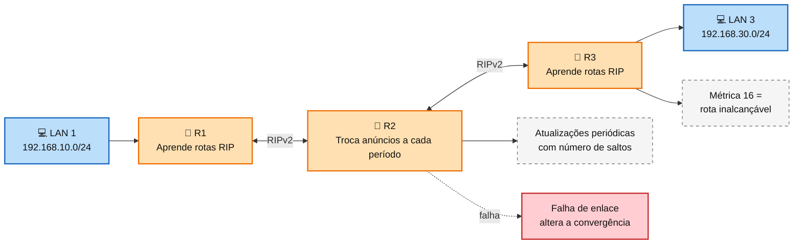
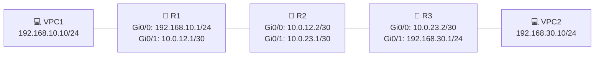
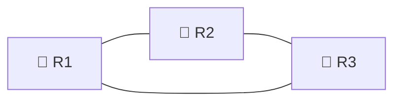

# Laboratório 04 - RIP e Análise de Convergência

- **Instituição:** Universidade de Brasília (UnB)
- **Departamento:** Departamento de Engenharia Elétrica (ENE)
- **Curso:** Engenharia de Redes de Comunicação
- **Disciplina:** ENE0025 - Protocolos de Transporte e Roteamento
- **Professor responsável:** Prof. Dr. Laerte Peotta de Melo
- **Tema:** Roteamento por vetor de distâncias com RIPv2 e análise de convergência

---

### Material de Apoio: Podcast Latência Zero

<table>
  <tr>
    <td width="140" align="center">
      <a href="https://open.spotify.com/show/59S06LhFsKlyvfLFQCJ8fK">
        
      </a>
    </td>
    <td valign="top">
      O podcast <strong>Latência Zero</strong> apresenta discussões técnicas complementares sobre os temas da disciplina.<br><br>
      🎧 <strong>Episódio 2:</strong> <a href="https://open.spotify.com/episode/5My3JBmZoVyoKaOL1MGArI">Quando o link cai: A prova de fogo do RIPv2 e a Convergência de Rede</a>
    </td>
  </tr>
</table>

---

## 1. Objetivos

Ao final da atividade, o aluno deverá ser capaz de:

- configurar o **RIPv2** em uma topologia com três roteadores;
- anunciar redes diretamente conectadas;
- verificar tabelas de roteamento e parâmetros do protocolo RIP;
- observar o comportamento da rede após a queda de um enlace;
- medir e interpretar o **tempo de convergência**;
- analisar o impacto de mecanismos como **split horizon**, **poison reverse** e **triggered updates**;
- relacionar a prática com as limitações do RIP em redes maiores.

---

## 2. Introdução e Fundamentação Teórica

### 2.1 Tema

Implementação do **RIPv2** em topologia com múltiplos roteadores, seguida de **análise de convergência após falha de enlace**.

### 2.2 Justificativa

Este laboratório eleva o nível de dificuldade em relação às práticas iniciais da disciplina ao introduzir um protocolo de roteamento dinâmico clássico baseado em **vetor-distância**. A atividade permite ao aluno observar não apenas a configuração do **RIPv2**, mas também o comportamento da rede diante de uma mudança de topologia.

Ao analisar a propagação de rotas, o desaparecimento de caminhos e o tempo necessário para a rede atingir um novo estado estável, o estudante compreende limitações importantes do RIP, como **convergência lenta**, dependência de temporizadores e vulnerabilidade a problemas como **count to infinity**. A prática também prepara o terreno para comparações futuras com protocolos de convergência mais rápida, como o **OSPF**.

### 2.3 Fundamentação teórica

Protocolos de roteamento dinâmico foram desenvolvidos para permitir que roteadores descubram, atualizem e removam rotas automaticamente, reduzindo a necessidade de configuração manual em redes com múltiplos caminhos e mudanças frequentes. Entre esses protocolos, o **RIP - Routing Information Protocol** ocupa lugar importante na história das redes IP por sua simplicidade de operação e valor didático. Mesmo sendo considerado limitado para redes modernas de maior porte, ele continua sendo extremamente útil em laboratório por permitir a observação clara de conceitos fundamentais como troca de rotas, atualização periódica, métrica por saltos e convergência.

O RIP pertence à classe dos protocolos de **vetor-distância**. Nesse modelo, cada roteador anuncia periodicamente a seus vizinhos as redes que conhece e a distância até elas, medida em **número de saltos**. Cada roteador, ao receber essas informações, recalcula sua tabela de roteamento e escolhe o melhor caminho com base na menor métrica. No RIP, uma rota com até **15 saltos** é considerada alcançável; uma métrica **16** representa destino inalcançável. Essa característica torna o protocolo simples, mas também limita sua aplicação a redes pequenas.

#### 2.3.1 Diagrama explicativo do funcionamento do RIP


O funcionamento do RIP depende da troca regular de informações entre roteadores vizinhos. No RIPv1, essas atualizações eram enviadas por broadcast, enquanto o RIPv2 introduziu melhorias importantes, como suporte a CIDR/VLSM, autenticação e envio por multicast, tornando o protocolo mais adequado a ambientes IPv4 contemporâneos. Ainda assim, a lógica de vetor-distância foi mantida, o que preserva suas limitações estruturais.

Um dos conceitos mais importantes para compreender o comportamento do RIP é o de convergência. Diz-se que a rede convergiu quando todos os roteadores possuem uma visão consistente e atualizada da topologia. Em situação estável, isso significa que todas as tabelas de roteamento refletem corretamente os melhores caminhos disponíveis. Quando ocorre uma falha de enlace, porém, essa consistência não é restaurada imediatamente. Cada roteador precisa detectar a mudança, propagar a nova informação e recalcular suas rotas. Esse processo pode levar tempo, especialmente em protocolos de vetor-distância como o RIP.

A lentidão da convergência do RIP está relacionada ao uso de temporizadores e ao modo como as informações se propagam pela rede. Como os anúncios são periódicos, pode haver atraso entre a ocorrência da falha e sua percepção pelos demais roteadores. Durante esse intervalo, alguns dispositivos ainda podem acreditar que o caminho antigo continua válido, o que gera inconsistências temporárias. Em laboratório, esse comportamento é particularmente útil porque permite ao aluno observar, na prática, a diferença entre uma rede operando em estado estável e uma rede em processo de adaptação a uma mudança de topologia.

Outro fenômeno clássico associado ao RIP é o problema de count to infinity. Esse problema ocorre quando roteadores trocam informações incorretas sobre uma rede que deixou de existir, aumentando gradualmente a métrica até que ela atinja o valor 16, considerado infinito no contexto do protocolo. Esse comportamento pode prolongar a convergência e gerar loops temporários. Para reduzir esse tipo de problema, o RIP incorpora mecanismos como split horizon, poison reverse e triggered updates. O split horizon evita que uma rota aprendida por uma interface seja anunciada de volta por essa mesma interface. O poison reverse marca explicitamente uma rota como inalcançável ao reenviá-la. Já os triggered updates permitem acelerar a propagação de mudanças sem depender exclusivamente do próximo ciclo periódico de atualização.


*Imagem gerada com uso de inteligência artificial (OpenAI, ChatGPT).*

> **Importante:** o RIP utiliza **UDP porta 520** para o envio de atualizações; no RIPv2, as mensagens são enviadas ao grupo multicast `224.0.0.9` ([**RFC 2453**](https://datatracker.ietf.org/doc/html/rfc2453)). Isso reforça a ideia de que protocolos de roteamento também operam sobre camadas e mecanismos bem definidos da pilha TCP/IP. O roteamento dinâmico não é apenas uma configuração isolada, mas parte do comportamento sistêmico da rede.

### 2.4 Funcionamento interno do RIPv2

O RIP é especificado pela [**RFC 1058**](https://datatracker.ietf.org/doc/html/rfc1058) (RIPv1) e pela [**RFC 2453**](https://datatracker.ietf.org/doc/html/rfc2453) (RIPv2). Cada roteador mantém uma tabela com destino, métrica e próximo salto e a divulga por mensagens *Response*, com até 25 rotas por mensagem. Ao receber um anúncio, o roteador soma 1 à métrica e instala a rota se ela for nova ou melhor. Um roteador também pode solicitar a tabela do vizinho por uma mensagem *Request*, por exemplo, ao ser inicializado.

### 2.5 Exemplo concreto: temporizadores e falha de enlace

Quando o enlace entre **R2** e **R3** é desativado, **R3** deixa de receber as atualizações de R2. O comportamento é controlado por temporizadores:

| Temporizador | Valor padrão ([**RFC 2453**](https://datatracker.ietf.org/doc/html/rfc2453)) | Valor padrão (Cisco IOS) | Função |
|---|---|---|---|
| Atualização periódica | 30 s | 30 s | Intervalo de envio da tabela completa |
| Expiração (*timeout* / *invalid*) | 180 s | 180 s | Sem atualização por esse tempo, a rota passa a métrica 16 |
| *Garbage-collection* / *flush* | 120 s após a expiração | 240 s após a última atualização | Remoção definitiva da rota da tabela |
| *Hold-down* | Não definido | 180 s | Período em que a rota é mantida sem aceitar alternativas; comportamento proprietário da Cisco |

Os valores efetivos podem ser conferidos com `show ip protocols`, e a divergência entre RFC e implementação deve ser considerada ao interpretar os tempos medidos no laboratório.

### 2.6 Protocolos envolvidos

| Protocolo | Camada OSI | Camada TCP/IP | Transporte / porta | Destino |
|---|---|---|---|---|
| RIPv2 | 7 (Aplicação), com função de controle da camada 3 | Aplicação | UDP 520 | `224.0.0.9` (multicast) |
| RIPv1 | 7 (Aplicação) | Aplicação | UDP 520 | `255.255.255.255` (broadcast) |

---

## 3. Topologia e Cenário

### 3.1 Topologia proposta



### 3.2 Endereçamento IP

| Dispositivo | Interface | Endereço IP   | Máscara           | Gateway        |
|-------------|:-----------:|---------------|-------------------|:----------------:|
| R1          | Gi0/0      | 192.168.10.1  | 255.255.255.0     | -              |
| R1          | Gi0/1      | 10.0.12.1     | 255.255.255.252   | -              |
| R2          | Gi0/0      | 10.0.12.2     | 255.255.255.252   | -              |
| R2          | Gi0/1      | 10.0.23.1     | 255.255.255.252   | -              |
| R3          | Gi0/0      | 10.0.23.2     | 255.255.255.252   | -              |
| R3          | Gi0/1      | 192.168.30.1  | 255.255.255.0     | -              |
| VPC1        | -      | 192.168.10.10 | 255.255.255.0     | 192.168.10.1   |
| VPC2        | -      | 192.168.30.10 | 255.255.255.0     | 192.168.30.1   |

### 3.3 Montagem do cenário no PNetLab

Adicionar ao laboratório:

- **3 roteadores Cisco IOSv** (*Virtual IOS*), com ao menos duas interfaces cada;
- **2 hosts VPCs**;
- enlaces ponto a ponto entre os roteadores.

#### 3.3.1 Conexões da topologia

- conectar o **VPC1** à interface **Gi0/0** do **R1**;
- conectar a interface **Gi0/1** do **R1** à interface **Gi0/0** do **R2**;
- conectar a interface **Gi0/1** do **R2** à interface **Gi0/0** do **R3**;
- conectar o **VPC2** à interface **Gi0/1** do **R3**.

#### 3.3.2 Resultado esperado da montagem

Ao final da montagem, o cenário deverá permitir:

- conectividade entre cada host e seu gateway local;
- troca de rotas dinâmicas entre os roteadores;
- comunicação fim a fim entre as duas LANs;
- observação do comportamento da rede após uma falha de enlace.

---

## 4. Roteiro Prático Passo a Passo

### 4.1 Configuração básica dos hosts

#### 4.1.1 VPC1

```text
ip 192.168.10.10/24 192.168.10.1
save
```

#### 4.1.2 VPC2

```text
ip 192.168.30.10/24 192.168.30.1
save
```

### 4.2 Configuração dos roteadores

#### 4.2.1 R1

```cisco
enable
configure terminal
hostname R1
no ip domain-lookup

interface Gi0/0
 ip address 192.168.10.1 255.255.255.0
 no shutdown
exit

interface Gi0/1
 ip address 10.0.12.1 255.255.255.252
 no shutdown
exit

! Ativa o RIP versão 2 (UDP 520, multicast 224.0.0.9)
router rip
 version 2
 ! Desativa a sumarização automática por classe (permite VLSM)
 no auto-summary
 ! Interfaces cobertas pelas redes abaixo enviam e recebem anúncios RIP
 network 192.168.10.0
 network 10.0.12.0
end
copy running-config startup-config
```

> O comando `network` do RIP aceita apenas endereços de rede *classful*: `network 10.0.12.0` e `network 10.0.23.0` são convertidos para `network 10.0.0.0` na configuração em execução, e `network 192.168.10.0` e `network 192.168.30.0` permanecem como redes de classe C. Na prática, toda interface com endereço em `10.0.0.0/8` passa a participar do RIP.

#### 4.2.2 R2

```cisco
enable
configure terminal
hostname R2
no ip domain-lookup

interface Gi0/0
 ip address 10.0.12.2 255.255.255.252
 no shutdown
exit

interface Gi0/1
 ip address 10.0.23.1 255.255.255.252
 no shutdown
exit

! Ativa o RIP versão 2 (UDP 520, multicast 224.0.0.9)
router rip
 version 2
 ! Desativa a sumarização automática por classe (permite VLSM)
 no auto-summary
 ! Interfaces cobertas pelas redes abaixo enviam e recebem anúncios RIP
 network 10.0.12.0
 network 10.0.23.0
end
copy running-config startup-config
```

#### 4.2.3 R3

```cisco
enable
configure terminal
hostname R3
no ip domain-lookup

interface Gi0/0
 ip address 10.0.23.2 255.255.255.252
 no shutdown
exit

interface Gi0/1
 ip address 192.168.30.1 255.255.255.0
 no shutdown
exit

! Ativa o RIP versão 2 (UDP 520, multicast 224.0.0.9)
router rip
 version 2
 ! Desativa a sumarização automática por classe (permite VLSM)
 no auto-summary
 ! Interfaces cobertas pelas redes abaixo enviam e recebem anúncios RIP
 network 10.0.23.0
 network 192.168.30.0
end
copy running-config startup-config
```

### 4.3 Verificação inicial

Em cada roteador, executar:

```cisco
show ip interface brief
show ip route
show ip protocols
```

No **VPC1**, testar a comunicação fim a fim:

```text
ping 192.168.30.10
```

### 4.4 Experimento de convergência

#### 4.4.1 Etapa 1 - Estado estável

Com a rede funcionando:

- verificar a rota para `192.168.30.0/24` em **R1**;
- verificar a rota para `192.168.10.0/24` em **R3**;
- confirmar a conectividade entre **VPC1** e **VPC2**.

#### 4.4.2 Etapa 2 - Falha de enlace

Desativar a interface entre **R2** e **R3**.

No **R2**:

```cisco
configure terminal
interface Gi0/1
shutdown
end
```

> No PNetLab, o desligamento administrativo de uma interface em uma extremidade pode não derrubar o estado da interface na extremidade oposta. Nesse caso, **R3** só perceberá a perda do vizinho pela expiração do temporizador de invalidação (180 s por padrão no Cisco IOS), o que torna a convergência mais lenta e mais visível.

#### 4.4.3 Etapa 3 - Observação

Após a falha:

- repetir `show ip route` em **R1**, **R2** e **R3**;
- testar `ping 192.168.30.10` a partir do **VPC1**;
- registrar em quanto tempo a rota deixa de ser utilizável;
- observar quando a rede atinge novo estado estável.

### 4.5 Desafio extra

Para elevar ainda mais a dificuldade, monte uma versão alternativa com **topologia redundante**:



Depois:

- anunciar as mesmas LANs;
- derrubar um enlace;
- comparar o comportamento do RIP com e sem caminho alternativo;
- verificar se a rede encontra nova rota e quanto tempo leva.

---

## 5. Verificação e Diagnóstico

### 5.1 Comandos de observação sugeridos

```cisco
show ip route rip
show ip protocols
debug ip rip
```

> O comando `debug ip rip` deve ser usado com cautela, pois gera saída contínua no console do roteador.

### 5.2 Checklist de validação

- [ ] Topologia criada corretamente no PNetLab  
- [ ] Interfaces dos roteadores configuradas com os endereços corretos  
- [ ] Hosts VPC configurados com IP e gateway corretos  
- [ ] RIPv2 habilitado nos três roteadores  
- [ ] Comando `no auto-summary` aplicado  
- [ ] Rotas RIP visíveis nas tabelas de roteamento  
- [ ] Comunicação fim a fim funcionando antes da falha  
- [ ] Falha de enlace simulada corretamente entre R2 e R3  
- [ ] Alterações na tabela de rotas observadas após a falha  
- [ ] Tempo de convergência registrado  
- [ ] Configurações salvas com sucesso  

### 5.3 Interpretação das saídas

**`show ip route rip`:** cada rota aprendida aparece com o código `R` e o formato `[120/1] via 10.0.12.2, 00:00:12, Gi0/1`:

| Campo | Significado |
|---|---|
| `R` | Rota aprendida por RIP |
| `[120/1]` | Distância administrativa (120, valor padrão do RIP) e métrica (número de saltos) |
| `via 10.0.12.2` | Próximo salto (roteador vizinho que anunciou a rota) |
| `00:00:12` | Tempo decorrido desde a última atualização recebida |
| `Gi0/1` | Interface de saída |

**`show ip protocols`:** exibe a versão do RIP, os temporizadores (*update*, *invalid*, *holddown*, *flushed*), as redes anunciadas e as fontes de informação de roteamento (vizinhos e tempo desde a última atualização). **`show ip rip database`** lista as rotas mantidas pelo processo RIP.

### 5.4 Metodologia de diagnóstico

1. **Enlace físico:** `show ip interface brief` com `up/up` em todas as interfaces;
2. **Endereçamento e sub-redes:** conferir que os dois lados de cada enlace `/30` estão na mesma sub-rede;
3. **Adjacência/vizinhança:** `show ip protocols` deve listar o vizinho como fonte de informação; conferir se a versão (1 ou 2) é a mesma nos dois lados;
4. **Tabela de rotas:** `show ip route rip`; rotas ausentes indicam `network` incompleto ou interface passiva;
5. **Políticas:** verificar `passive-interface`, ACLs e filtros de distribuição (`distribute-list`) que possam bloquear anúncios.

---

## 6. Segurança

### 6.1 Riscos associados

- **Ausência de autenticação:** por padrão, o roteador aceita atualizações RIP de qualquer origem nas interfaces habilitadas; um host na LAN pode injetar rotas falsas e desviar tráfego (*blackhole* ou interceptação).
- **Anúncios em redes de usuários:** as LANs `192.168.10.0/24` e `192.168.30.0/24` fazem parte do `network` do RIP, de modo que as interfaces voltadas aos hosts enviam e processam mensagens RIP.
- **Convergência lenta e *count to infinity*:** a janela de inconsistência após uma falha pode ser explorada para negação de serviço.

### 6.2 Boas práticas (*hardening*)

```cisco
! Impede o envio e o processamento de anúncios RIP na LAN de usuários
router rip
 passive-interface Gi0/0
 exit
! Autenticação criptográfica nos enlaces entre roteadores (exemplo em R1, interface Gi0/1)
key chain RIP-KEYS
 key 1
  key-string SENHA-LAB
interface Gi0/1
 ip rip authentication mode md5
 ip rip authentication key-chain RIP-KEYS
```

A autenticação criptográfica do RIPv2 é descrita na [**RFC 4822**](https://datatracker.ietf.org/doc/html/rfc4822). O valor `SENHA-LAB` é exclusivamente didático. A mesma configuração de autenticação deve ser aplicada nos dois extremos do enlace, com a mesma chave.

---

## 7. Questões para Análise e Discussão

### 7.1 Questões para análise

1. Qual foi o tempo aproximado de convergência após a falha do enlace?
2. Quais rotas deixaram de aparecer na tabela de roteamento após a interrupção?
3. O que aconteceu com o tráfego entre as redes `192.168.10.0/24` e `192.168.30.0/24` após a falha?
4. Como o RIP representa uma rota inalcançável?
5. Por que o RIP tende a convergir mais lentamente do que protocolos como o OSPF?
6. Qual a importância dos mecanismos de **split horizon**, **poison reverse** e **triggered updates**?
7. Em que tipo de cenário real o RIP deixaria de ser uma escolha adequada?

### 7.2 Conclusão

Este laboratório amplia a complexidade das práticas anteriores ao introduzir um protocolo de roteamento dinâmico e a análise do comportamento da rede diante de falhas. A configuração do **RIPv2** em uma topologia com múltiplos roteadores permite ao aluno compreender como rotas são propagadas, aprendidas e removidas.

A observação do processo de convergência evidencia limitações clássicas do RIP, especialmente em relação ao tempo de adaptação a mudanças de topologia. Com isso, a atividade estabelece uma base importante para o estudo comparativo com protocolos mais modernos e eficientes, como o **OSPF**, que serão explorados em etapas posteriores da disciplina.

---

## 8. Critérios de Avaliação e Entregáveis

### 8.1 Critérios de avaliação

| Critério | Pontos |
|---|---:|
| Montagem da topologia e endereçamento correto das interfaces | 2,0 |
| Configuração do protocolo RIPv2 (`version 2`, `no auto-summary`, anúncios) | 2,5 |
| Execução do teste de falha de enlace e análise da convergência | 2,5 |
| Verificação com comandos CLI (`show ip route`) e testes de conectividade | 1,5 |
| Respostas técnicas fundamentadas às questões de análise | 1,5 |

**Total: 10,0**

### 8.2 Entregáveis

O aluno deverá entregar:
- captura de tela da topologia montada no PNetLab;
- configurações de **R1**, **R2** e **R3** (`show running-config`);
- saídas de `show ip route` antes e depois da falha de enlace;
- evidência do `ping` antes e depois da falha;
- respostas completas às questões para análise;
- breve relatório síntese com análise do tempo de convergência observado e conclusão.

---

## 9. Referências

- [**RFC 1058**](https://datatracker.ietf.org/doc/html/rfc1058) - *Routing Information Protocol*.
- [**RFC 2453**](https://datatracker.ietf.org/doc/html/rfc2453) - *RIP Version 2*.
- [**RFC 4822**](https://datatracker.ietf.org/doc/html/rfc4822) - *RIPv2 Cryptographic Authentication*.
- Cisco Systems. *IP Routing: RIP Configuration Guide* (documentação oficial do fabricante).
- DOYLE, J.; CARROLL, J. D. *Routing TCP/IP, Volume I*. Cisco Press.
- KUROSE, J. F.; ROSS, K. W. *Redes de Computadores e a Internet: uma abordagem top-down*. Pearson.
- TANENBAUM, A. S.; WETHERALL, D. *Redes de Computadores*. Pearson.

---

[← Anterior: Laboratório 03](lab03.md) | [Índice Geral (README)](../README.md) | [Próximo: Laboratório 05 →](lab05.md)
