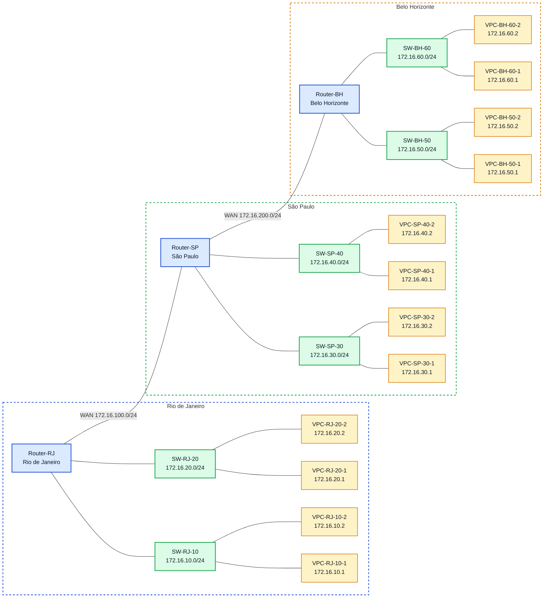

# Laboratório 05 - Roteamento Dinâmico com OSPF

- **Instituição:** Universidade de Brasília (UnB)
- **Departamento:** Departamento de Engenharia Elétrica (ENE)
- **Curso:** Engenharia de Redes de Comunicação
- **Disciplina:** ENE0025 - Protocolos de Transporte e Roteamento
- **Professor responsável:** Prof. Dr. Laerte Peotta de Melo
- **Tema:** Roteamento por estado de enlace com OSPFv2 (Área Única)

---

### Material de Apoio: Podcast Latência Zero

<table>
  <tr>
    <td width="140" align="center">
      <a href="https://open.spotify.com/show/59S06LhFsKlyvfLFQCJ8fK">
        
      </a>
    </td>
    <td valign="top">
      O podcast <strong>Latência Zero</strong> apresenta discussões técnicas complementares sobre os temas da disciplina.<br><br>
      🎧 <strong>Episódio 4:</strong> <a href="https://open.spotify.com/episode/6ha3fZPjrfBp8ZQNyIfTps?si=754a105ed6474063">RIP versus OSPF na prática</a>
    </td>
  </tr>
</table>

---

## 1. Objetivos

### 1.1 Objetivo

Configurar e validar o roteamento dinâmico com **OSPF** em uma topologia com três roteadores, compreendendo seu funcionamento como protocolo do tipo link-state e comparando-o conceitualmente com o RIP.

### 1.2 Objetivos específicos

Ao final deste laboratório, o estudante deverá ser capaz de:

- configurar interfaces IP em roteadores Cisco;
- ativar roteamento dinâmico com OSPF em área única (área 0);
- verificar a formação de adjacências OSPF;
- verificar tabelas de roteamento e custos de rota;
- validar conectividade entre redes remotas;
- capturar e analisar pacotes OSPF com o Wireshark, identificando os tipos de mensagem do protocolo (Hello, DBD, LSR, LSU, LSAck);
- explicar, por comparação, por que o OSPF é mais indicado que o RIP em redes maiores e mais complexas.

---

## 2. Introdução e Fundamentação Teórica

### 2.1 Fundamentação teórica

O roteador precisa saber por onde encaminhar os pacotes para que eles cheguem ao destino correto. Para isso, ele mantém uma tabela de rotas, que funciona como um mapa interno da rede. Essas informações podem ser inseridas de duas formas: manualmente pelo administrador, no caso do roteamento estático, ou aprendidas automaticamente, por meio dos protocolos de roteamento dinâmico. No roteamento dinâmico, os roteadores trocam informações entre si para descobrir quais redes existem e qual é o melhor caminho até elas. Isso torna a rede mais flexível, porque as rotas podem ser atualizadas automaticamente quando ocorre alguma mudança, como a queda de um enlace ou a entrada de uma nova rede.

Os protocolos de roteamento dinâmico podem ser divididos em dois grandes grupos. O primeiro é o dos protocolos internos, chamados de IGP (Interior Gateway Protocol), usados dentro de uma mesma organização, como uma empresa, universidade ou órgão público. O segundo é o dos protocolos externos, chamados de EGP (Exterior Gateway Protocol), usados na comunicação entre redes diferentes na Internet. O OSPF é um IGP, e é o protocolo em foco neste laboratório.

#### 2.1.1 Por que OSPF?

O OSPF (Open Shortest Path First) é um protocolo do tipo **link-state**. Cada roteador constrói uma visão lógica completa da topologia da rede (o *link-state database*) e calcula o melhor caminho até cada destino usando o algoritmo **SPF/Dijkstra**. Com isso, o OSPF oferece maior escalabilidade, convergência mais rápida diante de falhas e uma organização lógica da rede em áreas, sendo o protocolo mais adequado para ambientes corporativos maiores e mais exigentes - como o cenário multi-unidades deste laboratório.

O OSPF se parece com o uso de um aplicativo de navegação, um GPS mais inteligente: ele não olha apenas quantos roteadores existem no caminho, mas monta um mapa completo da rede e escolhe a rota de menor custo cumulativo (baseado na largura de banda dos enlaces), antes de decidir o trajeto. Por isso, toma decisões melhores em cenários maiores e mais complexos que os de uma rede pequena.

#### 2.1.2 Nota comparativa: OSPF x RIP

Para contextualizar as vantagens do OSPF, vale registrar como o RIP resolveria o mesmo problema. O RIP é um protocolo **distance-vector**, baseado no algoritmo Bellman-Ford, que escolhe rotas apenas pela contagem de saltos (quantos roteadores o pacote atravessa), sem considerar a qualidade ou capacidade dos enlaces. Como aceita no máximo 15 saltos e converge mais lentamente, o RIP é adequado apenas para redes pequenas e simples. É como pedir uma direção e receber a resposta "vá pelo caminho com menos cruzamentos", sem levar em conta se há trânsito ou se a via é melhor.

Essa comparação será retomada na Seção 7.1, mas a partir daqui todo o laboratório é conduzido apenas com **OSPF**.


*Imagem gerada com uso de inteligência artificial (OpenAI, ChatGPT).*

### 2.2 Funcionamento interno do OSPFv2

O *Open Shortest Path First* versão 2 é especificado na [**RFC 2328**](https://datatracker.ietf.org/doc/html/rfc2328). Seu funcionamento compreende quatro etapas:

1. **Descoberta de vizinhos:** mensagens *Hello* periódicas, enviadas ao grupo multicast `224.0.0.5`, estabelecem a vizinhança (*Hello interval* de 10 s e *Dead interval* de 40 s em redes *broadcast* e ponto a ponto, valores padrão da implementação Cisco);
2. **Sincronização da LSDB:** os vizinhos trocam *Database Description*, *Link State Request* e *Link State Update* até atingirem o estado `FULL`;
3. **Inundação de LSAs:** cada alteração de topologia é propagada por *Link State Advertisements* (LSAs) confirmados por *Link State Acknowledgment*;
4. **Cálculo SPF:** cada roteador executa o algoritmo de Dijkstra sobre a LSDB e instala as melhores rotas na tabela.

### 2.3 Exemplo concreto

No cenário deste laboratório, **Router-SP** conecta-se a **Router-RJ** pela rede `172.16.100.0/24` e a **Router-BH** pela rede `172.16.200.0/24`. Após a convergência, cada roteador conhece as oito redes `/24` do cenário. Uma queda do enlace entre SP e BH é detectada pelo *Dead interval* ou pela perda de estado da interface, e a rápida reexecução do SPF atualiza as tabelas.

### 2.4 Protocolos envolvidos

| Protocolo | Camada OSI | Camada TCP/IP | Encapsulamento | Endereços de destino |
|---|---|---|---|---|
| OSPFv2 | 3 (Rede) | Internet | IP protocolo 89 (sem camada de transporte) | `224.0.0.5` (*AllSPFRouters*) e `224.0.0.6` (*AllDRouters*) |

---

## 3. Topologia e Cenário

### 3.1 Topologia do laboratório

A topologia possui três roteadores interligando três unidades:

- **Router-RJ** - Rio de Janeiro
- **Router-SP** - São Paulo
- **Router-BH** - Belo Horizonte

Cada unidade possui duas LANs locais, e os roteadores são interligados por duas redes WAN.



### 3.2 Plano de endereçamento

#### 3.2.1 Tipos de interfaces

- **`Fa` = FastEthernet**  
  Interface Ethernet de menor velocidade, muito comum em laboratórios e em equipamentos mais antigos.  
  **Exemplo de uso:** conexão do roteador a uma rede local ou a um switch.  
  **Exemplo de interface:** `Fa0/0`, `Fa0/1`

- **`Gi` = GigabitEthernet**  
  Interface Ethernet de maior velocidade, bastante usada em redes atuais.  
  **Exemplo de uso:** uplink entre switches, conexão do roteador com a LAN principal ou com outro equipamento de maior capacidade.  
  **Exemplo de interface:** `Gi0/0`, `Gi0/1`

- **`s` = Serial**  
  Interface serial, muito utilizada em cenários WAN e em laboratórios de roteamento entre roteadores.  
  **Exemplo de uso:** enlace entre duas filiais ou conexão ponto a ponto entre roteadores.  
  **Exemplo de interface:** `s0/0`, `s0/1`

- **`lo` = Loopback**  
  Interface lógica, não física, criada por software.  
  **Exemplo de uso:** testes de conectividade, identificação estável do roteador e uso em protocolos de roteamento (por exemplo, para definir o Router ID do OSPF).  
  **Exemplo de interface:** `lo0`

- **`vlan` = interface lógica de VLAN**  
  Interface virtual associada a uma VLAN, muito comum em switches camada 3.  
  **Exemplo de uso:** gerenciamento do switch ou roteamento entre VLANs.  
  **Exemplo de interface:** `interface vlan 10`

- **`tunnel` = interface virtual de túnel**  
  Interface lógica usada para encapsular tráfego e criar comunicação virtual entre dois pontos.  
  **Exemplo de uso:** VPN, GRE ou transporte de IPv6 sobre IPv4.  
  **Exemplo de interface:** `tunnel0`

> Nos roteadores **IOSv** adotados neste repositório, todas as interfaces Ethernet são GigabitEthernet (`Gi`); a descrição de `Fa` é apresentada apenas por completude.

O cenário segue uma lógica simples com redes da faixa `172.16.0.0/16`, organizadas em sub-redes `/24`.

#### 3.2.2 Redes utilizadas

| Segmento | Rede | Máscara |
|---|---|---|
| LAN RJ-10 | 172.16.10.0 | 255.255.255.0 |
| LAN RJ-20 | 172.16.20.0 | 255.255.255.0 |
| WAN RJ-SP | 172.16.100.0 | 255.255.255.0 |
| LAN SP-30 | 172.16.30.0 | 255.255.255.0 |
| LAN SP-40 | 172.16.40.0 | 255.255.255.0 |
| WAN SP-BH | 172.16.200.0 | 255.255.255.0 |
| LAN BH-50 | 172.16.50.0 | 255.255.255.0 |
| LAN BH-60 | 172.16.60.0 | 255.255.255.0 |

#### 3.2.3 Endereçamento das interfaces dos roteadores

##### 3.2.3.1 Router-RJ

| Interface | Endereço IP | Máscara | Função |
|---|---|---|---|
| `Gi0/0` | 172.16.100.1 | 255.255.255.0 | WAN para São Paulo |
| `Gi0/1` | 172.16.10.254 | 255.255.255.0 | LAN RJ-10 |
| `Gi0/2` | 172.16.20.254 | 255.255.255.0 | LAN RJ-20 |

##### 3.2.3.2 Router-SP

| Interface | Endereço IP | Máscara | Função |
|---|---|---|---|
| `Gi0/0` | 172.16.100.2 | 255.255.255.0 | WAN para Rio de Janeiro |
| `Gi0/2` | 172.16.30.254 | 255.255.255.0 | LAN SP-30 |
| `Gi0/3` | 172.16.40.254 | 255.255.255.0 | LAN SP-40 |
| `Gi0/1` | 172.16.200.1 | 255.255.255.0 | WAN para Belo Horizonte |

##### 3.2.3.3 Router-BH

| Interface | Endereço IP | Máscara | Função |
|---|---|---|---|
| `Gi0/0` | 172.16.200.2 | 255.255.255.0 | WAN para São Paulo |
| `Gi0/1` | 172.16.50.254 | 255.255.255.0 | LAN BH-50 |
| `Gi0/2` | 172.16.60.254 | 255.255.255.0 | LAN BH-60 |

#### 3.2.4 Endereçamento dos hosts

| Host | Endereço IP | Máscara | Gateway |
|---|---|---|---|
| VPC-RJ-10-1 | 172.16.10.1 | 255.255.255.0 | 172.16.10.254 |
| VPC-RJ-10-2 | 172.16.10.2 | 255.255.255.0 | 172.16.10.254 |
| VPC-RJ-20-1 | 172.16.20.1 | 255.255.255.0 | 172.16.20.254 |
| VPC-RJ-20-2 | 172.16.20.2 | 255.255.255.0 | 172.16.20.254 |
| VPC-SP-30-1 | 172.16.30.1 | 255.255.255.0 | 172.16.30.254 |
| VPC-SP-30-2 | 172.16.30.2 | 255.255.255.0 | 172.16.30.254 |
| VPC-SP-40-1 | 172.16.40.1 | 255.255.255.0 | 172.16.40.254 |
| VPC-SP-40-2 | 172.16.40.2 | 255.255.255.0 | 172.16.40.254 |
| VPC-BH-50-1 | 172.16.50.1 | 255.255.255.0 | 172.16.50.254 |
| VPC-BH-50-2 | 172.16.50.2 | 255.255.255.0 | 172.16.50.254 |
| VPC-BH-60-1 | 172.16.60.1 | 255.255.255.0 | 172.16.60.254 |
| VPC-BH-60-2 | 172.16.60.2 | 255.255.255.0 | 172.16.60.254 |

### 3.3 Montagem no PNetLab

Montar a topologia com:

- 3 roteadores Cisco IOSv (*Virtual IOS*), com ao menos quatro interfaces no Router-SP e três nos demais;
- 6 switches;
- 12 PCs;
- 2 enlaces WAN entre os roteadores;
- enlaces Ethernet entre roteadores, switches e hosts.

---

## 4. Roteiro Prático Passo a Passo

### 4.1 Configuração básica das interfaces

> Obs.: antes de configurar as interfaces dos roteadores, é interessante configurar os endereços das máquinas que representam as sub-redes, com seus respectivos gateways. É importante lembrar que o gateway de cada sub-rede será a interface do roteador que foi configurada como membro dessa mesma sub-rede.

#### 4.1.1 Configuração para VPC-BH-60-2 (Exemplo)

```text
O formato básico é ip <ip_address> <subnet_mask> <gateway>

ip 172.16.60.2 255.255.255.0 172.16.60.254
show ip
save
```

Repita o mesmo comando para todos os outros VPCs considerando a Seção 3.2.4 (Endereçamento dos hosts).

#### 4.1.2 Router-RJ

```cisco
Router> enable
Router# configure terminal
Router(config)# hostname Router-RJ
Router-RJ(config)# interface Gi0/0
Router-RJ(config-if)# ip address 172.16.100.1 255.255.255.0
Router-RJ(config-if)# no shut
Router-RJ(config-if)# interface Gi0/1
Router-RJ(config-if)# ip address 172.16.10.254 255.255.255.0
Router-RJ(config-if)# no shut
Router-RJ(config-if)# interface Gi0/2
Router-RJ(config-if)# ip address 172.16.20.254 255.255.255.0
Router-RJ(config-if)# no shut
Router-RJ(config-if)# end
```

#### 4.1.3 Router-SP

```cisco
Router> enable
Router# configure terminal
Router(config)# hostname Router-SP
Router-SP(config)# interface Gi0/0
Router-SP(config-if)# ip address 172.16.100.2 255.255.255.0
Router-SP(config-if)# no shut
Router-SP(config-if)# interface Gi0/1
Router-SP(config-if)# ip address 172.16.200.1 255.255.255.0
Router-SP(config-if)# no shut
Router-SP(config-if)# interface Gi0/2
Router-SP(config-if)# ip address 172.16.30.254 255.255.255.0
Router-SP(config-if)# no shut
Router-SP(config-if)# interface Gi0/3
Router-SP(config-if)# ip address 172.16.40.254 255.255.255.0
Router-SP(config-if)# no shut
Router-SP(config-if)# end
```

#### 4.1.4 Router-BH

```cisco
Router> enable
Router# configure terminal
Router(config)# hostname Router-BH
Router-BH(config)# interface Gi0/0
Router-BH(config-if)# ip address 172.16.200.2 255.255.255.0
Router-BH(config-if)# no shut
Router-BH(config-if)# interface Gi0/1
Router-BH(config-if)# ip address 172.16.50.254 255.255.255.0
Router-BH(config-if)# no shut
Router-BH(config-if)# interface Gi0/2
Router-BH(config-if)# ip address 172.16.60.254 255.255.255.0
Router-BH(config-if)# no shut
Router-BH(config-if)# end
```

### 4.2 Verificação inicial sem roteamento dinâmico

Antes de configurar o OSPF, verificar:

- conectividade apenas entre redes diretamente conectadas;
- ausência de rotas remotas;
- tabela de rotas contendo apenas rotas conectadas.

#### 4.2.1 Comando de verificação

```cisco
show ip route
```

#### 4.2.2 Resultado esperado

- presença de rotas `C` e `L`;
- ausência de rotas aprendidas dinamicamente;
- pings bem-sucedidos apenas para redes diretamente conectadas.

### 4.3 Configuração do OSPF

Neste laboratório será utilizada apenas a **área 0** (backbone), com objetivo introdutório. Cada roteador anuncia diretamente as sub-redes `/24` às quais está conectado - diferente do RIP, que neste mesmo cenário poderia anunciar de forma simplificada a rede sumarizada `172.16.0.0`. No OSPF, essa granularidade por sub-rede é o que permite ao protocolo montar um mapa preciso da topologia.

#### 4.3.1 Router-RJ

```cisco
Router-RJ> enable
Router-RJ# configure terminal
Router-RJ(config)# ! Processo OSPF 64 (identificador local) e anúncio das redes na área 0
Router-RJ(config)# router ospf 64
Router-RJ(config-router)# network 172.16.10.0 0.0.0.255 area 0
Router-RJ(config-router)# network 172.16.20.0 0.0.0.255 area 0
Router-RJ(config-router)# network 172.16.100.0 0.0.0.255 area 0
Router-RJ(config-router)# end
```

#### 4.3.2 Router-SP

```cisco
Router-SP> enable
Router-SP# configure terminal
Router-SP(config)# ! Processo OSPF 65 (identificador local) e anúncio das redes na área 0
Router-SP(config)# router ospf 65
Router-SP(config-router)# network 172.16.30.0 0.0.0.255 area 0
Router-SP(config-router)# network 172.16.40.0 0.0.0.255 area 0
Router-SP(config-router)# network 172.16.100.0 0.0.0.255 area 0
Router-SP(config-router)# network 172.16.200.0 0.0.0.255 area 0
Router-SP(config-router)# end
```

#### 4.3.3 Router-BH

```cisco
Router-BH> enable
Router-BH# configure terminal
Router-BH(config)# ! Processo OSPF 66 (identificador local) e anúncio das redes na área 0
Router-BH(config)# router ospf 66
Router-BH(config-router)# network 172.16.50.0 0.0.0.255 area 0
Router-BH(config-router)# network 172.16.60.0 0.0.0.255 area 0
Router-BH(config-router)# network 172.16.200.0 0.0.0.255 area 0
Router-BH(config-router)# end
```

> **Nota:** os números de processo OSPF (64, 65, 66) são identificadores **locais**, válidos apenas dentro de cada roteador - não precisam ser iguais entre roteadores para que a adjacência se forme, ao contrário do que ocorre, por exemplo, com o *Autonomous System* no EIGRP.

---

## 5. Verificação e Diagnóstico

### 5.1 Verificação do OSPF

#### 5.1.1 Comandos em todos os roteadores

```cisco
show ip ospf neighbor
show ip route
show ip protocols
ping 172.16.30.1
ping 172.16.40.1
ping 172.16.50.1
ping 172.16.60.1
```

#### 5.1.2 Resultado esperado

- adjacência OSPF (estado `FULL`) formada entre RJ-SP e SP-BH;
- rotas aprendidas na tabela de roteamento com marcação `O`;
- conectividade total entre todas as LANs;
- custo de rota (`cost`) visível em `show ip route`, calculado a partir da largura de banda dos enlaces - diferente do RIP, que exibiria apenas a contagem de saltos.

### 5.2 Captura e análise de pacotes OSPF com Wireshark

Com a adjacência OSPF já formada (Seção 5.1), o objetivo desta etapa é observar o protocolo "por dentro", capturando o tráfego trocado entre os roteadores e identificando cada tipo de mensagem OSPF na prática.

#### 5.2.1 Posicionamento da captura

No PNetLab, habilitar a captura (ícone de *Wireshark*/*capture*) diretamente sobre um dos enlaces WAN, por exemplo o enlace entre **Router-RJ** e **Router-SP** (rede `172.16.100.0/24`). Capturar nesse ponto permite observar a troca de mensagens entre dois vizinhos OSPF sem o ruído de tráfego das LANs.

#### 5.2.2 Gerando tráfego OSPF para captura

Para capturar o processo completo de formação de adjacência (e não apenas os Hellos de manutenção), reiniciar o processo OSPF em um dos roteadores enquanto a captura estiver ativa:

```cisco
Router-SP# clear ip ospf process
```

O IOS solicita confirmação (`Reset ALL OSPF processes? [no]:`); responder `yes`.

> O comando `clear ip ospf process` força o roteador a derrubar e reformar a adjacência, reiniciando toda a sequência de estados (`Down → Init → 2-Way → ExStart → Exchange → Loading → Full`) - o que garante que a captura registre todos os tipos de pacote OSPF, não apenas os Hellos periódicos.

#### 5.2.3 Filtro no Wireshark

Aplicar o filtro de exibição para isolar apenas o tráfego OSPF (protocolo IP 89):

```text
ospf
```

Filtros complementares úteis:

```text
ospf.msg == 1
ospf.msg == 2
ospf.msg == 3
ospf.msg == 4
ospf.msg == 5
```

Os valores correspondem, respectivamente, a Hello, *Database Description* (DBD), *Link State Request* (LSR), *Link State Update* (LSU) e *Link State Acknowledgment* (LSAck), conforme a tabela da Seção 5.2.4.

#### 5.2.4 O que identificar em cada tipo de pacote

| Tipo (msg) | Nome | O que observar na captura |
|---|---|---|
| 1 | Hello | Endereço de origem/destino multicast (`224.0.0.5`); campos *Router ID*, *Area ID*, *Hello Interval* e *Dead Interval*; lista de vizinhos já conhecidos |
| 2 | Database Description (DBD) | Troca do resumo do *link-state database*; bits `I/M/MS` indicando início, continuação e quem é mestre da troca |
| 3 | Link State Request (LSR) | Solicitação dos LSAs completos que o roteador ainda não possui |
| 4 | Link State Update (LSU) | Envio dos LSAs completos (ex.: *Router LSA*, *Network LSA*); é aqui que aparece o custo de cada enlace anunciado |
| 5 | Link State Acknowledgment (LSAck) | Confirmação de recebimento dos LSAs, garantindo a entrega confiável do protocolo |

#### 5.2.5 Roteiro de análise sugerido

1. Localizar o primeiro pacote **Hello** após o `clear ip ospf process` e identificar o *Router ID* de origem.
2. Acompanhar a sequência **Hello → DBD → LSR → LSU → LSAck** e relacioná-la com a saída de `show ip ospf neighbor` (estado `FULL`) obtida na Seção 5.1.
3. Abrir um pacote **LSU** e localizar o custo (*metric*) anunciado para uma das LANs (por exemplo, `172.16.30.0/24`), comparando com o valor visto em `show ip ospf interface`.
4. Verificar o endereço de destino multicast `224.0.0.5` (All OSPF Routers) usado nos Hellos, e `224.0.0.6` (All DR Routers), caso apareça em algum pacote.
5. Salvar a captura (`.pcapng`) e destacar, com anotações, ao menos um pacote de cada tipo (Hello, DBD, LSR, LSU, LSAck).

### 5.3 Aprofundando o OSPF

#### 5.3.1 Router ID

Verificar o Router ID escolhido automaticamente por cada roteador:

```cisco
show ip ospf
show ip protocols
```

O Router ID é escolhido, por padrão (comportamento da implementação Cisco; a [**RFC 2328**](https://datatracker.ietf.org/doc/html/rfc2328) exige apenas um identificador único de 32 bits), a partir do maior endereço IP entre as interfaces de loopback ativas ou, na ausência delas, entre as interfaces físicas ativas. Em ambientes de produção, é comum fixá-lo manualmente com uma interface de loopback dedicada, para evitar que ele mude após uma reinicialização de interface.

#### 5.3.2 Custo (cost) da rota OSPF

O custo de cada interface é calculado por padrão como `100.000.000 / largura de banda (bps)`, ou seja, com largura de banda de referência de 100 Mb/s. Com esse valor, interfaces FastEthernet e GigabitEthernet resultam ambas em custo 1; o parâmetro `auto-cost reference-bandwidth` (em Mb/s) permite diferenciá-las e deve ser idêntico em todos os roteadores do domínio. Verificar o custo configurado em cada interface:

```cisco
show ip ospf interface Gi0/0
show ip ospf interface Gi0/1
```

#### 5.3.3 Tipos de vizinhança e estados

Observar a progressão dos estados de vizinhança OSPF durante a formação da adjacência (`Down → Init → 2-Way → ExStart → Exchange → Loading → Full`):

```cisco
show ip ospf neighbor
debug ip ospf adj
```

> Lembrar de desativar o `debug` ao final com `undebug all` ou `no debug ip ospf adj`.

### 5.4 Troubleshooting proposto

#### 5.4.1 Situação 1 - Remover uma rede do anúncio OSPF em São Paulo

```cisco
configure terminal
router ospf 65
 no network 172.16.40.0 0.0.0.255 area 0
end
```

Verificar:

- perda de rota para a rede `172.16.40.0/24`;
- impacto na conectividade;
- necessidade de restaurar a configuração.

#### 5.4.2 Situação 2 - Interromper o enlace SP-BH

```cisco
configure terminal
interface Gi0/1
 shutdown
end
```

Verificar:

- perda da adjacência com BH;
- remoção de rotas remotas;
- impacto nos testes de ping;
- tempo de convergência do OSPF até a atualização da tabela de rotas.

Restaurar:

```cisco
configure terminal
interface Gi0/1
 no shutdown
end
```

#### 5.4.3 Situação 3 - Alterar a área de uma rede (erro de configuração comum)

```cisco
configure terminal
router ospf 66
 no network 172.16.60.0 0.0.0.255 area 0
 network 172.16.60.0 0.0.0.255 area 1
end
```

Verificar:

- que **Router-BH** passa a possuir interfaces em duas áreas (área 0 no enlace WAN e área 1 na LAN `172.16.60.0/24`) e, por isso, atua como roteador de borda de área (ABR, *Area Border Router*);
- que a adjacência com **Router-SP** é mantida, pois o enlace WAN permanece na área 0, e que a rede `172.16.60.0/24` passa a ser vista nos demais roteadores como rota inter-área (`O IA`);
- que a falha de adjacência por *Area ID mismatch* ocorre quando os dois lados de um mesmo enlace são configurados em áreas diferentes; para observá-la, alterar a área apenas da rede `172.16.200.0/24` em um dos roteadores;
- restaurar para `area 0`.

### 5.5 Testes sugeridos

#### 5.5.1 Teste de alcance entre unidades

A partir de um host do Rio de Janeiro, testar conectividade com São Paulo e Belo Horizonte.

Exemplo a partir do VPC-RJ-10-1:

```bash
ping 172.16.30.1
ping 172.16.40.1
ping 172.16.50.1
ping 172.16.60.1
```

#### 5.5.2 Teste de tabela de rotas

```cisco
show ip route
```

#### 5.5.3 Teste de vizinhança OSPF

```cisco
show ip ospf neighbor
```

### 5.6 Interpretação das saídas

| Comando | Campos relevantes |
|---|---|
| `show ip ospf neighbor` | *Neighbor ID* (Router ID do vizinho), *Pri* (prioridade), *State* (`FULL/DR`, `FULL/BDR` ou `FULL/-`), *Dead Time* (contagem regressiva do *Dead interval*), *Address* e *Interface* |
| `show ip route ospf` | Código `O` (intra-área) ou `O IA` (inter-área); `[110/cost]` com distância administrativa 110 e custo acumulado; próximo salto; interface de saída |
| `show ip ospf interface` | Área, tipo de rede (`BROADCAST`, `POINT_TO_POINT`), custo, prioridade, DR/BDR, *Hello* e *Dead intervals* |

### 5.7 Metodologia de diagnóstico

1. **Enlace físico:** `show ip interface brief` com `up/up`;
2. **Endereçamento e sub-redes:** os dois extremos de cada enlace WAN na mesma sub-rede e máscara;
3. **Adjacências:** `show ip ospf neighbor`; estados presos em `INIT`, `2WAY` ou `EXSTART` indicam, respectivamente, comunicação unidirecional, ausência de eleição concluída ou problema de MTU;
4. **Parâmetros que devem coincidir:** área, *Hello* e *Dead interval*, máscara da sub-rede e, se configurada, autenticação (`show ip ospf interface`);
5. **Tabelas de roteamento:** `show ip route ospf` e `show ip ospf database`;
6. **Políticas:** ACLs, `passive-interface` e filtros de distribuição.

---

## 6. Segurança

### 6.1 Riscos associados

- **Ausência de autenticação:** sem autenticação, qualquer dispositivo capaz de enviar pacotes OSPF a um segmento pode formar adjacência e injetar LSAs falsos, alterando a topologia vista pelos roteadores.
- **Hellos em redes de usuários:** as LANs fazem parte do `network` do OSPF; as interfaces correspondentes enviam *Hellos* e aceitam vizinhos, ainda que não haja outro roteador.
- **Inundação de LSAs:** um roteador comprometido pode gerar LSAs em excesso e degradar toda a área.

### 6.2 Boas práticas (*hardening*)

```cisco
! Interfaces de LAN não formam adjacências (a rede continua anunciada)
router ospf 64
 passive-interface Gi0/1
 passive-interface Gi0/2
 exit
! Autenticação criptográfica nos enlaces WAN (exemplo: Router-RJ, interface Gi0/0)
interface Gi0/0
 ip ospf authentication message-digest
 ip ospf message-digest-key 1 md5 SENHA-LAB
```

A autenticação por *message digest* (MD5) é prevista na [**RFC 2328**](https://datatracker.ietf.org/doc/html/rfc2328). Para algoritmos baseados em HMAC-SHA, a [**RFC 5709**](https://datatracker.ietf.org/doc/html/rfc5709) define a extensão correspondente; seu suporte depende da versão do software (por exemplo, `ip ospf authentication key-chain` em versões recentes do Cisco IOS). O mesmo `key-id` e a mesma chave devem ser configurados nos dois extremos. O valor `SENHA-LAB` é exclusivamente didático.

---

## 7. Questões para Análise e Discussão

### 7.1 Comparação orientada entre OSPF e RIP

Este laboratório foi conduzido inteiramente em OSPF. Ainda assim, é importante que o estudante compreenda, ao menos conceitualmente, por que essa escolha foi feita. Responder, com base na fundamentação teórica (Seção 2) e na experiência prática deste laboratório:

1. Por que o OSPF é mais adequado do que o RIP para um cenário com três unidades distintas como este?
2. Qual algoritmo é usado pelo OSPF, e em que ele difere do algoritmo Bellman-Ford usado pelo RIP?
3. O que significa o OSPF ser um protocolo *link-state*, em oposição a um *distance-vector* como o RIP?
4. Como o custo (cost) do OSPF, baseado em largura de banda, produz decisões de roteamento diferentes da contagem de saltos do RIP?
5. Em que cenário (rede pequena, plana e estável) o RIP ainda seria uma escolha aceitável apesar de suas limitações?
6. Qual dos dois protocolos converge mais rapidamente após a queda de um enlace, e por quê?

### 7.2 Questões para análise

1. Qual a diferença fundamental no cálculo da métrica entre o RIP (contagem de saltos) e o OSPF (custo baseado em largura de banda)?
2. Quais são os 5 tipos de pacotes OSPF observados no Wireshark e qual o papel operacional de cada um?
3. Descreva a evolução dos estados de adjacência do OSPF (de Down até Full) durante a inicialização de uma vizinhança.
4. Por que em enlaces cujo tipo de rede OSPF é ponto a ponto (por exemplo, interfaces seriais ou Ethernet configurada com `ip ospf network point-to-point`) não há eleição de DR (*Designated Router*) e BDR (*Backup Designated Router*)? Qual é o tipo de rede padrão de uma interface Ethernet e quais são as consequências para os enlaces WAN deste laboratório?
5. O que é a LSDB (*Link-State Database*) e qual algoritmo é executado sobre ela para preencher a tabela de rotas do roteador?
6. Em caso de queda de um enlace, por que o OSPF converge significativamente mais rápido que o RIP?

### 7.3 Conclusão esperada

Ao final deste laboratório, o estudante deve compreender:

- a operação do protocolo OSPF em uma topologia corporativa distribuída;
- a importância da troca de pacotes de controle (Hello, DBD, LSR, LSU, LSAck) para estabelecer a vizinhança e sincronizar a LSDB;
- a superioridade da métrica de custo sobre a contagem de saltos do RIP;
- o impacto imediato da alteração de parâmetros e queda de enlaces na convergência da rede.

---

## 8. Critérios de Avaliação e Entregáveis

### 8.1 Critérios de avaliação

| Critério | Pontuação |
|---|---:|
| Configuração correta das interfaces e do OSPF | 2,0 |
| Formação de adjacências e convergência das tabelas de rotas | 2,0 |
| Testes de conectividade e alcance entre unidades | 1,5 |
| Captura e análise dos 5 tipos de pacotes OSPF no Wireshark | 2,0 |
| Diagnóstico e testes de troubleshooting propostos | 1,0 |
| Respostas técnicas às questões para análise | 1,5 |
| **Total** | **10,0** |

### 8.2 Entregáveis

- print da topologia no PNetLab;
- print do `show ip ospf neighbor`;
- print do `show ip route` com OSPF;
- print do `show ip ospf interface` de pelo menos uma interface;
- print de todas as saídas das Seções 5.1 e 5.5;
- arquivo de captura do Wireshark (`.pcapng`) com o tráfego OSPF, incluindo ao menos um pacote de cada tipo (Hello, DBD, LSR, LSU, LSAck);
- respostas fundamentadas às questões para análise;
- breve relatório contendo:
  - objetivo;
  - topologia;
  - comandos aplicados;
  - testes realizados;
  - análise dos pacotes OSPF capturados;
  - comparação conceitual entre OSPF e RIP.

---

## 9. Referências

- [**RFC 2328**](https://datatracker.ietf.org/doc/html/rfc2328) - *OSPF Version 2*.
- [**RFC 5709**](https://datatracker.ietf.org/doc/html/rfc5709) - *OSPFv2 HMAC-SHA Cryptographic Authentication*.
- [**RFC 2453**](https://datatracker.ietf.org/doc/html/rfc2453) - *RIP Version 2* (comparação conceitual da Seção 7.1).
- Cisco Systems. *IP Routing: OSPF Configuration Guide* (documentação oficial do fabricante).
- DOYLE, J.; CARROLL, J. D. *Routing TCP/IP, Volume I*. Cisco Press.
- KUROSE, J. F.; ROSS, K. W. *Redes de Computadores e a Internet: uma abordagem top-down*. Pearson.
- *Wireshark User's Guide* e referência de filtros de exibição do protocolo OSPF (`ospf`).

---

[← Anterior: Laboratório 04](lab04.md) | [Índice Geral (README)](../README.md) | [Próximo: Laboratório 06 →](lab06.md)
