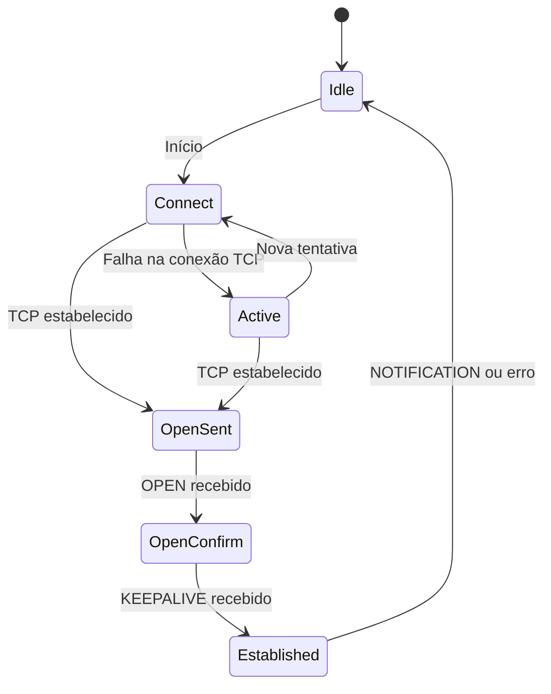
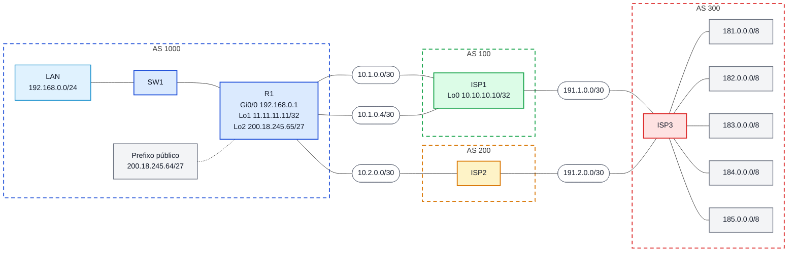

# Laboratório 06 - Roteamento Externo via BGP

- **Instituição:** Universidade de Brasília (UnB)
- **Departamento:** Departamento de Engenharia Elétrica (ENE)
- **Curso:** Engenharia de Redes de Comunicação
- **Disciplina:** ENE0025 - Protocolos de Transporte e Roteamento
- **Professor responsável:** Prof. Dr. Laerte Peotta de Melo
- **Tema:** Roteamento interdomínio (BGP-4), eBGP e peering via loopback

---

### Material de Apoio: Podcast Latência Zero

<table>
  <tr>
    <td width="140" align="center">
      <a href="https://open.spotify.com/show/59S06LhFsKlyvfLFQCJ8fK">
        
      </a>
    </td>
    <td valign="top">
      O podcast <strong>Latência Zero</strong> apresenta discussões técnicas complementares sobre os temas da disciplina.<br><br>
      🎧 <strong>Episódio 5:</strong> <a href="https://open.spotify.com/episode/5h5COkh8c51req9tUxZhzs?si=20722c87de1b41aa">Como o protocolo BGP sustenta a internet</a>
    </td>
  </tr>
</table>

---

## 1. Objetivos

### 1.1 Objetivo

Configurar o protocolo **BGP** no roteador da empresa para que ela possa **anunciar seu prefixo público à Internet** por meio de seus provedores.

### 1.2 Objetivos específicos

Ao final deste laboratório, o estudante deverá ser capaz de:

- compreender o papel do **BGP** no roteamento entre sistemas autônomos;
- identificar vizinhanças **eBGP**;
- configurar o BGP em um roteador de borda corporativo;
- anunciar um prefixo público usando o comando `network`;
- entender o uso de **loopback**, `update-source` e `ebgp-multihop`;
- verificar a tabela de rotas e a tabela BGP;
- capturar e dissecar mensagens do protocolo BGP (OPEN, KEEPALIVE e UPDATE) com o Wireshark;
- verificar o funcionamento prático da opção TCP MD5 Signature e do parâmetro TTL no eBGP multihop.

---

## 2. Introdução e Fundamentação Teórica

### 2.1 Fundamentação teórica BGP

O **BGP (Border Gateway Protocol)** é o protocolo usado para trocar rotas entre **redes grandes diferentes**, chamadas de **Sistemas Autônomos (AS)**.  Na prática, ele ajuda um roteador a decidir **por qual provedor ou caminho externo** um pacote deve seguir para chegar a outra rede.

> Pense assim: enquanto protocolos como **RIP** e **OSPF** costumam organizar rotas **dentro de uma empresa ou organização**, o **BGP** é usado para trocar rotas **entre empresas, provedores e a Internet**.

O BGP-4 está definido na [**RFC 4271**](https://datatracker.ietf.org/doc/html/rfc4271) (2006), que tornou obsoleta a [**RFC 1771**](https://datatracker.ietf.org/doc/html/rfc1771) (1995), e utiliza um algoritmo de roteamento dinâmico do tipo vetor-caminho, similar ao vetor-distância. A diferença principal é que cada “hop” do BGP representa o salto entre um AS inteiro para evitar a ocorrência de loop e não apenas entre roteadores distintos.

De forma mais simples, o BGP funciona como uma **conversa entre grandes redes** para decidir por onde os dados devem passar. É como se cada rede dissesse:

- “essas redes eu conheço”
- “esse caminho passa por mim”
- “para chegar lá, você pode usar esta rota”

Ou seja, o BGP ajuda a escolher **qual caminho seguir para sair de uma rede e chegar em outra**.

#### 2.1.1 eBGP

O **eBGP** significa **External BGP**.

Ele é usado quando a troca de rotas acontece entre roteadores que pertencem a **AS diferentes**, ou seja, entre **redes diferentes**.

##### 2.1.1.1 Exemplo de eBGP

- uma empresa no **AS 1000**
- conectada a um provedor no **AS 100**

Nesse caso, a sessão entre eles é **eBGP**, porque estão em sistemas autônomos diferentes.

De forma bem simples: o **eBGP conecta uma rede ao mundo externo**.

#### 2.1.2 iBGP

O **iBGP** significa **Internal BGP**.

Ele é usado quando a troca de rotas acontece entre roteadores do **mesmo AS**, ou seja, **dentro da mesma rede grande**.

##### 2.1.2.1 Exemplo de iBGP

- dois roteadores dentro do **AS 1000**
- compartilhando entre si as rotas aprendidas externamente

Nesse caso, a sessão entre eles é **iBGP**, porque os dois pertencem ao mesmo sistema autônomo.

De forma simples: o **iBGP espalha essa informação dentro da própria rede**.

#### 2.1.3 Analogia didática

Imagine que cada **AS** é como um **país**.

- **eBGP** é como a comunicação entre **países diferentes**
- **iBGP** é como a comunicação entre **cidades do mesmo país**, repassando decisões que vieram do exterior

Outra forma de imaginar é pensar em viagens:

- **eBGP** é como conversar com pessoas de **outras cidades ou outros países** para saber como chegar até lá
- **iBGP** é como avisar as pessoas da **sua própria cidade** qual estrada usar para sair dela


*Imagem gerada com uso de inteligência artificial (OpenAI, ChatGPT).*

#### 2.1.4 Síntese conceitual

- **BGP**: protocolo de roteamento entre sistemas autônomos
- **eBGP**: troca de rotas entre **AS diferentes**
- **iBGP**: troca de rotas **dentro do mesmo AS**

O BGP não escolhe apenas o caminho mais curto.  

Ele permite:

- decidir por qual provedor sair;
- controlar quais rotas serão anunciadas;
- organizar o tráfego de forma mais estratégica;
- aplicar regras e preferências de roteamento.

Por isso, o BGP é o protocolo mais importante quando falamos de **Internet, provedores e roteamento entre organizações**.

### 2.2 Funcionamento interno do BGP-4

O BGP-4 estabelece uma sessão TCP entre pares e troca quatro tipos de mensagem definidos na [**RFC 4271**](https://datatracker.ietf.org/doc/html/rfc4271): `OPEN` (parâmetros da sessão), `KEEPALIVE` (manutenção), `UPDATE` (anúncio ou retirada de prefixos com seus atributos) e `NOTIFICATION` (erro, seguido do encerramento da sessão). O progresso da sessão é descrito por uma máquina de estados:



Cada `UPDATE` carrega atributos de caminho, entre os quais `ORIGIN`, `AS_PATH` e `NEXT_HOP`. O atributo `AS_PATH` registra a sequência de sistemas autônomos atravessados e é usado como mecanismo de prevenção de laços: um roteador rejeita anúncios cujo `AS_PATH` contenha o seu próprio número de AS.

### 2.3 Exemplo concreto

A empresa (AS 1000) anuncia o bloco `200.18.245.64/27`, que abrange 32 endereços (`200.18.245.64` a `200.18.245.95`). No `UPDATE` enviado ao ISP1 (AS 100), o prefixo aparece no campo NLRI, com `ORIGIN` igual a `IGP` (gerado pelo comando `network`), `AS_PATH` contendo `1000` e `NEXT_HOP` igual ao endereço de origem da sessão.

### 2.4 Protocolos envolvidos

| Protocolo | Camada OSI | Camada TCP/IP | Transporte / porta | Observação |
|---|---|---|---|---|
| BGP-4 | 7 (Aplicação), com função de controle da camada 3 | Aplicação | TCP 179 | Sessão unicast entre pares configurados manualmente |
| ICMP | 3 (Rede) | Internet | IP protocolo 1 | Usado nos testes de alcançabilidade ([**RFC 792**](https://datatracker.ietf.org/doc/html/rfc792)) |

---

## 3. Topologia e Cenário

### 3.1 Topologia do laboratório

O cenário representa um pequeno trecho do núcleo operacional da Internet, com **três provedores** e **uma empresa** que precisa anunciar o bloco público **`200.18.245.64/27`**.  **BGP** é um protocolo de roteamento **interdomínios**, usado entre **sistemas autônomos (AS)**.

Dados do cenário:

- a empresa pertence ao **AS 1000**;
- o **ISP1** pertence ao **AS 100**;
- o **ISP2** pertence ao **AS 200**;
- a senha das vizinhanças é **`SENHA`**.

#### 3.1.1 Descrição do cenário

A **empresa** pertence ao **AS 1000** e possui o bloco público **200.18.245.64/27**, que será anunciado para a Internet usando o protocolo **BGP**. Internamente, a empresa também possui a rede local **192.168.0.0/24**, conectada ao roteador **R1** por meio do **SW1**. No roteador da empresa, também é criada a interface de loopback **11.11.11.11/32**, que será usada como origem da sessão BGP com o **ISP1**. Uma segunda loopback, **Loopback2 (200.18.245.65/27)**, pertence ao bloco público e é usada como endereço de origem nos testes de conectividade fim a fim.

O roteador **R1** conecta-se ao **ISP1**, pertencente ao **AS 100**, por dois enlaces físicos, usando as redes **10.1.0.0/30** e **10.1.0.4/30**. Entretanto, a vizinhança BGP com o ISP1 não é feita pelos endereços físicos desses enlaces. Ela é estabelecida com o endereço **10.10.10.10/32**, que corresponde à **interface de loopback do ISP1**. Por isso, no roteador da empresa é necessário usar os comandos `update-source Loopback1` e `ebgp-multihop 2`, além de criar rotas estáticas para alcançar esse endereço pelos enlaces disponíveis.

A empresa também se conecta ao **ISP2**, pertencente ao **AS 200**, por meio da rede **10.2.0.0/30**. Nesse caso, a vizinhança BGP é feita diretamente com o endereço real da interface do provedor, **10.2.0.2**, sem necessidade de loopback remota.

O **ISP1** conecta-se ao **ISP3**, pertencente ao **AS 300**, pela rede **191.1.0.0/30**. O **ISP2** também se conecta ao **ISP3**, usando a rede **191.2.0.0/30**. No **AS 300**, o roteador **ISP3** concentra vários prefixos externos já existentes no cenário, entre eles **181.0.0.0/8**, **182.0.0.0/8**, **183.0.0.0/8**, **184.0.0.0/8** e **185.0.0.0/8**.

Dessa forma, o laboratório representa uma empresa anunciando seu prefixo público para dois provedores distintos, sendo um deles configurado com vizinhança via loopback e outro com vizinhança direta pela interface física. Esse arranjo permite estudar, de forma prática, o funcionamento do **BGP externo**, o anúncio de prefixos, o uso de `network`, o papel das interfaces de loopback e a formação de sessões entre diferentes sistemas autônomos.

#### 3.1.2 Diagrama lógico



### 3.2 Informações fornecidas pelo cenário

- a empresa anuncia o bloco **`200.18.245.64/27`**;
- o vizinho do **ISP1** deve ser estabelecido com a loopback **`10.10.10.10/32`**;
- a empresa deve usar a loopback **`11.11.11.11/32`** como origem da sessão com o ISP1;
- a empresa deve criar a **`Loopback2`** com o endereço **`200.18.245.65/27`**, pertencente ao bloco anunciado, para uso como origem dos testes de `ping` (Laboratório 07);
- a vizinhança com o **ISP2** será feita pelos endereços reais das interfaces diretamente conectadas;
- o **R1** é um nó **Cisco IOSv** (*Virtual IOS*) com ao menos quatro interfaces (`Gi0/0` a `Gi0/3`).

---

## 4. Roteiro Prático Passo a Passo

### 4.1 Configuração básica das interfaces em R1

```cisco
R1> enable

R1# configure terminal

R1(config)# no ip domain lookup

R1(config)# interface loopback 1

R1(config-if)# ip address 11.11.11.11 255.255.255.255

R1(config-if)# no shut

R1(config-if)# interface loopback 2

R1(config-if)# ip address 200.18.245.65 255.255.255.224

R1(config-if)# no shut

R1(config-if)# interface Gi0/0

R1(config-if)# ip address 192.168.0.1 255.255.255.0

R1(config-if)# no shut

R1(config-if)# interface Gi0/1

R1(config-if)# ip address 10.1.0.1 255.255.255.252

R1(config-if)# no shut

R1(config-if)# interface Gi0/2

R1(config-if)# ip address 10.1.0.5 255.255.255.252

R1(config-if)# no shut

R1(config-if)# interface Gi0/3

R1(config-if)# ip address 10.2.0.1 255.255.255.252

R1(config-if)# no shut

R1(config-if)# end
```

### 4.2 Configuração do BGP em R1

```cisco
R1> enable

R1# configure terminal

R1(config)# router bgp 1000

R1(config-router)# neighbor 10.10.10.10 remote-as 100

R1(config-router)# neighbor 10.10.10.10 password SENHA

R1(config-router)# neighbor 10.10.10.10 ebgp-multihop 2

R1(config-router)# neighbor 10.10.10.10 update-source Loopback1

R1(config-router)# neighbor 10.2.0.2 remote-as 200

R1(config-router)# neighbor 10.2.0.2 password SENHA

R1(config-router)# network 200.18.245.64 mask 255.255.255.224

R1(config-router)# exit

R1(config)# ip route 10.10.10.10 255.255.255.255 Gi0/1

R1(config)# ip route 10.10.10.10 255.255.255.255 Gi0/2

R1(config)# ip route 200.18.245.64 255.255.255.224 Null0
```

### 4.3 Explicação da configuração

- primeiro o BGP foi inicializado no **AS 1000**;
- depois foi configurada a vizinhança com o **ISP1** usando **endereços de loopback**;
- por isso foi necessário usar:
  - `update-source Loopback1`
  - `ebgp-multihop 2`
  - duas rotas estáticas para alcançar `10.10.10.10/32` (apontadas diretamente para as interfaces de saída, o que depende de *proxy ARP* no vizinho; em ambientes reais, recomenda-se indicar o endereço do próximo salto);
- em seguida foi configurada a vizinhança com o **ISP2**, desta vez usando o endereço real da interface;
- foi criada a `Loopback2` (`200.18.245.65/27`), que dá existência a um endereço do bloco público e serve de origem para testes fim a fim;
- por fim, foi anunciado o prefixo público da empresa com:
  - `network 200.18.245.64 mask 255.255.255.224`

---

## 5. Verificação e Diagnóstico

### 5.1 Verificação

Verificar os seguintes comandos em todos os roteadores dos sistemas autônomos (AS).

```cisco
Router# show ip route

Router# show ip bgp

Router# show ip bgp summary

Router# show run
```

### 5.2 Captura e Análise de Tráfego com Wireshark

O BGP opera sobre uma conexão **TCP confiável na porta 179**. Nesta etapa, o aluno deverá capturar a troca de mensagens entre o roteador corporativo (**R1**) e os provedores para analisar o estabelecimento da sessão e a propagação de rotas.

#### 5.2.1 Procedimento de Captura no PNetLab

1. No ambiente do **PNetLab**, clique com o botão direito sobre o enlace entre **R1** e **ISP1** (interface `Gi0/1`) ou entre **R1** e **ISP2** (interface `Gi0/3`).
2. Selecione **Capture** $\rightarrow$ selecione a interface correspondente para iniciar o Wireshark.
3. No campo de filtro de exibição (*display filter*) do Wireshark, utilize:
   ```text
   bgp || tcp.port == 179
   ```
4. Para forçar a renegociação da sessão e a reemissão dos anúncios sem alterar as configurações, execute em **R1**:
   ```cisco
   R1# clear ip bgp *
   ```
   > **Nota:** Para forçar apenas o reenvio das mensagens de anúncio (UPDATE) sem derrubar a conexão TCP subjacente, utilize o comando de *soft reset*: `clear ip bgp * soft`.

#### 5.2.2 Mensagens BGP a Identificar e Analisar

O aluno deverá localizar no Wireshark os seguintes tipos de pacotes definidos na [**RFC 4271**](https://datatracker.ietf.org/doc/html/rfc4271):

##### 5.2.2.1 Handshake TCP de Transporte (Porta 179)
- Identificar os pacotes `SYN`, `SYN-ACK` e `ACK` que inicializam o canal confiável.
- Observar a presença da opção **TCP Option (19) - TCP MD5 Signature** no cabeçalho TCP, resultante da configuração do comando `neighbor ... password SENHA`. Esse mecanismo ([**RFC 2385**](https://datatracker.ietf.org/doc/html/rfc2385)) foi substituído pela *TCP Authentication Option* (TCP-AO, [**RFC 5925**](https://datatracker.ietf.org/doc/html/rfc5925)); ver Seção 6.

##### 5.2.2.2 Mensagem BGP OPEN
- Inspecionada imediatamente após a conclusão do *handshake* TCP.
- **Campos a analisar:**
  - `Version`: versão do BGP (deve ser 4);
  - `My Autonomous System`: número do AS local (AS 1000 para R1; AS 100 para ISP1; AS 200 para ISP2);
  - `Hold Time`: tempo de retenção proposto (padrão de 180 segundos no Cisco IOS; a [**RFC 4271**](https://datatracker.ietf.org/doc/html/rfc4271) sugere 90 segundos);
  - `BGP Identifier`: endereço IP do Router-ID do emissor;
  - `Optional Parameters`: capacidades negociadas (e.g., suporte a MP-BGP e AS de 4 bytes).

##### 5.2.2.3 Mensagem BGP KEEPALIVE
- Pacote periódico simples (composto apenas pelo cabeçalho padrão de 19 bytes do BGP).
- Observar que ele é trocado a cada $\frac{1}{3}$ do *Hold Time* (tipicamente a cada 60 segundos) para manter o estado da adjacência como `Established`.

##### 5.2.2.4 Mensagem BGP UPDATE
- Mensagem responsável por divulgar ou retirar rotas.
- **Campos a analisar:**
  - `Network Layer Reachability Information (NLRI)`: verificar o prefixo público anunciado pela empresa (**`200.18.245.64/27`**);
  - `Path Attributes`:
    - **ORIGIN:** deve indicar `IGP` (código 0), gerado pelo comando `network`;
    - **AS_PATH:** deve conter a sequência de ASs percorridos;
    - **NEXT_HOP:** endereço do próximo salto para o prefixo anunciado.

##### 5.2.2.5 Inspeção do TTL no Cabeçalho IP (eBGP Multihop)
- Comparar o campo **Time to Live (TTL)** nos pacotes IP entre os dois enlaces:
  - Na sessão com o **ISP2** (enlace direto): o TTL é enviado com valor **1** (padrão de sessões eBGP);
  - Na sessão com o **ISP1** (via Loopback com `ebgp-multihop 2`): o TTL é enviado com valor **2**. Por padrão, o eBGP exige que o vizinho esteja diretamente conectado e envia pacotes com TTL 1; como o endereço `10.10.10.10/32` (loopback) não pertence a uma sub-rede diretamente conectada, o comando `ebgp-multihop 2` desativa essa verificação e eleva o TTL, permitindo que a sessão TCP seja estabelecida pelo caminho resolvido pelas rotas estáticas.

### 5.3 O que o aluno deve observar

Durante a verificação e a análise de pacotes, o aluno deve observar:

- se as vizinhanças BGP foram estabelecidas (estado `Established`);
- se o prefixo **`200.18.245.64/27`** aparece sendo anunciado na tabela BGP e nos pacotes UPDATE capturados;
- se a tabela BGP mostra rotas aprendidas dos provedores;
- se a tabela de rotas contém a rota estática para `10.10.10.10/32`;
- se o prefixo `200.18.245.64/27` consta na tabela de rotas como conectado (via `Loopback2`) e se a rota estática para `Null0` foi criada como âncora, mantendo o anúncio do prefixo mesmo que a loopback seja desativada;
- a sequência temporal da captura: Handshake TCP $\rightarrow$ Mensagens OPEN $\rightarrow$ KEEPALIVE $\rightarrow$ UPDATE.

### 5.4 Interpretação das saídas

**`show ip bgp summary`:**

| Campo | Significado |
|---|---|
| `Neighbor` | Endereço do vizinho BGP |
| `V` | Versão do protocolo (4) |
| `AS` | AS remoto |
| `MsgRcvd` / `MsgSent` | Mensagens recebidas e enviadas |
| `Up/Down` | Tempo no estado atual |
| `State/PfxRcd` | Número de prefixos recebidos, se a sessão estiver `Established`; caso contrário, o nome do estado (`Idle`, `Active`, `Connect`, `OpenSent`, `OpenConfirm`) |

**`show ip bgp`:** cada linha traz os campos `Network`, `Next Hop`, `Metric` (MED), `LocPrf` (*Local Preference*), `Weight` e `Path` (`AS_PATH` seguido da origem). O código `*` indica rota válida, `>` indica a melhor rota selecionada e `i` indica rota aprendida por iBGP.

### 5.5 Metodologia de diagnóstico

1. **Enlace físico e endereçamento:** `show ip interface brief` e `ping` entre os endereços das interfaces;
2. **Alcançabilidade do endereço da sessão:** para a sessão com o ISP1, `show ip route 10.10.10.10` e `ping 10.10.10.10 source Loopback1`;
3. **Configuração do vizinho:** número do AS (`remote-as`), senha idêntica nos dois lados, `update-source` e `ebgp-multihop` coerentes com a topologia;
4. **Estado da sessão:** `show ip bgp summary`; estados `Idle` ou `Active` persistentes indicam falha na conexão TCP na porta 179, divergência de AS, senha ou endereço de origem;
5. **Anúncio do prefixo:** o comando `network` só anuncia o prefixo se houver rota idêntica na tabela de roteamento (condição satisfeita pela rota conectada da `Loopback2` e, como âncora, pela rota para `Null0`); conferir com `show ip route 200.18.245.64`;
6. **Políticas:** filtros de prefixo, `route-map` e limites de prefixos que possam bloquear anúncios.

---

## 6. Segurança

### 6.1 Riscos associados

- **Vazamento de rotas (*route leak*):** a empresa está conectada a dois provedores e não aplica filtros de saída. Nessa condição, o R1 pode readvertir ao ISP2 as rotas aprendidas do ISP1 (e vice-versa), passando a funcionar como trânsito indevido. A [**RFC 8212**](https://datatracker.ietf.org/doc/html/rfc8212) trata do comportamento padrão seguro na ausência de políticas.
- **Sequestro de prefixo e falsificação de origem:** o BGP-4 não valida, por si só, se um AS está autorizado a originar um prefixo ([**RFC 4272**](https://datatracker.ietf.org/doc/html/rfc4272)). A validação de origem com a infraestrutura de chaves públicas de recursos (RPKI) está descrita na [**RFC 6811**](https://datatracker.ietf.org/doc/html/rfc6811).
- **Interferência na sessão TCP:** pacotes falsificados (por exemplo, `RST`) podem derrubar a sessão. A assinatura MD5 do TCP ([**RFC 2385**](https://datatracker.ietf.org/doc/html/rfc2385)), usada neste roteiro com `password SENHA`, está obsoleta e foi substituída pela *TCP Authentication Option* (TCP-AO, [**RFC 5925**](https://datatracker.ietf.org/doc/html/rfc5925)).
- **Sessão com `ebgp-multihop`:** amplia a distância da qual pacotes podem atingir o roteador; para vizinhos diretamente conectados, o mecanismo de segurança baseado em TTL (GTSM, [**RFC 5082**](https://datatracker.ietf.org/doc/html/rfc5082)) é preferível.
- **Esgotamento de recursos:** a ausência de limite de prefixos aceitos permite que um vizinho com configuração incorreta sobrecarregue a tabela BGP.

### 6.2 Boas práticas (*hardening*)

```cisco
! Anuncia somente o prefixo da empresa (evita tornar-se trânsito entre ISP1 e ISP2)
ip prefix-list SAIDA-EMPRESA seq 5 permit 200.18.245.64/27
router bgp 1000
 neighbor 10.10.10.10 prefix-list SAIDA-EMPRESA out
 neighbor 10.2.0.2 prefix-list SAIDA-EMPRESA out
 ! Limita o número de prefixos aceitos de cada vizinho (alerta em 80%)
 neighbor 10.10.10.10 maximum-prefix 100 80
 neighbor 10.2.0.2 maximum-prefix 100 80
 ! Sessão diretamente conectada: aceita apenas pacotes com TTL de origem 255 (GTSM)
 neighbor 10.2.0.2 ttl-security hops 1
```

O comando `ttl-security` deve ser aplicado nos dois extremos da sessão e não pode ser combinado com `ebgp-multihop` no mesmo vizinho.

**Migração do MD5 para o TCP-AO.** O TCP-AO deve ser adotado nos ambientes em que o equipamento o suporte. O suporte depende do sistema operacional e da versão do software; a imagem Cisco IOSv utilizada neste laboratório pode não oferecê-lo, e por isso o roteiro mantém a assinatura MD5 como mecanismo disponível no PNetLab. O comando de configuração do TCP-AO deve ser consultado na documentação da versão em uso. O valor `SENHA` é exclusivamente didático. As práticas operacionais recomendadas para o BGP estão consolidadas na [**RFC 7454**](https://datatracker.ietf.org/doc/html/rfc7454) (BCP 194).

---

## 7. Questões para Análise e Discussão

1. Qual é a função do BGP nesse cenário?
2. Por que a sessão com o ISP1 usa endereço de loopback?
3. Por que foi necessário configurar `ebgp-multihop 2`?
4. Qual a função do `update-source Loopback1`?
5. Por que foi criada a rota `ip route 200.18.245.64 255.255.255.224 Null0`? Qual é o seu papel, dado que a `Loopback2` já fornece uma rota conectada para o mesmo prefixo?
6. Qual a diferença entre o pareamento com o ISP1 e com o ISP2?
7. Com base na captura do Wireshark, qual o papel da mensagem OPEN e quais parâmetros principais são negociados nela antes do envio de rotas?
8. Explique por que os pacotes BGP destinados ao ISP1 apresentam TTL igual a 2, enquanto os pacotes destinados ao ISP2 utilizam TTL igual a 1.

---

## 8. Critérios de Avaliação e Entregáveis

### 8.1 Critérios de avaliação

| Critério | Pontos |
|---|---:|
| Configuração correta das interfaces e rotas | 2,0 |
| Configuração correta do BGP e vizinhanças | 2,5 |
| Entendimento da vizinhança por loopback e multihop | 1,5 |
| Captura e análise dos pacotes BGP no Wireshark | 2,0 |
| Verificação com comandos CLI e respostas técnicas | 2,0 |

**Total: 10,0**

### 8.2 Entregáveis

- print da topologia no PNetLab;
- print do `show ip bgp summary`;
- print do `show ip bgp`;
- print do `show ip route`;
- print das capturas do Wireshark contendo o estabelecimento da sessão BGP;
- print do pacote BGP OPEN destacando os campos `My AS` e `BGP Identifier`;
- print do pacote BGP UPDATE destacando o prefixo anunciado no campo NLRI e seus atributos;
- relatório curto com:
  - objetivo;
  - comandos executados;
  - explicação da sessão com loopback e análise de TTL;
  - conclusão;
- respostas completas às questões para análise.

---

## 9. Referências

- [**RFC 4271**](https://datatracker.ietf.org/doc/html/rfc4271) - *A Border Gateway Protocol 4 (BGP-4)*.
- [**RFC 1771**](https://datatracker.ietf.org/doc/html/rfc1771) - *A Border Gateway Protocol 4 (BGP-4)* (obsoleta, substituída pela RFC 4271).
- [**RFC 4272**](https://datatracker.ietf.org/doc/html/rfc4272) - *BGP Security Vulnerabilities Analysis*.
- [**RFC 2385**](https://datatracker.ietf.org/doc/html/rfc2385) - *Protection of BGP Sessions via the TCP MD5 Signature Option* (obsoleta).
- [**RFC 5925**](https://datatracker.ietf.org/doc/html/rfc5925) - *The TCP Authentication Option*.
- [**RFC 5082**](https://datatracker.ietf.org/doc/html/rfc5082) - *The Generalized TTL Security Mechanism (GTSM)*.
- [**RFC 6811**](https://datatracker.ietf.org/doc/html/rfc6811) - *BGP Prefix Origin Validation*.
- [**RFC 7454**](https://datatracker.ietf.org/doc/html/rfc7454) - *BGP Operations and Security* (BCP 194).
- [**RFC 8212**](https://datatracker.ietf.org/doc/html/rfc8212) - *Default External BGP (EBGP) Route Propagation Behavior without Policies*.
- Cisco Systems. *IP Routing: BGP Configuration Guide* (documentação oficial do fabricante).
- HALABI, S.; MCPHERSON, D. *Internet Routing Architectures*. Cisco Press.
- DOYLE, J.; CARROLL, J. D. *Routing TCP/IP, Volume II*. Cisco Press.

---

[← Anterior: Laboratório 05](lab05.md) | [Índice Geral (README)](../README.md) | [Próximo: Laboratório 07 →](lab07.md)
