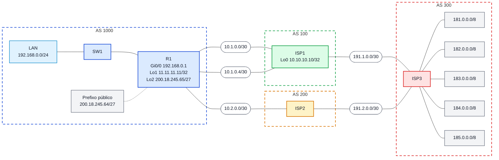

# Laboratório 07 - Configuração dos Provedores (BGP Externo)

- **Instituição:** Universidade de Brasília (UnB)
- **Departamento:** Departamento de Engenharia Elétrica (ENE)
- **Curso:** Engenharia de Redes de Comunicação
- **Disciplina:** ENE0025 - Protocolos de Transporte e Roteamento
- **Professor responsável:** Prof. Dr. Laerte Peotta de Melo
- **Tema:** Infraestrutura de trânsito BGP entre sistemas autônomos múltiplos

> **Pré-requisito:** Este laboratório é continuação do **Laboratório 06**.

---

## 1. Objetivos

Configurar os roteadores **ISP1**, **ISP2** e **ISP3** para permitir o funcionamento completo do cenário de **BGP externo**.

---

## 2. Introdução e Fundamentação Teórica

### 2.1 Papel dos provedores no cenário

Neste laboratório, o AS 300 (ISP3) representa a rede externa com os prefixos de teste, e os AS 100 (ISP1) e AS 200 (ISP2) representam provedores que oferecem trânsito à empresa (AS 1000) e se conectam ao ISP3. Do ponto de vista das relações comerciais entre sistemas autônomos, a empresa é **cliente** dos ISP1 e ISP2, e estes se comportam, em relação ao ISP3, como **clientes ou pares**, dependendo do contrato. Sessões eBGP entre ASs distintos usam o número do AS do vizinho em `remote-as` e trocam prefixos conforme as políticas de cada lado.

### 2.2 Funcionamento interno

A sequência de configuração garante que, quando cada sessão for iniciada, o vizinho já esteja alcançável: o ISP3 é configurado primeiro (origina os prefixos de teste), seguido do ISP1 e do ISP2. No ISP1, a sessão com o R1 usa as loopbacks `10.10.10.10` (ISP1) e `11.11.11.11` (R1), alcançadas por duas rotas estáticas, o que exige `ebgp-multihop 2` e `update-source`, como visto no Laboratório 06 ([**RFC 4271**](https://datatracker.ietf.org/doc/html/rfc4271)).

### 2.3 Exemplo concreto

O prefixo `181.0.0.0/8`, originado pelo ISP3 (AS 300), chega ao R1 por dois caminhos: com `AS_PATH` `100 300` (via ISP1) e `200 300` (via ISP2). O prefixo `200.18.245.64/27`, originado pelo R1, chega ao ISP3 com `AS_PATH` `100 1000` ou `200 1000`.

### 2.4 Protocolos envolvidos

| Protocolo | Camada OSI | Camada TCP/IP | Transporte / porta |
|---|---|---|---|
| BGP-4 | 7 (Aplicação), com função de controle da camada 3 | Aplicação | TCP 179 |

---

## 3. Topologia e Cenário

### 3.1 Premissas do cenário

#### 3.1.1 Diagrama lógico



Considerando a topologia do laboratório 06:

- **R1** pertence ao **AS 1000**
- **ISP1** pertence ao **AS 100**
- **ISP2** pertence ao **AS 200**
- **ISP3** pertence ao **AS 300**

Os enlaces considerados são:

- **R1 ↔ ISP1**
  - rede **10.1.0.0/30**
  - rede **10.1.0.4/30**

- **R1 ↔ ISP2**
  - rede **10.2.0.0/30**

- **ISP1 ↔ ISP3**
  - rede **191.1.0.0/30**

- **ISP2 ↔ ISP3**
  - rede **191.2.0.0/30**

Também serão utilizadas as loopbacks:

- **ISP1:** `10.10.10.10/32`
- **R1:** `Loopback2`, `200.18.245.65/27` (bloco anunciado, criada no Laboratório 06)

E os prefixos externos anunciados por **ISP3**:

- `181.0.0.0/8`
- `182.0.0.0/8`
- `183.0.0.0/8`
- `184.0.0.0/8`
- `185.0.0.0/8`

---

## 4. Roteiro Prático Passo a Passo

### 4.1 Configuração do ISP3

Configure primeiro o **ISP3**, pois ele representa a rede externa com os prefixos de teste.

```cisco
ISP3> enable
ISP3# configure terminal
ISP3(config)# no ip domain lookup
ISP3(config)# interface Gi0/0
ISP3(config-if)# ip address 191.1.0.2 255.255.255.252
ISP3(config-if)# no shut
ISP3(config-if)# interface Gi0/1
ISP3(config-if)# ip address 191.2.0.2 255.255.255.252
ISP3(config-if)# no shut
ISP3(config-if)# interface loopback 1
ISP3(config-if)# ip address 181.0.0.1 255.0.0.0
ISP3(config-if)# interface loopback 2
ISP3(config-if)# ip address 182.0.0.1 255.0.0.0
ISP3(config-if)# interface loopback 3
ISP3(config-if)# ip address 183.0.0.1 255.0.0.0
ISP3(config-if)# interface loopback 4
ISP3(config-if)# ip address 184.0.0.1 255.0.0.0
ISP3(config-if)# interface loopback 5
ISP3(config-if)# ip address 185.0.0.1 255.0.0.0
ISP3(config-if)# end
```

#### 4.1.1 BGP no ISP3

```cisco
ISP3> enable

ISP3# configure terminal

ISP3(config)# router bgp 300

ISP3(config-router)# bgp router-id 30.30.30.30

ISP3(config-router)# neighbor 191.1.0.1 remote-as 100

ISP3(config-router)# neighbor 191.1.0.1 password SENHA

ISP3(config-router)# neighbor 191.2.0.1 remote-as 200

ISP3(config-router)# neighbor 191.2.0.1 password SENHA

ISP3(config-router)# network 181.0.0.0 mask 255.0.0.0

ISP3(config-router)# network 182.0.0.0 mask 255.0.0.0

ISP3(config-router)# network 183.0.0.0 mask 255.0.0.0

ISP3(config-router)# network 184.0.0.0 mask 255.0.0.0

ISP3(config-router)# network 185.0.0.0 mask 255.0.0.0

ISP3(config-router)# end
```

> **Nota:** o comando `bgp router-id` fixa o identificador do processo BGP. Sem ele, o Cisco IOS escolhe o maior endereço de loopback (no ISP3, `185.0.0.1`), e o identificador mudaria ao criar ou remover loopbacks, o que reinicia as sessões. Adota-se o endereço de teste de cada provedor (`10.10.10.10`, `20.20.20.20` e `30.30.30.30`); as loopbacks do ISP2 e do ISP3 são criadas no Laboratório 08. O identificador do R1 não é alterado neste laboratório.

### 4.2 Configuração do ISP1

O **ISP1** possui dois enlaces físicos com o **R1**, além de uma loopback usada como vizinho BGP.

#### 4.2.1 Interfaces do ISP1

```cisco
ISP1> enable
ISP1# configure terminal
ISP1(config)# no ip domain lookup
ISP1(config)# interface loopback 0
ISP1(config-if)# ip address 10.10.10.10 255.255.255.255
ISP1(config-if)# no shut
ISP1(config-if)# interface Gi0/0
ISP1(config-if)# ip address 10.1.0.2 255.255.255.252
ISP1(config-if)# no shut
ISP1(config-if)# interface Gi0/1
ISP1(config-if)# ip address 10.1.0.6 255.255.255.252
ISP1(config-if)# no shut
ISP1(config-if)# interface Gi0/2
ISP1(config-if)# ip address 191.1.0.1 255.255.255.252
ISP1(config-if)# no shut
ISP1(config-if)# end
```

#### 4.2.2 BGP no ISP1

```cisco
ISP1> enable
ISP1# configure terminal
ISP1(config)# router bgp 100
ISP1(config-router)# bgp router-id 10.10.10.10
ISP1(config-router)# neighbor 11.11.11.11 remote-as 1000
ISP1(config-router)# neighbor 11.11.11.11 password SENHA
ISP1(config-router)# neighbor 11.11.11.11 ebgp-multihop 2
ISP1(config-router)# neighbor 11.11.11.11 update-source Loopback0
ISP1(config-router)# neighbor 191.1.0.2 remote-as 300
ISP1(config-router)# neighbor 191.1.0.2 password SENHA
ISP1(config-router)# network 10.10.10.10 mask 255.255.255.255
ISP1(config-router)# exit
ISP1(config)# ip route 11.11.11.11 255.255.255.255 10.1.0.1
ISP1(config)# ip route 11.11.11.11 255.255.255.255 10.1.0.5
ISP1(config)# end
```

> **Nota:** as rotas estáticas para `11.11.11.11/32` indicam o endereço de próximo salto do R1 em cada enlace (`10.1.0.1` e `10.1.0.5`), o que evita que o ISP1 execute ARP para o próprio destino e dispensa o *proxy ARP*. No R1, as rotas para `10.10.10.10/32` do Laboratório 06 apontam apenas para a interface de saída (`Gi0/1` e `Gi0/2`) e dependem de *proxy ARP* no ISP1 (habilitado por padrão no Cisco IOS). Em ambientes reais, recomenda-se indicar também ali o próximo salto (`10.1.0.2` e `10.1.0.6`).

### 4.3 Configuração do ISP2

O **ISP2** possui um enlace direto com o **R1** e um enlace com o **ISP3**.

#### 4.3.1 Interfaces do ISP2

```cisco
ISP2> enable
ISP2# configure terminal
ISP2(config)# no ip domain lookup
ISP2(config)# interface Gi0/0
ISP2(config-if)# ip address 10.2.0.2 255.255.255.252
ISP2(config-if)# no shut
ISP2(config-if)# interface Gi0/1
ISP2(config-if)# ip address 191.2.0.1 255.255.255.252
ISP2(config-if)# no shut
ISP2(config-if)# end
```

#### 4.3.2 BGP no ISP2

```cisco
ISP2> enable

ISP2# configure terminal

ISP2(config)# router bgp 200

ISP2(config-router)# bgp router-id 20.20.20.20

ISP2(config-router)# neighbor 10.2.0.1 remote-as 1000

ISP2(config-router)# neighbor 10.2.0.1 password SENHA

ISP2(config-router)# neighbor 191.2.0.2 remote-as 300

ISP2(config-router)# neighbor 191.2.0.2 password SENHA

ISP2(config-router)# end
```

### 4.4 Ordem recomendada de configuração

Para evitar dúvidas, use esta sequência:

1. Configurar **ISP3**
2. Configurar **ISP1**
3. Configurar **ISP2**
4. Manter o **R1** com a configuração já aplicada
5. Fazer a verificação final em todos os roteadores

---

## 5. Verificação e Diagnóstico

### 5.1 Verificação final

Após concluir as configurações, execute os comandos abaixo em todos os roteadores:

```cisco
Router# show ip bgp summary

Router# show ip bgp

Router# show ip route

Router# show run
```

### 5.2 O que deve funcionar

Ao final, o cenário deve apresentar:

- sessão BGP entre **R1 e ISP1** em estado **Established**
- sessão BGP entre **R1 e ISP2** em estado **Established**
- sessão BGP entre **ISP1 e ISP3** em estado **Established**
- sessão BGP entre **ISP2 e ISP3** em estado **Established**

No **R1**, devem aparecer as rotas para:

- `181.0.0.0/8`
- `182.0.0.0/8`
- `183.0.0.0/8`
- `184.0.0.0/8`
- `185.0.0.0/8`

Nos provedores, deve aparecer o prefixo da empresa:

- `200.18.245.64/27`

Além disso, o R1 deve alcançar `181.0.0.1` com `ping 181.0.0.1 source Loopback2`.

### 5.3 Interpretação das saídas e comandos adicionais

Além de `show ip bgp summary` e `show ip bgp` (campos descritos no Laboratório 06), são úteis:

| Comando | Finalidade |
|---|---|
| `show ip bgp neighbors <ip> advertised-routes` | Prefixos anunciados ao vizinho |
| `show ip bgp neighbors <ip> routes` | Prefixos recebidos do vizinho e aceitos |
| `show ip bgp 200.18.245.64` | Detalhes do prefixo: `AS_PATH`, `NEXT_HOP`, origem e melhor caminho |
| `show ip bgp neighbors <ip>` | Estado da sessão, temporizadores, capacidades negociadas e motivo do último reinício |

### 5.4 Metodologia de diagnóstico

1. **Enlace e endereçamento:** `show ip interface brief` e `ping` entre os extremos de cada enlace;
2. **Alcançabilidade das loopbacks:** `show ip route 10.10.10.10` (no R1) e `show ip route 11.11.11.11` (no ISP1);
3. **Sessões:** `show ip bgp summary`; sessões em `Idle`/`Active` exigem a verificação de `remote-as`, senha, `update-source` e `ebgp-multihop` dos dois lados; o campo `BGP router identifier` deve exibir o valor fixado em cada provedor (`10.10.10.10`, `20.20.20.20` e `30.30.30.30`);
4. **Prefixos originados:** o ISP3 deve possuir as cinco loopbacks na tabela de roteamento (necessárias para o `network`);
5. **Propagação:** `show ip bgp` no R1 deve listar `181.0.0.0/8` a `185.0.0.0/8`, e no ISP3 deve listar `200.18.245.64/27`.

### 5.5 Teste fim a fim a partir do R1

Quando o R1 emite um `ping` com o endereço de origem padrão (o da interface de saída, por exemplo, `10.1.0.1`), o ISP3 não possui rota de retorno, pois os prefixos de enlace não são anunciados por BGP, e o teste falha, ainda que o plano de controle esteja correto. Para validar o plano de dados, utiliza-se como origem a `Loopback2` (`200.18.245.65/27`), criada no Laboratório 06 com endereço pertencente ao bloco `200.18.245.64/27`, que foi anunciado por BGP e é conhecido pelo ISP3:

```cisco
! Origem no bloco anunciado: o ISP3 conhece a rota de retorno
ping 181.0.0.1 source Loopback2
! Caminho percorrido até o prefixo externo
traceroute 181.0.0.1 source Loopback2
```

Como contraprova, `ping 181.0.0.1` sem a opção `source` deve falhar. Os testes de `ping` entre os provedores (por exemplo, do ISP1 para `181.0.0.1`) não sofrem dessa limitação, pois o endereço do enlace com o ISP3 é conhecido por este.

---

## 6. Segurança

### 6.1 Riscos associados

- **Aceitação irrestrita de anúncios de clientes:** sem filtros de entrada, um cliente (ou um erro de configuração) pode anunciar prefixos que não lhe pertencem, caracterizando sequestro de prefixo ou vazamento de rotas ([**RFC 7454**](https://datatracker.ietf.org/doc/html/rfc7454)).
- **Anúncio de infraestrutura:** o ISP1 anuncia a própria loopback (`10.10.10.10/32`, endereço privado da [**RFC 1918**](https://datatracker.ietf.org/doc/html/rfc1918)) por BGP; endereços de gerência e de enlace normalmente não devem ser propagados.
- **Falsificação de origem na borda:** o tráfego de clientes pode conter endereços de origem falsificados ([**RFC 2827**](https://datatracker.ietf.org/doc/html/rfc2827) e [**RFC 3704**](https://datatracker.ietf.org/doc/html/rfc3704)).
- **Numeração real em ambiente de ensino:** o cenário usa números de AS (100, 200, 300 e 1000) e prefixos (`200.18.245.64/27`, `181.0.0.0/8` a `185.0.0.0/8`) que podem estar atribuídos a terceiros. O laboratório deve permanecer isolado da Internet. Para documentação, as [**RFC 5398**](https://datatracker.ietf.org/doc/html/rfc5398) (AS) e [**RFC 5737**](https://datatracker.ietf.org/doc/html/rfc5737) (prefixos IPv4) reservam faixas apropriadas, e os AS privados são tratados na [**RFC 6996**](https://datatracker.ietf.org/doc/html/rfc6996).

### 6.2 Boas práticas (*hardening*)

```cisco
! Nos provedores: aceitar do cliente somente o bloco que lhe foi delegado
ip prefix-list CLIENTE-AS1000 seq 5 permit 200.18.245.64/27
! ISP1 (AS 100)
router bgp 100
 neighbor 11.11.11.11 prefix-list CLIENTE-AS1000 in
 neighbor 11.11.11.11 maximum-prefix 10 80
! ISP2 (AS 200)
router bgp 200
 neighbor 10.2.0.1 prefix-list CLIENTE-AS1000 in
 neighbor 10.2.0.1 maximum-prefix 10 80
! Interface voltada ao cliente no ISP2: descarta pacotes com origem sem rota de retorno (uRPF estrito)
interface Gi0/0
 ip verify unicast source reachable-via rx
```

As senhas das sessões (`SENHA`) utilizam a assinatura MD5 do TCP, obsoleta frente ao TCP-AO; a discussão está na Seção 6 do Laboratório 06. Em ambientes reais, a validação de origem com RPKI ([**RFC 6811**](https://datatracker.ietf.org/doc/html/rfc6811)) complementa os filtros de prefixo.

---

## 7. Questões para Análise e Discussão

1. Por que os provedores ISP1, ISP2 e ISP3 não anunciam suas redes internas de enlace e gerência diretamente para os clientes ou para a Internet pública?
2. Qual a importância técnica e econômica do estabelecimento de sessões de *Peering* direto entre provedores (ISP1-ISP3 e ISP2-ISP3) para a latência e o tráfego global?
3. Qual a diferença operacional observada entre a sessão eBGP com o ISP1 (via interface Loopback com múltiplos enlaces) e a sessão com o ISP2 (enlace físico único direto)?
4. Ao inspecionar a tabela BGP no ISP3 (`show ip bgp`), como ele aprendeu a rota para o prefixo da empresa (`200.18.245.64/27`)? Qual o *AS-Path* e o próximo salto (*Next Hop*) exibidos?
5. O que aconteceria com o fluxo de tráfego da empresa caso o enlace primário entre R1 e ISP1 sofresse uma interrupção física? Como o BGP reage diante desse evento?

---

## 8. Critérios de Avaliação e Entregáveis

### 8.1 Critérios de avaliação

| Critério | Pontos |
|---|---:|
| Configuração e ativação das interfaces dos provedores | 2,0 |
| Estabelecimento das sessões eBGP (adjacências *Established*) | 3,0 |
| Propagação e validação correta dos prefixos (181-185/8 e 200.18.245.64/27) | 2,0 |
| Testes de conectividade e análise de rotas (`show ip bgp` / `show ip route`) | 1,5 |
| Respostas técnicas às questões de análise | 1,5 |

**Total: 10,0**

### 8.2 Entregáveis

- print da topologia montada no PNetLab com indicação dos estados BGP;
- print da saída de `show ip bgp summary` em **ISP1**, **ISP2** e **ISP3**;
- print da tabela BGP (`show ip bgp`) no **ISP3**, comprovando o aprendizado do bloco `200.18.245.64/27`;
- evidência de testes de `ping` para os prefixos de destino na Internet (`181.0.0.1`, etc.), a partir do R1, com origem na `Loopback2` (Seção 5.5), e dos provedores;
- respostas técnicas fundamentadas às questões de análise;
- relatório síntese contendo: objetivo, configuração aplicada nos provedores, análise do fluxo de anúncios e conclusão.

---

## 9. Referências

- [**RFC 4271**](https://datatracker.ietf.org/doc/html/rfc4271) - *A Border Gateway Protocol 4 (BGP-4)*.
- [**RFC 7454**](https://datatracker.ietf.org/doc/html/rfc7454) - *BGP Operations and Security* (BCP 194).
- [**RFC 6811**](https://datatracker.ietf.org/doc/html/rfc6811) - *BGP Prefix Origin Validation*.
- [**RFC 1918**](https://datatracker.ietf.org/doc/html/rfc1918) - *Address Allocation for Private Internets*.
- [**RFC 2827**](https://datatracker.ietf.org/doc/html/rfc2827) - *Network Ingress Filtering* (BCP 38).
- [**RFC 3704**](https://datatracker.ietf.org/doc/html/rfc3704) - *Ingress Filtering for Multihomed Networks* (BCP 84).
- [**RFC 5398**](https://datatracker.ietf.org/doc/html/rfc5398) - *Autonomous System (AS) Number Reservation for Documentation Use*.
- [**RFC 5737**](https://datatracker.ietf.org/doc/html/rfc5737) - *IPv4 Address Blocks Reserved for Documentation*.
- [**RFC 6996**](https://datatracker.ietf.org/doc/html/rfc6996) - *Autonomous System (AS) Reservation for Private Use*.
- Cisco Systems. *IP Routing: BGP Configuration Guide* (documentação oficial do fabricante).
- HALABI, S.; MCPHERSON, D. *Internet Routing Architectures*. Cisco Press.

---

[← Anterior: Laboratório 06](lab06.md) | [Índice Geral (README)](../README.md) | [Próximo: Laboratório 08 →](lab08.md)
