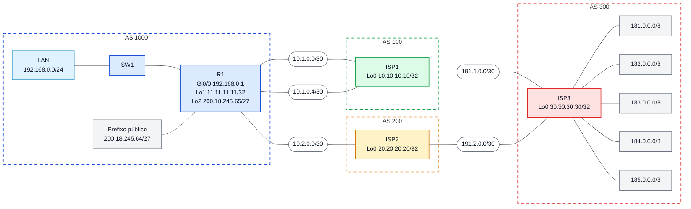

# Laboratório 08 - Políticas BGP e Integração com OSPF

- **Instituição:** Universidade de Brasília (UnB)
- **Departamento:** Departamento de Engenharia Elétrica (ENE)
- **Curso:** Engenharia de Redes de Comunicação
- **Disciplina:** ENE0025 - Protocolos de Transporte e Roteamento
- **Professor responsável:** Prof. Dr. Laerte Peotta de Melo
- **Tema:** Engenharia de tráfego BGP (weight), redundância e injeção de rota default no OSPF

> **Pré-requisito:** Este laboratório é continuação do **Laboratório 07**.

---

## 1. Objetivos

Aplicar políticas de roteamento **BGP** e integrar o **BGP** ao **OSPF** em um cenário já previamente configurado, realizando apenas os ajustes específicos deste laboratório para anúncio de prefixos, escolha de caminho preferencial de saída, propagação controlada de rota default e análise de redundância entre provedores, além da verificação de conectividade total (*ping*) entre todos os roteadores do cenário.

---

## 2. Introdução e Fundamentação Teórica

### 2.1 Observação preliminar - Continuação das atividades anteriores

> Considere que as configurações básicas de interfaces, endereçamento IP, conectividade inicial e topologia já foram realizadas anteriormente.  Portanto, **não devem ser refeitas** as configurações iniciais da infraestrutura.  Neste laboratório, o foco será apenas nas configurações **necessárias para continuidade das atividades**, especificamente:
> 
> - OSPF interno no roteador da empresa.
> - recapitulação das sessões eBGP com os provedores (já configuradas no Laboratório 06; os comandos podem ser reaplicados sem prejuízo ou apenas conferidos).
> - política de preferência de saída.
> - propagação controlada de rota default.
> - análise de redundância e failover.

### 2.2 Situação-problema

Uma empresa do **AS 1000** possui o bloco público **200.18.245.64/27** e já está conectada a dois provedores:

- **ISP1**, no **AS 100**, por dois enlaces físicos
- **ISP2**, no **AS 200**, por um enlace físico

Os provedores alcançam o **AS 300**, onde existem diversos prefixos externos.  
Com a infraestrutura básica já pronta, a empresa agora precisa:

1. anunciar seu prefixo público para a Internet
2. preferir o **ISP1** como caminho principal de saída
3. manter o **ISP2** como contingência
4. usar **OSPF** para representar o domínio interno da empresa
5. propagar apenas a **rota default** no OSPF, evitando inserir prefixos externos desnecessários no domínio interno

### 2.3 Fundamentação

Neste laboratório, o **OSPF** será usado para representar o domínio interno da empresa, enquanto o **BGP** será usado na borda para:

- anunciar o bloco público da empresa
- receber rotas externas
- aplicar política de preferência de saída

A integração entre **OSPF** e **BGP** será feita de forma controlada.  
Em vez de redistribuir várias rotas externas para o OSPF, será propagada apenas a **rota default**, mantendo o domínio interno mais limpo e mais simples de administrar.

### 2.4 Funcionamento interno: seleção do melhor caminho no BGP

Quando o mesmo prefixo é recebido por mais de um vizinho, o BGP aplica uma sequência de critérios de desempate. A ordem abaixo corresponde ao comportamento do Cisco IOS; a [**RFC 4271**](https://datatracker.ietf.org/doc/html/rfc4271) (Seção 9.1) define os critérios padronizados, entre os quais o *weight* não consta.

| Ordem | Critério | Preferência | Observação |
|---|---|---|---|
| 1 | `Weight` | Maior | Proprietário Cisco; local ao roteador |
| 2 | `LOCAL_PREF` | Maior | Propagado dentro do AS (iBGP) |
| 3 | Rota originada localmente | Local | `network`, `aggregate` ou redistribuição |
| 4 | `AS_PATH` | Mais curto | Menos ASs atravessados |
| 5 | `ORIGIN` | `IGP` < `EGP` < incompleto | Origem do anúncio |
| 6 | `MED` | Menor | Comparado entre rotas do mesmo AS vizinho |
| 7 | Tipo de sessão | eBGP sobre iBGP | |
| 8 | Métrica IGP até o `NEXT_HOP` | Menor | |
| 9 | Desempates finais | Rota mais antiga; menor *Router ID* | |

### 2.5 Exemplo concreto

Para o prefixo `181.0.0.0/8`, o R1 recebe dois caminhos: via ISP1 (`AS_PATH` `100 300`) e via ISP2 (`AS_PATH` `200 300`). Os dois possuem o mesmo comprimento de `AS_PATH`. Com `weight 200` para o vizinho ISP1 e `weight 100` para o ISP2, o critério 1 seleciona o caminho via ISP1 antes de qualquer comparação posterior. Se a sessão com o ISP1 for encerrada, o caminho via ISP2 passa a ser o único disponível e é instalado.

### 2.6 Integração entre OSPF e BGP

O OSPF distribui a rota default aos roteadores internos como LSA do tipo 5 (externo, `E2` por padrão) quando o comando `default-information originate` é aplicado no roteador de borda (ASBR, *Autonomous System Boundary Router*). Redistribuir toda a tabela BGP no IGP aumenta a LSDB e acopla a estabilidade interna à da Internet, razão pela qual a propagação de apenas a rota default é preferida em redes corporativas.

### 2.7 Protocolos envolvidos

| Protocolo | Camada OSI | Camada TCP/IP | Transporte / porta |
|---|---|---|---|
| OSPFv2 | 3 (Rede) | Internet | IP protocolo 89 |
| BGP-4 | 7 (Aplicação), com função de controle da camada 3 | Aplicação | TCP 179 |
| ICMP (*Internet Control Message Protocol*) | 3 (Rede) | Internet | IP protocolo 1 |

---

## 3. Topologia e Cenário

### 3.1 Topologia lógica



### 3.2 Premissas adotadas

Considere que os seguintes elementos **já estão configurados**:

- interfaces físicas dos roteadores
- endereçamento IP básico
- conectividade entre os enlaces
- loopback do **R1**
- loopback do **ISP1**
- configuração dos provedores **ISP1**, **ISP2** e **ISP3** do Laboratório 07, inclusive as rotas estáticas do ISP1 para `11.11.11.11/32` (origem da sessão BGP multihop com o R1)
- topologia montada no PNetLab

Neste laboratório, serão realizadas apenas as configurações referentes a:

- **OSPF** no roteador da empresa
- loopbacks de teste e seu anúncio BGP no **ISP2** e no **ISP3** (Seção 4.5)
- **BGP** no roteador da empresa
- política BGP para preferência de saída
- propagação da rota default no OSPF
- testes de falha e verificação

### 3.3 Dados relevantes do cenário

#### 3.3.1 Empresa - AS 1000

- Prefixo público: `200.18.245.64/27`
- LAN interna: `192.168.0.0/24`
- Loopback do R1: `11.11.11.11/32`
- `Loopback2` do R1: `200.18.245.65/27` (bloco anunciado, usada como origem de testes)

#### 3.3.2 ISP1 - AS 100

- Loopback do ISP1: `10.10.10.10/32` (anunciada via BGP)

#### 3.3.3 ISP2 - AS 200

- Vizinho direto com R1 pela rede `10.2.0.0/30`
- `Loopback0` do ISP2 (endereço de teste, anunciada via BGP): `20.20.20.20/32`

#### 3.3.4 Prefixos externos no ISP3 - AS 300

- `181.0.0.0/8`
- `182.0.0.0/8`
- `183.0.0.0/8`
- `184.0.0.0/8`
- `185.0.0.0/8`

Além dos prefixos acima, o ISP3 possui a `Loopback0` de teste `30.30.30.30/32`, anunciada via BGP.

---

## 4. Roteiro Prático Passo a Passo

### 4.1 Etapa 1 - Configuração do OSPF interno no R1

Neste laboratório, o OSPF representa o domínio interno da empresa.

```cisco
R1> enable
R1# configure terminal
R1(config)# router ospf 10
R1(config-router)# network 192.168.0.0 0.0.0.255 area 0
R1(config-router)# network 11.11.11.11 0.0.0.0 area 0
R1(config-router)# end
```

### 4.2 Etapa 2 - Recapitulação da configuração BGP no R1

Nesta etapa, recapitula-se a configuração do **BGP** realizada no Laboratório 06 no roteador da empresa, considerando que a infraestrutura do cenário já está pronta. Os comandos podem ser reaplicados sem prejuízo, ou a configuração existente pode ser apenas conferida com `show running-config | section router bgp`.

```cisco
R1> enable
R1# configure terminal
R1(config)# router bgp 1000
R1(config-router)# neighbor 10.10.10.10 remote-as 100
R1(config-router)# neighbor 10.10.10.10 password SENHA
R1(config-router)# neighbor 10.10.10.10 ebgp-multihop 2
R1(config-router)# neighbor 10.10.10.10 update-source Loopback1
R1(config-router)# neighbor 10.2.0.2 remote-as 200
R1(config-router)# neighbor 10.2.0.2 password SENHA
R1(config-router)# network 200.18.245.64 mask 255.255.255.224
R1(config-router)# exit
R1(config)# ip route 10.10.10.10 255.255.255.255 Gi0/1
R1(config)# ip route 10.10.10.10 255.255.255.255 Gi0/2
R1(config)# ip route 200.18.245.64 255.255.255.224 Null0
R1(config)# end
```

> **Nota técnica:** como a `Loopback2` do R1 (`200.18.245.65/27`) já instala a rota conectada `200.18.245.64/27` (distância administrativa 0), esse prefixo já satisfaz o comando `network`, e a rota estática para `Null0` (distância administrativa 1) permanece inativa na tabela. Ela só passa a ser necessária quando o prefixo anunciado não existe em nenhuma interface do roteador (por exemplo, ao anunciar um bloco agregado).

### 4.3 Etapa 3 - Política BGP: ISP1 como principal, ISP2 como backup

A política abaixo define o **ISP1** como caminho preferencial de saída e o **ISP2** como contingência.

```cisco
R1> enable

R1# configure terminal

R1(config)# router bgp 1000

R1(config-router)# neighbor 10.10.10.10 weight 200

R1(config-router)# neighbor 10.2.0.2 weight 100

R1(config-router)# end
```

#### 4.3.1 Observação

- O atributo **weight** é proprietário da Cisco, tem significado apenas local ao roteador e não é propagado; o atributo padronizado, propagado entre os roteadores iBGP do mesmo AS, é o **local preference** ([**RFC 4271**](https://datatracker.ietf.org/doc/html/rfc4271), Seção 5.1.5)
- Neste caso, ele está sendo usado para demonstrar de forma simples a escolha de caminho preferencial
- Enquanto os dois caminhos estiverem disponíveis, o tráfego deve preferir o **ISP1**
- Em caso de falha do ISP1, a saída deve migrar para o **ISP2**

### 4.4 Etapa 4 - Integração entre BGP e OSPF

A integração proposta neste laboratório não redistribui todos os prefixos externos no OSPF. Será propagada apenas a **rota default**, o que representa uma prática mais limpa para o domínio interno.

#### 4.4.1 Criar rota default no R1

```cisco
R1> enable

R1# configure terminal

R1(config)# ip route 0.0.0.0 0.0.0.0 10.10.10.10

R1(config)# end
```

#### 4.4.2 Propagar a default route no OSPF

```cisco
R1> enable

R1# configure terminal

R1(config)# router ospf 10

R1(config-router)# default-information originate

R1(config-router)# end
```

> **Nota técnica:** a rota default estática aponta para a loopback do ISP1 (`10.10.10.10`). Se o ISP1 se tornar inalcançável, essa rota deixa de existir e, como `default-information originate` foi usado sem a opção `always`, o OSPF deixa de anunciar a rota default, mesmo que o ISP2 permaneça disponível. Se os enlaces físicos com o ISP1 estiverem ativos, mas a sessão BGP estiver encerrada, a rota default continua instalada e o tráfego pode ser descartado (*blackhole*). Para que o domínio interno passe a usar o ISP2 em caso de falha, é necessário prever uma rota default alternativa (por exemplo, uma rota estática flutuante com distância administrativa maior, como `ip route 0.0.0.0 0.0.0.0 10.2.0.2 250`) ou usar `default-information originate always`. A escolha depende do comportamento que se deseja demonstrar e não foi alterada neste roteiro.

### 4.5 Etapa 5 - Loopbacks de teste e anúncio nos provedores

Para que os quatro roteadores (R1, ISP1, ISP2 e ISP3) se alcancem, cada um precisa de um endereço conhecido por todos os demais. Os endereços dos enlaces ponto a ponto (`10.1.0.0/30`, `191.1.0.0/30` etc.) não são anunciados no BGP, de modo que um roteador não adjacente não possui rota de retorno para eles. Utilizam-se, portanto, endereços de teste anunciados via BGP, e os *pings* são emitidos com esse endereço como origem (`source`).

| Roteador | AS | Endereço de teste | Anúncio no BGP |
|---|---|---|---|
| R1 | 1000 | `200.18.245.65/27` (`Loopback2`) | `network 200.18.245.64 mask 255.255.255.224` (Etapa 2) |
| ISP1 | 100 | `10.10.10.10/32` (`Loopback0`) | `network 10.10.10.10 mask 255.255.255.255` |
| ISP2 | 200 | `20.20.20.20/32` (`Loopback0`) | `network 20.20.20.20 mask 255.255.255.255` |
| ISP3 | 300 | `30.30.30.30/32` (`Loopback0`) | `network 30.30.30.30 mask 255.255.255.255` |

Os endereços `20.20.20.20/32` e `30.30.30.30/32` são sugeridos por este roteiro e podem ser substituídos, desde que distintos entre si e atualizados no filtro da Seção 6.2. Por pertencerem a faixas públicas reais, devem ser usados apenas em ambiente isolado da Internet, como já ressalvado no Laboratório 07.

#### 4.5.1 ISP1 (apenas conferir)

O ISP1 já foi configurado no Laboratório 07 (Seção 4.2) com o anúncio de `10.10.10.10/32` e as rotas estáticas para `11.11.11.11/32`. Nada deve ser reaplicado; confira:

```cisco
show running-config | section router bgp
show ip route 11.11.11.11
```

A saída deve conter `network 10.10.10.10 mask 255.255.255.255` e duas rotas estáticas para `11.11.11.11/32`, uma por enlace, com próximos saltos `10.1.0.1` e `10.1.0.5`. O `bgp router-id` do ISP1 deve ser `10.10.10.10`.

> **Nota técnica:** as rotas estáticas do R1 para `10.10.10.10` indicam apenas a interface de saída (`Gi0/1` e `Gi0/2`, conforme o Laboratório 06) e dependem de *proxy ARP* no ISP1. Se o PNetLab não responder ao ARP e a sessão não subir, substitua-as no R1 por rotas com próximo salto: `ip route 10.10.10.10 255.255.255.255 10.1.0.2` e `ip route 10.10.10.10 255.255.255.255 10.1.0.6`.

#### 4.5.2 ISP2

```cisco
interface Loopback0
 ip address 20.20.20.20 255.255.255.255
 exit
router bgp 200
 network 20.20.20.20 mask 255.255.255.255
 end
```

#### 4.5.3 ISP3

```cisco
interface Loopback0
 ip address 30.30.30.30 255.255.255.255
 exit
router bgp 300
 network 30.30.30.30 mask 255.255.255.255
 end
```

> **Nota técnica:** a `Loopback1` do R1 (`11.11.11.11/32`) **não** deve ser anunciada no BGP. Ela é a origem da sessão com o ISP1, e aprender o endereço de origem da sessão por meio da própria sessão cria dependência circular (recursão de *next hop*). Por isso o R1 utiliza a `Loopback2` como origem dos testes.

---

## 5. Verificação e Diagnóstico

### 5.1 Etapa 6 - Verificação das rotas e da política

Depois de aplicar as configurações, verifique:

- se as sessões BGP foram estabelecidas
- se o prefixo da empresa está sendo anunciado
- se o melhor caminho é o ISP1
- se a rota default está presente no domínio OSPF

#### 5.1.1 Comandos sugeridos no R1

```cisco
show ip interface brief
show ip route
show ip bgp
show ip bgp summary
show ip ospf
show ip ospf database
show ip protocols
show running-config
! teste de alcance a um prefixo do AS 300 (matriz completa na Seção 5.2)
ping 181.0.0.1 source Loopback2
```

#### 5.1.2 Comandos sugeridos nos provedores

```cisco
show ip interface brief
show ip route
show ip bgp
show ip bgp summary
show running-config
```

### 5.2 Etapa 7 - Verificação de conectividade entre todos os roteadores

O teste utiliza mensagens *echo* do ICMP. Um `ping` sem a opção `source` emite o pacote com o endereço da interface de saída (por exemplo, `10.1.0.x`), e os roteadores não adjacentes não possuem rota de retorno para esse endereço; o teste falha mesmo com o roteamento correto. Por isso todos os testes abaixo usam como origem o endereço de teste anunciado via BGP (Seção 4.5).

| Origem | Destino | Comando |
|---|---|---|
| R1 | ISP1 | `ping 10.10.10.10 source Loopback2` |
| R1 | ISP2 | `ping 20.20.20.20 source Loopback2` |
| R1 | ISP3 | `ping 30.30.30.30 source Loopback2` |
| ISP1 | R1 | `ping 200.18.245.65 source Loopback0` |
| ISP1 | ISP2 | `ping 20.20.20.20 source Loopback0` |
| ISP1 | ISP3 | `ping 30.30.30.30 source Loopback0` |
| ISP2 | R1 | `ping 200.18.245.65 source Loopback0` |
| ISP2 | ISP1 | `ping 10.10.10.10 source Loopback0` |
| ISP2 | ISP3 | `ping 30.30.30.30 source Loopback0` |
| ISP3 | R1 | `ping 200.18.245.65 source Loopback0` |
| ISP3 | ISP1 | `ping 10.10.10.10 source Loopback0` |
| ISP3 | ISP2 | `ping 20.20.20.20 source Loopback0` |

Pontos de análise:

- **Vizinhos diretos:** o ping entre endereços de um mesmo enlace (`10.1.0.0/30`, `10.1.0.4/30`, `10.2.0.0/30`, `191.1.0.0/30`, `191.2.0.0/30`) funciona sem BGP e serve como primeiro teste de camada 3.
- **Efeito do *weight*:** no R1, o `weight 200` do ISP1 prevalece sobre o `AS_PATH` mais curto do ISP2. O caminho do R1 até `20.20.20.20` segue, portanto, por ISP1 e ISP3 e não pelo enlace direto com o ISP2. Confirme com `traceroute 20.20.20.20 source Loopback2` e `show ip bgp 20.20.20.20`.
- **Assimetria:** o ISP2 alcança o R1 diretamente (`AS_PATH` `1000`), enquanto o retorno do R1 para o ISP2 pode seguir por outro caminho. Isso é esperado e não indica falha.
- **Rota em falta:** quando um ping falha, verifique `show ip bgp <prefixo>` e `show ip route <prefixo>` na origem e, em seguida, no destino, pois o retorno também exige rota.
- **LAN `192.168.0.0/24`:** não é anunciada e não há NAT neste cenário; hosts da LAN alcançam apenas o R1, e os ISPs não possuem rota de retorno para eles.

### 5.3 Etapa 8 - Teste de falha

#### 5.3.1 Procedimento

1. Verifique o melhor caminho com todos os enlaces ativos
2. Desative um dos enlaces físicos com o **ISP1**
3. Observe se a sessão BGP com o ISP1 continua ativa por causa da loopback
4. Em seguida, desative a conectividade total com o **ISP1**
5. Verifique se a saída migra para o **ISP2**

#### 5.3.2 O que observar

- o **ISP1** deve ser o caminho principal
- o **ISP2** deve assumir em caso de falha
- a rota default continua representando a saída do domínio interno
- com o ISP1 inalcançável, o ping a `10.10.10.10` falha por definição; para comprovar a migração de saída, use `ping 181.0.0.1 source Loopback2` e `show ip bgp 181.0.0.0`

### 5.4 Interpretação das saídas

| Comando | O que verificar |
|---|---|
| `show ip bgp` | O caminho marcado com `>` é o melhor; a coluna `Weight` deve exibir `200` para as rotas aprendidas do ISP1 e `100` para as do ISP2 |
| `show ip bgp 181.0.0.0` | Detalhe do prefixo: ambos os caminhos, `AS_PATH`, `NEXT_HOP` e o motivo da seleção (`best`) |
| `show ip ospf database external` | LSA tipo 5 da rota default originada pelo R1 |
| `show ip route 0.0.0.0` | Rota default instalada, com o próximo salto `10.10.10.10` |
| `ping <destino> source <loopback>` | `!!!!!` indica resposta; `.` indica ausência de resposta (sem rota de ida ou de volta); `U` indica destino inalcançável informado por um roteador intermediário |

Como o R1 é o único roteador do domínio OSPF neste cenário, a propagação da rota default é observada na LSDB (e não em outro roteador).

### 5.5 Metodologia de diagnóstico

1. **Enlaces e adjacências:** `show ip interface brief`, `show ip bgp summary`;
2. **Rotas estáticas para a loopback do ISP1:** `show ip route 10.10.10.10`;
3. **Política:** `show ip bgp` com a coluna `Weight`; a alteração de `weight` só tem efeito após o reinício ou a atualização da sessão (`clear ip bgp * soft`);
4. **Integração OSPF/BGP:** `show ip ospf database external` e `show ip route`;
5. **Falha:** repetir as verificações após a desativação das interfaces do ISP1 e registrar o tempo para a mudança de caminho (dependente do *hold time* da sessão BGP, 180 s por padrão).

---

## 6. Segurança

### 6.1 Riscos associados

- **Propagação de rotas externas ao IGP:** a rota default originada no OSPF pode atrair tráfego de toda a rede interna para um único ponto; a falha ou o comprometimento do R1 afeta todo o domínio.
- **Aceitação de anúncios de provedores sem filtros:** sem filtros de entrada, o R1 aceita qualquer prefixo, inclusive endereços privados ou o próprio bloco da empresa, e a loopback do ISP1 (`10.10.10.10/32`), anunciada por BGP, pode competir com a rota estática que sustenta a própria sessão.
- **R1 como trânsito entre provedores:** sem filtro de saída, o R1 repassa ao ISP2 as rotas aprendidas do ISP1 e vice-versa, tornando-se caminho alternativo entre os dois provedores (tráfego de terceiros sobre o enlace da empresa).
- **Adjacências OSPF não autorizadas:** as LANs participam do OSPF e podem receber *Hellos* de equipamentos não autorizados.
- **Dependência do *weight*:** por ser local ao roteador, o *weight* não é auditável a partir de outros equipamentos e pode ser perdido em uma substituição do roteador.

### 6.2 Boas práticas (*hardening*)

```cisco
! Filtro de entrada nas sessões com os provedores
ip prefix-list ENTRADA-ISP seq 5 deny 10.0.0.0/8 le 32
ip prefix-list ENTRADA-ISP seq 10 deny 172.16.0.0/12 le 32
ip prefix-list ENTRADA-ISP seq 15 deny 192.168.0.0/16 le 32
ip prefix-list ENTRADA-ISP seq 20 deny 200.18.245.64/27 le 32
ip prefix-list ENTRADA-ISP seq 22 permit 20.20.20.20/32
ip prefix-list ENTRADA-ISP seq 23 permit 30.30.30.30/32
ip prefix-list ENTRADA-ISP seq 25 permit 0.0.0.0/0 le 24
! Filtro de saída: o R1 anuncia somente o próprio bloco (evita trânsito entre provedores)
ip prefix-list SAIDA-ISP seq 5 permit 200.18.245.64/27
router bgp 1000
 neighbor 10.10.10.10 prefix-list ENTRADA-ISP in
 neighbor 10.2.0.2 prefix-list ENTRADA-ISP in
 neighbor 10.10.10.10 prefix-list SAIDA-ISP out
 neighbor 10.2.0.2 prefix-list SAIDA-ISP out
 exit
! LAN interna: sem formação de adjacências OSPF e com autenticação na área 0
router ospf 10
 passive-interface Gi0/0
 area 0 authentication message-digest
```

Após aplicar os filtros, execute `clear ip bgp * soft` para reavaliar as rotas. As entradas `seq 22` e `seq 23` liberam as loopbacks `/32` de teste do ISP2 e do ISP3, que o `permit ... le 24` descartaria. A entrada `seq 5` descarta o `10.10.10.10/32` anunciado por BGP; o R1 continua a alcançá-lo pelas rotas estáticas da Etapa 2. Com o filtro de saída, ISP1 e ISP2 deixam de se alcançar por meio do R1 e passam a fazê-lo apenas pelo ISP3.

A autenticação por *message digest* exige também a chave na interface (`ip ospf message-digest-key`), como descrito no Laboratório 05. Recomenda-se ainda aplicar, na sessão com o ISP2 (diretamente conectada), o mecanismo GTSM ([**RFC 5082**](https://datatracker.ietf.org/doc/html/rfc5082)) e substituir a assinatura MD5 pelo TCP-AO quando suportado, conforme a Seção 6 do Laboratório 06.

---

## 7. Questões para Análise e Discussão

### 7.1 Questões para análise

1. Qual é o papel do **OSPF** neste laboratório?
2. Qual é o papel do **BGP** neste laboratório?
3. Por que o bloco **200.18.245.64/27** é anunciado externamente, mas a rede **192.168.0.0/24** não?
4. Qual a vantagem de formar a sessão BGP com o ISP1 por **loopback**?
5. Qual é a função do comando `update-source Loopback1`?
6. Qual é a função do comando `ebgp-multihop 2`?
7. Como verificar, no `show ip bgp`, qual ISP está sendo preferido?
8. Por que é mais adequado propagar apenas a **default route** no OSPF?
9. O que acontece quando o enlace principal com o ISP1 falha?
10. Qual a diferença entre usar **OSPF** para a rede interna e **BGP** para a borda?
11. Por que o `ping 30.30.30.30` a partir do R1 falha sem a opção `source Loopback2`?
12. Por que o R1 poderia se tornar trânsito entre o ISP1 e o ISP2, e como a lista de prefixos `SAIDA-ISP` evita isso?

### 7.2 Conclusão esperada

Ao concluir este laboratório, o estudante deve perceber que:

- **OSPF** e **BGP** têm papéis diferentes e complementares
- **BGP** é usado para troca de rotas e políticas entre sistemas autônomos
- **OSPF** é mais adequado para o domínio interno
- A integração entre ambos deve ser seletiva
- Políticas BGP permitem controlar a saída da rede
- Redundância com múltiplos provedores aumenta a resiliência do ambiente

---

## 8. Critérios de Avaliação e Entregáveis

### 8.1 Critérios de avaliação

| Critério | Pontuação |
|---|---:|
| Configuração e convergência do OSPF interno | 2,0 |
| Configuração das sessões BGP com ISP1 (multihop/loopback) e ISP2 | 2,0 |
| Aplicação da política de preferência de saída (*weight*) | 2,0 |
| Integração e propagação seletiva da rota default no OSPF | 1,5 |
| Conectividade total entre os roteadores (loopbacks anunciadas e matriz de *pings*) | 1,0 |
| Comandos de verificação e respostas técnicas às questões para análise | 1,5 |
| **Total** | **10,0** |

### 8.2 Entregáveis

Cada aluno deve entregar relatório contendo:

- print da topologia no PNetLab;
- print do `show ip bgp summary` no R1;
- print do `show ip bgp` no R1;
- print do `show ip route` no R1;
- prints dos testes de `ping` entre todos os roteadores (Seção 5.2);
- print do `show ip ospf neighbor` ou `show ip protocols`;
- relatório curto contendo:
  - objetivo do laboratório;
  - descrição da política aplicada;
  - explicação da integração OSPF/BGP;
  - análise do comportamento em caso de falha;
- respostas completas às questões para análise.

---

## 9. Referências

- [**RFC 4271**](https://datatracker.ietf.org/doc/html/rfc4271) - *A Border Gateway Protocol 4 (BGP-4)*.
- [**RFC 2328**](https://datatracker.ietf.org/doc/html/rfc2328) - *OSPF Version 2*.
- [**RFC 7454**](https://datatracker.ietf.org/doc/html/rfc7454) - *BGP Operations and Security* (BCP 194).
- [**RFC 5082**](https://datatracker.ietf.org/doc/html/rfc5082) - *The Generalized TTL Security Mechanism (GTSM)*.
- Cisco Systems. *IP Routing: BGP Configuration Guide* e *IP Routing: OSPF Configuration Guide* (documentação oficial do fabricante).
- HALABI, S.; MCPHERSON, D. *Internet Routing Architectures*. Cisco Press.
- DOYLE, J.; CARROLL, J. D. *Routing TCP/IP, Volumes I e II*. Cisco Press.

---

[← Anterior: Laboratório 07](lab07.md) | [Índice Geral (README)](../README.md) | [Próximo: Laboratório 09 →](lab09.md)
