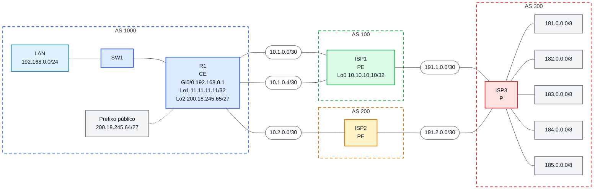

# Laboratório 09 - Implementação de MPLS no Backbone

- **Instituição:** Universidade de Brasília (UnB)
- **Departamento:** Departamento de Engenharia Elétrica (ENE)
- **Curso:** Engenharia de Redes de Comunicação
- **Disciplina:** ENE0025 - Protocolos de Transporte e Roteamento
- **Professor responsável:** Prof. Dr. Laerte Peotta de Melo
- **Tema:** Comutação por rótulos (MPLS) e distribuição de labels LDP sobre backbone OSPF

> **Pré-requisito:** Este laboratório é continuação do **Laboratório 08**.

---

### Material de Apoio: Podcast Latência Zero

<table>
  <tr>
    <td width="140" align="center">
      <a href="https://open.spotify.com/show/59S06LhFsKlyvfLFQCJ8fK">
        
      </a>
    </td>
    <td valign="top">
      O podcast <strong>Latência Zero</strong> apresenta discussões técnicas complementares sobre os temas da disciplina.<br><br>
      🎧 <strong>Episódio 6:</strong> <a href="https://open.spotify.com/episode/5RXovxuVQ6eLXa5pt2dUeR?si=dZE1TCGAQwyFAuxqumNnyQ">A Engenharia de Rótulos do Protocolo MPLS</a>
    </td>
  </tr>
</table>

---

## 1. Objetivos

Implementar um backbone **MPLS** simplificado na rede do provedor, dando continuidade ao **Lab 08**, de modo a compreender o papel dos roteadores **CE**, **PE** e **P**, habilitar o transporte por rótulos no núcleo da operadora e verificar o funcionamento do backbone MPLS sobre uma infraestrutura previamente estabelecida com **OSPF** e **BGP**.

---

## 2. Introdução e Fundamentação Teórica

### 2.1 Observação inicial

> **Importante:** este laboratório é uma continuação do **Lab 08**.  Considere que a topologia, o endereçamento IP básico, a conectividade entre enlaces e as sessões BGP já foram previamente configuradas.  Portanto, neste laboratório **não devem ser refeitas** as configurações básicas já concluídas.  O foco agora será apenas nas configurações necessárias para:
>
> - identificar os papéis **CE**, **PE** e **P**;
> - ativar o **OSPF** no backbone do provedor, se ainda não estiver operacional;
> - habilitar o **MPLS** nos enlaces do núcleo;
> - verificar a distribuição de rótulos e o encaminhamento no backbone.


*Imagem gerada com uso de inteligência artificial (OpenAI, ChatGPT).*

### 2.2 Situação-problema

No laboratório 08, a empresa do **AS 1000** estabeleceu conectividade com dois provedores e aplicou políticas BGP para definir caminho preferencial de saída. Agora, a operadora deseja evoluir sua infraestrutura e implantar um **backbone MPLS** entre seus roteadores, de modo que o transporte no núcleo passe a utilizar **comutação por rótulos**, preparando a rede para maior escalabilidade e para futuras ofertas de serviços avançados.

### 2.3 Fundamentação teórica


*Imagem gerada com uso de inteligência artificial (OpenAI, ChatGPT).*

O **MPLS (Multiprotocol Label Switching)** é uma tecnologia que adiciona rótulos aos pacotes, permitindo que o encaminhamento no backbone ocorra com base nesses rótulos, e não apenas pela análise completa do cabeçalho IP a cada salto.

Em um cenário simplificado de operadora, os papéis dos roteadores podem ser entendidos assim:

- **CE (Customer Edge)** é o roteador do cliente.
Ele fica na empresa e recebe a conectividade oferecida pela operadora. Em geral, o CE não precisa conhecer MPLS; para ele, a comunicação com o provedor costuma parecer apenas um enlace IP normal.

- **PE (Provider Edge)** é o roteador de borda da operadora, diretamente conectado ao CE.
Ele faz a interface entre a rede do cliente e a nuvem do provedor. É no PE que a operadora trata as rotas do cliente, associa serviços e, em cenários mais avançados, trabalha com elementos como VRF e redistribuição das rotas do CE para processos internos da operadora.

- **P (Provider)** é o roteador do núcleo da operadora.
Ele fica dentro da nuvem MPLS e participa do transporte do tráfego no backbone. Diferentemente do PE, o roteador P não se conecta ao cliente; sua função principal é encaminhar pacotes com base em rótulos MPLS dentro da infraestrutura da operadora.
- **LDP significa Label Distribution Protocol:** Protocolo usado em redes MPLS para que os roteadores troquem entre si os rótulos (labels) que serão usados no encaminhamento dos pacotes.
> **OBSERVAÇÃO:** 
> Se o roteador ISP1 sabe, pelo OSPF, que para chegar à loopback do ISP3 deve passar por determinado enlace, o LDP vai permitir que os roteadores troquem informações como:
> - “para esse destino, use o label X”
> - “quando receber esse label, troque por Y”
> - “ou retire o label antes de entregar no destino”
> A principal função do LDP é: distribuir rótulos MPLS entre roteadores vizinhos para viabilizar o encaminhamento dos pacotes no backbone MPLS.

Neste laboratório:

- **R1** será tratado como **CE**;
- **ISP1** e **ISP2** serão tratados como **PEs**;
- **ISP3** será tratado como elemento central do backbone, assumindo o papel de **P**.

Divisão de responsabilidades:

- **OSPF → descobre o caminho**
- **LDP → distribui os rótulos**
- **MPLS → encaminha com base nesses rótulos**  

O **OSPF** será usado como protocolo interno do backbone da operadora, enquanto o **MPLS** será habilitado nos enlaces da rede do provedor. Nos laboratórios anteriores, os três roteadores pertencem a sistemas autônomos distintos (AS 100, AS 200 e AS 300); reuni-los em um único domínio OSPF/MPLS é uma **simplificação didática**, pois, em uma operadora real, o backbone pertence a um único AS. 

### 2.4 Funcionamento interno do MPLS

No MPLS ([**RFC 3031**](https://datatracker.ietf.org/doc/html/rfc3031)), o primeiro roteador do domínio (LER, *Label Edge Router*) insere um cabeçalho de 32 bits entre os cabeçalhos de enlace e de rede ([**RFC 3032**](https://datatracker.ietf.org/doc/html/rfc3032)), composto por: rótulo (*Label*, 20 bits), *Traffic Class* (3 bits), bit de fundo de pilha (*S*, 1 bit) e *Time to Live* (8 bits). Os roteadores intermediários (LSR, *Label Switching Router*) consultam apenas o rótulo, substituem-no pelo rótulo de saída e encaminham o quadro. No penúltimo salto, o rótulo é normalmente removido (*Penultimate Hop Popping*, PHP), de modo que o último roteador receba o pacote IP puro.

O *Label Distribution Protocol* (LDP, [**RFC 5036**](https://datatracker.ietf.org/doc/html/rfc5036)) associa rótulos aos prefixos presentes na tabela do IGP. Por isso, o OSPF precisa estar estável e anunciar as loopbacks dos LSRs antes da ativação do MPLS.

### 2.5 Exemplo concreto

Para o prefixo `2.2.2.2/32` (loopback do ISP2), o ISP1 recebe do ISP3 o rótulo associado a esse prefixo. Um pacote do ISP1 destinado a `2.2.2.2` recebe esse rótulo; o ISP3, que é o penúltimo salto, remove o rótulo (rótulo de saída `Pop Label` na `show mpls forwarding-table`) e entrega o pacote IP ao ISP2.

### 2.6 Protocolos envolvidos

| Protocolo | Camada OSI | Camada TCP/IP | Transporte / porta | Observação |
|---|---|---|---|---|
| MPLS | 2,5 (entre enlace e rede) | - | Encapsulamento sobre Ethernet (EtherType `0x8847` para unicast) | Rótulo de 20 bits |
| LDP | 7 (Aplicação), com função de controle | Aplicação | UDP 646 (descoberta, multicast `224.0.0.2`) e TCP 646 (sessão) | O endereço de transporte deve ser alcançável |
| OSPFv2 | 3 (Rede) | Internet | IP protocolo 89 | IGP do backbone |

---

## 3. Topologia e Cenário

### 3.1 Topologia lógica



### 3.2 Premissas adotadas

Considere que os seguintes elementos **já estão configurados**:

- interfaces físicas e endereçamento IP;
- sessões BGP previamente estabelecidas;
- anúncio do prefixo da empresa;
- política de saída preferencial no R1;
- conectividade entre todos os enlaces.

Neste laboratório, serão realizadas apenas as configurações referentes a:

- backbone OSPF do provedor;
- habilitação do MPLS no núcleo;
- verificação de labels e encaminhamento.

### 3.3 Papéis dos roteadores no cenário

| Roteador | Papel no Lab 09 | Descrição |
|---|---|---|
| R1 | CE | Roteador do cliente |
| ISP1 | PE | Borda da operadora conectada ao cliente |
| ISP2 | PE | Borda da operadora conectada ao cliente |
| ISP3 | P | Núcleo do backbone da operadora |

### 3.4 Dados relevantes do backbone

#### 3.4.1 Enlaces do backbone do provedor
- ISP1 ↔ ISP3: `191.1.0.0/30`
- ISP2 ↔ ISP3: `191.2.0.0/30`

#### 3.4.2 Mapeamento de interfaces do backbone

| Dispositivo | Interface | Uso |
|---|---|---|
| ISP1 | Gi0/2 | enlace com ISP3 |
| ISP2 | Gi0/1 | enlace com ISP3 |
| ISP3 | Gi0/0 | enlace com ISP1 |
| ISP3 | Gi0/1 | enlace com ISP2 |

Os nomes de interface seguem a configuração dos enlaces ISP1-ISP3 e ISP2-ISP3 realizada no Laboratório 07.

#### 3.4.3 Loopbacks sugeridas para identificação interna
Caso ainda não existam loopbacks para o backbone, utilize:

- ISP1: `1.1.1.1/32`
- ISP2: `2.2.2.2/32`
- ISP3: `3.3.3.3/32`

Essas loopbacks serão úteis para o OSPF e para a identificação lógica dos LSRs no backbone.

---

## 4. Roteiro Prático Passo a Passo

### 4.1 Configuração das loopbacks do backbone

Configure apenas se ainda não tiver criado essas interfaces em atividades anteriores.

#### 4.1.1 ISP1

```cisco
ISP1> enable

ISP1# configure terminal

ISP1(config)# interface loopback 1

ISP1(config-if)# ip address 1.1.1.1 255.255.255.255

ISP1(config-if)# end
```

#### 4.1.2 ISP2

```cisco
ISP2> enable

ISP2# configure terminal

ISP2(config)# interface loopback 1

ISP2(config-if)# ip address 2.2.2.2 255.255.255.255

ISP2(config-if)# end
```

#### 4.1.3 ISP3

```cisco
ISP3> enable

ISP3# configure terminal

ISP3(config)# interface loopback 10

ISP3(config-if)# ip address 3.3.3.3 255.255.255.255

ISP3(config-if)# end
```

### 4.2 OSPF no backbone do provedor

O OSPF será usado como protocolo interno da operadora.  
Nesta etapa, configure ou ajuste o OSPF apenas nos roteadores do backbone.

#### 4.2.1 ISP1

```cisco
ISP1> enable

ISP1# configure terminal

ISP1(config)# router ospf 100

ISP1(config-router)# router-id 1.1.1.1

ISP1(config-router)# network 191.1.0.0 0.0.0.3 area 0

ISP1(config-router)# network 1.1.1.1 0.0.0.0 area 0

ISP1(config-router)# end
```

#### 4.2.2 ISP2

```cisco
ISP2> enable

ISP2# configure terminal

ISP2(config)# router ospf 100

ISP2(config-router)# router-id 2.2.2.2

ISP2(config-router)# network 191.2.0.0 0.0.0.3 area 0

ISP2(config-router)# network 2.2.2.2 0.0.0.0 area 0

ISP2(config-router)# end
```

#### 4.2.3 ISP3

```cisco
ISP3> enable

ISP3# configure terminal

ISP3(config)# router ospf 100

ISP3(config-router)# router-id 3.3.3.3

ISP3(config-router)# network 191.1.0.0 0.0.0.3 area 0

ISP3(config-router)# network 191.2.0.0 0.0.0.3 area 0

ISP3(config-router)# network 3.3.3.3 0.0.0.0 area 0

ISP3(config-router)# end
```

### 4.3 Habilitação do MPLS no backbone

Depois que o OSPF estiver funcional no backbone, habilite o MPLS apenas nos enlaces internos da operadora.

#### 4.3.1 ISP1

```cisco
ISP1> enable

ISP1# configure terminal

ISP1(config)# interface Gi0/2

ISP1(config-if)# mpls ip

ISP1(config-if)# end
```

#### 4.3.2 ISP2

```cisco
ISP2> enable

ISP2# configure terminal

ISP2(config)# interface Gi0/1

ISP2(config-if)# mpls ip

ISP2(config-if)# end
```

#### 4.3.3 ISP3

```cisco
ISP3> enable

ISP3# configure terminal

ISP3(config)# interface Gi0/0

ISP3(config-if)# mpls ip

ISP3(config-if)# interface Gi0/1

ISP3(config-if)# mpls ip

ISP3(config-if)# end
```

### 4.4 Fixação do LDP Router ID

O *LDP Router ID* é, por padrão, o maior endereço IP entre as interfaces de loopback; os vizinhos estabelecem a sessão TCP do LDP com esse endereço, que precisa ser alcançável pelo IGP. Neste cenário, os roteadores possuem outras loopbacks de laboratórios anteriores (por exemplo, `10.10.10.10` no ISP1 e `185.0.0.1` no ISP3) que não são anunciadas pelo OSPF do backbone e, por serem numericamente maiores, seriam escolhidas como identificador. Para evitar esse problema, fixar o identificador na loopback anunciada no OSPF:

```cisco
! ISP1
mpls ldp router-id Loopback1 force
! ISP2
mpls ldp router-id Loopback1 force
! ISP3
mpls ldp router-id Loopback10 force
```

A opção `force` aplica a alteração imediatamente, reiniciando as sessões LDP existentes. Após a mudança, `show mpls ldp neighbor` deve exibir o LDP ID de cada vizinho com o endereço da loopback correspondente (`1.1.1.1`, `2.2.2.2` e `3.3.3.3`).

---

## 5. Verificação e Diagnóstico

### 5.1 Verificação do backbone OSPF

Antes de validar o MPLS, verifique se o backbone OSPF da operadora está funcionando corretamente.

#### 5.1.1 Comandos sugeridos

```cisco
show ip ospf neighbor
show ip route
show ip protocols
show ip interface brief
```

#### 5.1.2 O que observar

- vizinhança OSPF entre **ISP1** e **ISP3**;
- vizinhança OSPF entre **ISP2** e **ISP3**;
- presença das loopbacks na tabela de rotas;
- alcançabilidade do backbone por roteamento interno.

### 5.2 Verificação do MPLS

Depois de habilitar o MPLS nos enlaces do backbone, verifique a distribuição de labels.

#### 5.2.1 Comandos sugeridos

```cisco
! Interfaces com MPLS habilitado
show mpls interfaces
! Vizinhos LDP e estado das sessões
show mpls ldp neighbor
! Rótulos associados a cada prefixo (local e de saída)
show mpls ldp bindings
! Tabela de encaminhamento por rótulos
show mpls forwarding-table
show ip route
! A partir do ISP1: o primeiro salto (ISP3) deve exibir o rótulo MPLS usado
traceroute 2.2.2.2 source 1.1.1.1
```

#### 5.2.2 O que observar

- interfaces com MPLS habilitado;
- vizinhos LDP estabelecidos;
- presença de labels na forwarding table;
- associação entre prefixos e rótulos.

### 5.3 Teste de observação

Identificar:

1. onde termina o papel do cliente;
2. onde começa a nuvem do provedor;
3. quais roteadores são CE, PE e P;
4. em quais enlaces o MPLS foi ativado;
5. quais prefixos do backbone receberam rótulos.

### 5.4 Interpretação das saídas

| Comando | Campos relevantes |
|---|---|
| `show mpls interfaces` | Interfaces com `mpls ip` ativo, protocolo de rótulo (`LDP`) e estado operacional |
| `show mpls ldp neighbor` | `Peer LDP Ident` (LDP ID do vizinho), estado da sessão (`Oper`), interface e endereço de transporte |
| `show mpls ldp bindings` | Para cada prefixo: rótulo local e rótulos recebidos de cada vizinho |
| `show mpls forwarding-table` | `Local Label`, `Outgoing Label` (`Pop Label` indica remoção no penúltimo salto), `Prefix`, bytes comutados, interface e próximo salto |

### 5.5 Metodologia de diagnóstico

1. **Enlaces e IGP:** `show ip interface brief`, `show ip ospf neighbor` com estado `FULL`;
2. **Alcançabilidade das loopbacks:** `show ip route 3.3.3.3` e `ping 3.3.3.3 source Loopback1` (conforme a loopback de cada roteador);
3. **LDP Router ID:** o endereço de transporte do vizinho precisa ser alcançável; verificar com `show mpls ldp discovery` e `show mpls ldp neighbor`;
4. **Sessões LDP:** descoberta (UDP 646) e sessão (TCP 646) não podem ser bloqueadas por ACLs; verificar `mpls ip` nos dois lados do enlace;
5. **Rótulos e encaminhamento:** `show mpls ldp bindings` e `show mpls forwarding-table`; ausência de rótulos para um prefixo indica que o prefixo não está no IGP;
6. **Políticas:** filtros de rótulos (`mpls ldp advertise-labels`) e ACLs de infraestrutura.

---

## 6. Segurança

### 6.1 Riscos associados

- **Sessões LDP sem autenticação:** um dispositivo que alcance a porta 646 de um LSR pode tentar estabelecer sessão e injetar associações de rótulo falsas, desviando ou descartando tráfego. A [**RFC 5036**](https://datatracker.ietf.org/doc/html/rfc5036) prevê a proteção da sessão por assinatura MD5 do TCP.
- **Pacotes rotulados vindos de clientes:** interfaces voltadas ao cliente não devem aceitar pacotes MPLS; por isso, neste roteiro, o `mpls ip` é habilitado somente nos enlaces internos do backbone ([**RFC 4381**](https://datatracker.ietf.org/doc/html/rfc4381)).
- **Exposição da topologia:** por padrão, o TTL do IP é copiado para o cabeçalho MPLS, de modo que `traceroute` originado fora do domínio revela os roteadores do núcleo.
- **Dependência do IGP:** qualquer comprometimento do OSPF (adjacências indevidas, LSAs falsos) afeta a distribuição de rótulos.

### 6.2 Boas práticas (*hardening*)

```cisco
! No ISP1 e no ISP2: autenticação MD5 da sessão LDP com o ISP3 (LDP ID 3.3.3.3)
mpls ldp neighbor 3.3.3.3 password SENHA-LAB
! No ISP3: autenticação com cada PE (ajustar o LDP ID de cada vizinho)
mpls ldp neighbor 1.1.1.1 password SENHA-LAB
mpls ldp neighbor 2.2.2.2 password SENHA-LAB
! Oculta os saltos do núcleo em traceroutes de origem externa ao domínio
no mpls ip propagate-ttl forwarded
! Autenticação OSPF na área do backbone (exemplo no ISP1, interface Gi0/2)
router ospf 100
 area 0 authentication message-digest
interface Gi0/2
 ip ospf message-digest-key 1 md5 SENHA-LAB
```

O valor `SENHA-LAB` é exclusivamente didático, e a senha deve ser a mesma nos dois extremos de cada sessão. Recomenda-se ainda restringir, por ACL, o acesso às portas TCP/UDP 646 apenas aos endereços dos LSRs do backbone.

---

## 7. Questões para Análise e Discussão

### 7.1 Questões para análise

1. Qual é a principal diferença entre **roteamento IP tradicional** e **encaminhamento com MPLS**?
2. Qual é a função do **OSPF** dentro do backbone do provedor?
3. Qual é o papel dos roteadores **PE**?
4. Qual é o papel do roteador **P**?
5. Por que o cliente normalmente não precisa configurar MPLS no seu roteador?
6. Como o **Lab 09** complementa o **Lab 08**?
7. O que significa dizer que o MPLS atua como tecnologia de “camada 2,5”?
8. Por que o backbone precisa de um IGP estável antes da ativação do MPLS?

### 7.2 Conclusão esperada

Ao final deste laboratório, o estudante deve perceber que:

- o **BGP** continua importante na borda da rede;
- o **OSPF** organiza a alcançabilidade interna do backbone;
- o **MPLS** permite transportar o tráfego por meio de rótulos;
- a nuvem da operadora possui lógica própria, diferente da rede do cliente;

---

## 8. Critérios de Avaliação e Entregáveis

### 8.1 Critérios de avaliação

| Critério | Pontuação |
|---|---:|
| Identificação correta dos papéis CE, PE e P na topologia | 1,5 |
| Configuração e convergência do OSPF no backbone | 2,5 |
| Habilitação do MPLS e formação de adjacência LDP nos enlaces internos | 2,5 |
| Comandos de verificação técnica (`show mpls interfaces`, `ldp neighbor`, `forwarding-table`) | 1,5 |
| Respostas técnicas às questões para análise e comparação didática | 2,0 |
| **Total** | **10,0** |

### 8.2 Entregáveis

Cada aluno deve entregar:

- print da topologia no PNetLab;
- print do `show ip ospf neighbor` em pelo menos um roteador do backbone;
- print do `show mpls interfaces`;
- print do `show mpls ldp neighbor`;
- print do `show mpls forwarding-table`;
- relatório curto contendo:
  - objetivo do laboratório;
  - papéis CE, PE e P no cenário;
  - conclusão sobre o uso de MPLS no backbone;
- respostas completas às questões para análise.

---

## 9. Referências

- [**RFC 3031**](https://datatracker.ietf.org/doc/html/rfc3031) - *Multiprotocol Label Switching Architecture*.
- [**RFC 3032**](https://datatracker.ietf.org/doc/html/rfc3032) - *MPLS Label Stack Encoding*.
- [**RFC 5036**](https://datatracker.ietf.org/doc/html/rfc5036) - *LDP Specification*.
- [**RFC 4381**](https://datatracker.ietf.org/doc/html/rfc4381) - *Analysis of the Security of BGP/MPLS IP Virtual Private Networks (VPNs)*.
- [**RFC 2328**](https://datatracker.ietf.org/doc/html/rfc2328) - *OSPF Version 2*.
- Cisco Systems. *Multiprotocol Label Switching Configuration Guide* (documentação oficial do fabricante).
- DAVIE, B.; REKHTER, Y. *MPLS: Technology and Applications*. Morgan Kaufmann.
- KUROSE, J. F.; ROSS, K. W. *Redes de Computadores e a Internet: uma abordagem top-down*. Pearson.

---

[← Anterior: Laboratório 08](lab08.md) | [Índice Geral (README)](../README.md) | [Próximo: Laboratório 10 →](lab10.md)
