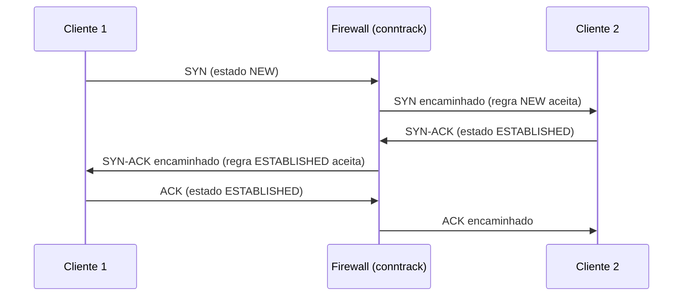
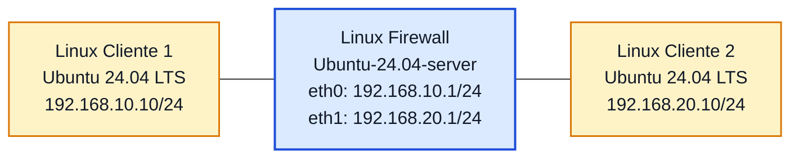

# Laboratório 11 - Firewall Stateful com `iptables`

- **Instituição:** Universidade de Brasília (UnB)
- **Departamento:** Departamento de Engenharia Elétrica (ENE)
- **Curso:** Engenharia de Redes de Comunicação
- **Disciplina:** ENE0025 - Protocolos de Transporte e Roteamento
- **Professor responsável:** Prof. Dr. Laerte Peotta de Melo
- **Tema:** Filtragem stateful com conntrack e acompanhamento de conexões no iptables

> **Pré-requisito:** Este laboratório reutiliza o ambiente e a topologia do **Laboratório 10**, baseado em nós Linux com **Ubuntu 24.04 LTS**.

---

## 1. Objetivos

Implementar um **firewall stateful** em uma máquina Linux no PNetLab, reutilizando a topologia do **Laboratório 10**, com regras baseadas em **estado de conexão** para permitir automaticamente o tráfego de retorno de sessões já autorizadas.

---

## 2. Introdução e Fundamentação Teórica

### 2.1 Introdução

No **Laboratório 10**, o controle foi feito com um **firewall de pacotes sem estado (*stateless*)**. Nesse modelo, cada pacote é tratado de forma isolada e, por isso, normalmente é necessário criar regras explícitas de ida e de volta.

No **Laboratório 11**, o firewall passa a acompanhar o **estado das conexões**. Com isso, é possível permitir o início de uma comunicação e deixar que o tráfego de retorno seja aceito automaticamente quando ele pertencer a uma sessão já estabelecida.

No Linux, isso é feito com `iptables` e rastreamento de conexões do kernel, usando principalmente:

- `-m conntrack` Ativa o módulo de rastreamento de conexões no iptables, permitindo que a regra use informações sobre o estado da comunicação.
- `--ctstate NEW` Indica que o pacote está iniciando uma nova conexão.
- `--ctstate ESTABLISHED` Indica que o pacote faz parte de uma conexão já estabelecida, ou seja, de uma comunicação que já foi iniciada e aceita antes.
- `--ctstate RELATED` Indica que o pacote está relacionado a uma conexão existente, mesmo que não pertença exatamente ao fluxo principal.


*Imagem gerada com uso de inteligência artificial (OpenAI, ChatGPT).*

### 2.2 Situação-problema

Uma organização deseja evoluir seu firewall Linux, saindo de um modelo de filtragem simples de pacotes para um modelo **stateful**, capaz de reconhecer conexões já estabelecidas e permitir automaticamente o tráfego de retorno, reduzindo a quantidade de regras e tornando a política mais fácil de administrar.

### 2.3 Conceitos de estado

#### 2.3.1 `NEW`
Pacote que inicia uma nova conexão.

#### 2.3.2 `ESTABLISHED`
Pacote pertencente a uma conexão já estabelecida.

#### 2.3.3 `RELATED`
Pacote relacionado a uma conexão existente, como uma mensagem de erro ICMP (por exemplo, *Destination Unreachable*) gerada em resposta a um pacote de uma conexão rastreada.

> Neste Laboratório o foco principal será observar a diferença entre **NEW** e **ESTABLISHED**.

### 2.4 Funcionamento interno: tabela de conexões

O módulo `conntrack` do núcleo Linux mantém uma tabela com as conexões observadas. Cada entrada é identificada pela tupla (endereço de origem, endereço de destino, protocolo, porta de origem, porta de destino) e contém a tupla de resposta esperada, o estado e um temporizador. O estado `NEW` é atribuído ao primeiro pacote de uma conexão; assim que um pacote do sentido inverso é visto, a conexão passa a `ESTABLISHED`. Pacotes que não se encaixam em nenhuma conexão e não iniciam uma válida recebem o estado `INVALID`.



Para protocolos sem conexão, como UDP e ICMP, o `conntrack` associa pares de pacotes de ida e volta dentro de um tempo limite. Os estados disponíveis para uso em regras são `NEW`, `ESTABLISHED`, `RELATED`, `INVALID` e `UNTRACKED`.

### 2.5 Exemplo concreto

Com a regra central (`ESTABLISHED,RELATED`) e a regra de nova conexão do Cliente 1 para a porta TCP 80 do Cliente 2, o retorno do tráfego HTTP é aceito sem regra no sentido inverso. Um pacote TCP isolado enviado pelo Cliente 2 com porta de origem 80, que seria aceito no Laboratório 10 pela regra `--sport 80`, é classificado como `INVALID` ou `NEW` e descartado, pois não pertence a uma conexão iniciada pelo Cliente 1.

### 2.6 Protocolos envolvidos

| Mecanismo | Camada OSI | Camada TCP/IP | Observação |
|---|---|---|---|
| `conntrack` (Netfilter) | 3 e 4 (Rede e Transporte) | Internet e Transporte | Rastreia ICMP, TCP e UDP |
| TCP | 4 (Transporte) | Transporte | Estados de conexão conforme a [**RFC 9293**](https://datatracker.ietf.org/doc/html/rfc9293) |
| ICMP | 3 (Rede) | Internet | IP protocolo 1 ([**RFC 792**](https://datatracker.ietf.org/doc/html/rfc792)) |

---

## 3. Topologia e Cenário

### 3.1 Topologia lógica



### 3.2 Plano de endereçamento

| Dispositivo | Interface | Endereço IP | Máscara | Gateway |
|---|---|---|---|---|
| Linux Cliente 1 | eth0 | 192.168.10.10 | 255.255.255.0 | 192.168.10.1 |
| Linux Firewall | eth0 | 192.168.10.1 | 255.255.255.0 | - |
| Linux Firewall | eth1 | 192.168.20.1 | 255.255.255.0 | - |
| Linux Cliente 2 | eth0 | 192.168.20.10 | 255.255.255.0 | 192.168.20.1 |

### 3.3 Pré-requisitos

Considere já concluídos a partir do **Laboratório 10**:

- ambiente configurado com máquinas Linux baseadas em **Ubuntu 24.04 LTS** (`linux-ubuntu-24.04-server`);
- configuração IP dos hosts e do Linux Firewall;
- ativação do roteamento IP (`net.ipv4.ip_forward = 1`);
- testes básicos de conectividade do Laboratório 10.

Confirme no firewall:

```bash
ip addr show
cat /proc/sys/net/ipv4/ip_forward
```

---

## 4. Roteiro Prático Passo a Passo

### 4.1 Limpeza inicial

```bash
sudo iptables -F
sudo iptables -X
sudo iptables -Z
sudo iptables -P FORWARD DROP
```

### 4.2 Regra central do firewall stateful

A principal diferença deste Laboratório é permitir automaticamente o tráfego de retorno de conexões já estabelecidas.

```bash
sudo iptables -A FORWARD -m conntrack --ctstate ESTABLISHED,RELATED -j ACCEPT
```

Essa regra permite:

- pacotes que pertencem a conexões já aceitas;
- pacotes relacionados a conexões existentes.

### 4.3 Regras de novas conexões iniciadas pelo Cliente 1

#### 4.3.1 Permitir ICMP iniciado pelo Cliente 1

```bash
sudo iptables -A FORWARD -s 192.168.10.10 -d 192.168.20.10 -p icmp -m conntrack --ctstate NEW -j ACCEPT
```

#### 4.3.2 Permitir HTTP iniciado pelo Cliente 1

```bash
sudo iptables -A FORWARD -s 192.168.10.10 -d 192.168.20.10 -p tcp --dport 80 -m conntrack --ctstate NEW -j ACCEPT
```

#### 4.3.3 Conjunto final mínimo de regras

```bash
sudo iptables -F
sudo iptables -P FORWARD DROP
sudo iptables -A FORWARD -m conntrack --ctstate ESTABLISHED,RELATED -j ACCEPT
sudo iptables -A FORWARD -s 192.168.10.10 -d 192.168.20.10 -p icmp -m conntrack --ctstate NEW -j ACCEPT
sudo iptables -A FORWARD -s 192.168.10.10 -d 192.168.20.10 -p tcp --dport 80 -m conntrack --ctstate NEW -j ACCEPT
```

---

## 5. Verificação e Diagnóstico

### 5.1 Verificação das regras

```bash
sudo iptables -L -n -v
sudo iptables -S
```

### 5.2 Testes práticos

#### 5.2.1 Teste de ICMP iniciado pelo Cliente 1

No **Linux Cliente 1**:

```bash
ping 192.168.20.10
```

Resultado esperado: **deve funcionar**.

No **Linux Cliente 2**:

```bash
ping 192.168.10.10
```

Resultado esperado: **deve falhar**.

#### 5.2.2 Teste de HTTP iniciado pelo Cliente 1

No **Linux Cliente 2**, suba um serviço HTTP simples:

```bash
sudo python3 -m http.server 80
```

ou

```bash
sudo busybox httpd -f -p 80
```

No **Linux Cliente 1**:

```bash
curl http://192.168.20.10
```

ou

```bash
wget -O- http://192.168.20.10
```

Resultado esperado: **deve funcionar**.

#### 5.2.3 Teste de nova conexão iniciada pelo Cliente 2

```bash
nc -vz 192.168.10.10 80
```

Resultado esperado: **deve falhar**.

#### 5.2.4 Teste de Telnet não permitido

No **Linux Cliente 1**:

```bash
telnet 192.168.20.10 23
```

ou

```bash
nc -vz 192.168.20.10 23
```

Resultado esperado: **deve falhar**.

### 5.3 Atividade comparativa para visualizar a diferença entre firewall de pacotes sem estado (stateless) e stateful

Nesta atividade, os alunos devem comparar o comportamento do **Laboratório 10** e do **Laboratório 11** na mesma topologia.

#### 5.3.1 Etapa A - Executar o Laboratório 10

Aplicar as regras do **firewall de pacotes sem estado (*stateless*)** e observar que, para o tráfego funcionar, foi necessário criar:

- regra de ida;
- regra de volta.

Exemplo observado no Laboratório 10:

- Cliente 1 inicia HTTP para Cliente 2;
- o retorno precisou ser tratado por regra explícita.

#### 5.3.2 Etapa B - Executar o Laboratório 11

Substituir as regras anteriores pelas regras **stateful** deste Laboratório e observar que agora basta:

- permitir a conexão nova;
- permitir `ESTABLISHED,RELATED`.

#### 5.3.3 Etapa C - Realizar os mesmos testes nos dois laboratórios

Os alunos devem testar:

- ping iniciado pelo Cliente 1;
- ping iniciado pelo Cliente 2;
- HTTP iniciado pelo Cliente 1;
- nova conexão TCP iniciada pelo Cliente 2;
- tentativa de Telnet.

#### 5.3.4 Etapa D - Comparar a saída das regras

Executar em ambos os cenários:

```bash
sudo iptables -L -n -v
sudo iptables -S
```

Se o utilitário estiver instalado no firewall (`sudo apt install -y conntrack`):

```bash
sudo conntrack -L
```

#### 5.3.5 Tabela para preenchimento pelos alunos

| Teste | Laboratório 10 - Firewall de pacotes sem estado (stateless) | Laboratório 11 - Stateful |
|---|---|---|
| Ping iniciado pelo Cliente 1 |  |  |
| Retorno da comunicação |  |  |
| HTTP Cliente 1 → Cliente 2 |  |  |
| Nova conexão iniciada pelo Cliente 2 |  |  |
| Quantidade de regras |  |  |
| Facilidade de administração |  |  |

#### 5.3.6 Síntese esperada da atividade

Ao final, o aluno deve perceber que:

- no **filtro de pacotes**, normalmente é preciso escrever regras explícitas de ida e de volta;
- no **stateful**, o retorno de conexões autorizadas é tratado automaticamente;
- o modelo stateful reduz regras duplicadas e melhora a legibilidade da política.

### 5.4 Inspeção de conexões rastreadas

Se o pacote `conntrack` estiver instalado no firewall (`sudo apt install -y conntrack`):

```bash
sudo conntrack -L
```

> Se esse utilitário não estiver instalado, a análise pode ser feita pelos testes práticos e pelos contadores das regras.

### 5.5 Interpretação da saída de `conntrack -L`

Cada linha corresponde a uma conexão rastreada e contém os campos:

| Campo | Significado |
|---|---|
| `tcp 6` / `icmp 1` / `udp 17` | Protocolo e seu número |
| Valor numérico seguinte | Tempo restante, em segundos, até a expiração da entrada |
| `ESTABLISHED`, `TIME_WAIT`, entre outros | Estado da conexão TCP, quando aplicável |
| `src=`, `dst=`, `sport=`, `dport=` | Tupla do sentido de ida; em seguida aparece a tupla do sentido de resposta |
| `[UNREPLIED]` | Nenhuma resposta foi vista ainda |
| `[ASSURED]` | Tráfego nos dois sentidos confirmado; a entrada tem prioridade de retenção |

### 5.6 Metodologia de diagnóstico

1. **Enlace, endereçamento e encaminhamento:** `ip -br addr` e `cat /proc/sys/net/ipv4/ip_forward`;
2. **Ordem das regras:** a regra `ESTABLISHED,RELATED` deve vir antes das regras que dependem de `NEW`; conferir com `sudo iptables -L FORWARD -n -v --line-numbers`;
3. **Contadores:** a regra de novas conexões deve incrementar no início de cada teste e a regra de retorno durante a sessão;
4. **Tabela de conexões:** `sudo conntrack -L` durante o teste; ausência de entrada indica que o primeiro pacote não foi aceito pela regra `NEW`;
5. **Serviço de destino:** `ss -tln` no servidor para diferenciar bloqueio de ausência de serviço.

---

## 6. Segurança

### 6.1 Riscos associados

- **Esgotamento da tabela de conexões:** cada nova conexão ocupa uma entrada. Inundações de pacotes `SYN` ou de pacotes UDP/ICMP com origens variadas podem encher a tabela (limite `nf_conntrack_max`) e causar descarte de conexões legítimas.
- **Tempos limite longos:** conexões TCP estabelecidas permanecem na tabela por muito tempo (o padrão do Linux para `ESTABLISHED` é de 5 dias), o que facilita o consumo de memória.
- **Estado `RELATED`:** aceita mensagens ICMP de erro associadas a conexões existentes; podem revelar informações da rede interna a um observador.
- **Limitação do filtro com estado:** a inspeção é feita nas camadas 3 e 4; o conteúdo da aplicação não é analisado (tratado a partir do Laboratório 12).
- **Pacotes `INVALID`:** pacotes malformados ou fora de sequência podem ser usados em varreduras e evasão, se aceitos por regras amplas.

### 6.2 Boas práticas (*hardening*)

```bash
# Descarta pacotes fora de qualquer conexão válida (inserida antes da regra ESTABLISHED,RELATED)
sudo iptables -I FORWARD 1 -m conntrack --ctstate INVALID -j DROP
# Variante da regra de HTTP com limite de taxa para novas conexões TCP (substitui a regra da Seção 4.3)
sudo iptables -A FORWARD -s 192.168.10.10 -d 192.168.20.10 -p tcp --dport 80 --syn -m conntrack --ctstate NEW -m limit --limit 50/s --limit-burst 100 -j ACCEPT
# Consulta do limite e da ocupação da tabela de conexões
sysctl net.netfilter.nf_conntrack_max
sysctl net.netfilter.nf_conntrack_count
```

O ajuste de `nf_conntrack_max` e dos tempos limite (`net.netfilter.nf_conntrack_tcp_timeout_established`) deve considerar a memória disponível. As demais recomendações do Laboratório 10 (antispoofing, registro de descartes, persistência de regras e preservação do acesso de gerência) permanecem válidas.

---

## 7. Questões para Análise e Discussão

### 7.1 Questões para análise

1. O que diferencia um firewall stateful de um firewall de pacotes simples?
2. Qual a função de `-m conntrack --ctstate ESTABLISHED,RELATED`?
3. Por que o retorno da conexão HTTP não precisou de regra explícita no sentido inverso?
4. O que caracteriza um pacote no estado `NEW`?
5. Qual a principal vantagem de usar regras stateful em relação ao Laboratório  10?
6. Por que o Cliente 2 não conseguiu iniciar novas conexões para o Cliente 1?
7. O que mudou na quantidade e na lógica das regras entre o Laboratório 10 e o Laboratório 11?
8. Em que tipo de ambiente um firewall stateful tende a ser mais adequado?
9. O firewall stateful elimina a necessidade de política de bloqueio padrão? Explique.
10. O que a atividade comparativa mostrou de forma mais clara sobre a diferença entre os dois modelos?

### 7.2 Conclusão esperada

Ao final deste Laboratório, o aluno deve perceber que:

- um firewall stateful acompanha o estado das conexões;
- o `iptables`, com `conntrack`, permite liberar respostas automaticamente;
- o modelo stateful reduz a necessidade de regras duplicadas de retorno;
- a comparação prática com o Laboratório 10 torna mais visível a diferença entre os dois modelos;
- o firewall stateful representa uma evolução natural em relação ao firewall de pacotes sem estado (*stateless*) estudado no Laboratório 10.

---

## 8. Critérios de Avaliação e Entregáveis

### 8.1 Critérios de avaliação

| Critério | Pontuação |
|---|---:|
| Reutilização correta da topologia e do endereçamento | 1,5 |
| Limpeza e aplicação das políticas padrão e regras com `conntrack` | 2,5 |
| Implementação da lógica stateful (`ESTABLISHED,RELATED` e `NEW`) | 2,5 |
| Testes práticos de conectividade unidirecional e bloqueio | 1,5 |
| Respostas técnicas às questões para análise e tabela comparativa | 2,0 |
| **Total** | **10,0** |

### 8.2 Entregáveis

Cada aluno deve entregar relatório contendo:

- print da topologia no PNetLab;
- print da configuração IP dos três Linux;
- print do comando `iptables -L -n -v`;
- evidência dos testes de:
  - ping iniciado pelo Cliente 1 e funcionando;
  - ping iniciado pelo Cliente 2 e falhando;
  - HTTP iniciado pelo Cliente 1 e funcionando;
  - tentativa de Telnet bloqueada;
- tabela comparativa preenchida entre **Laboratório 10** e **Laboratório 11**;
- texto curto explicando a diferença entre firewall de pacotes e firewall stateful;
- respostas completas às questões para análise.

---

## 9. Referências

- [**RFC 792**](https://datatracker.ietf.org/doc/html/rfc792) - *Internet Control Message Protocol*.
- [**RFC 2979**](https://datatracker.ietf.org/doc/html/rfc2979) - *Behavior of and Requirements for Internet Firewalls*.
- [**RFC 9293**](https://datatracker.ietf.org/doc/html/rfc9293) - *Transmission Control Protocol (TCP)*.
- Projeto Netfilter. *Documentação do Netfilter e do rastreamento de conexões (conntrack)*. Disponível em: https://www.netfilter.org/documentation/.
- Páginas de manual `iptables-extensions(8)` e `conntrack(8)`.
- ZWICKY, E. D.; COOPER, S.; CHAPMAN, D. B. *Building Internet Firewalls*. O'Reilly.
- KUROSE, J. F.; ROSS, K. W. *Redes de Computadores e a Internet: uma abordagem top-down*. Pearson.

---

[← Anterior: Laboratório 10](lab10.md) | [Índice Geral (README)](../README.md) | [Próximo: Laboratório 12 →](lab12.md)
