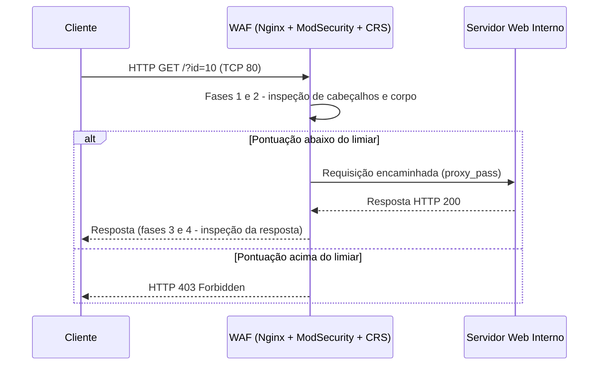
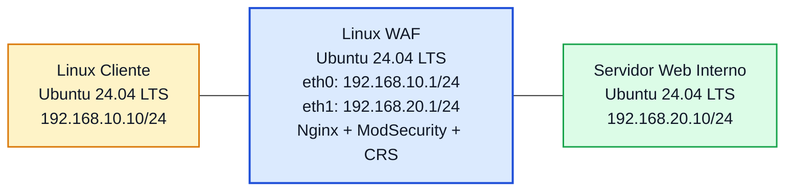

# Laboratório 12 - Implementação de WAF com ModSecurity e OWASP CRS

- **Instituição:** Universidade de Brasília (UnB)
- **Departamento:** Departamento de Engenharia Elétrica (ENE)
- **Curso:** Engenharia de Redes de Comunicação
- **Disciplina:** ENE0025 - Protocolos de Transporte e Roteamento
- **Professor responsável:** Prof. Dr. Laerte Peotta de Melo
- **Tema:** Proteção de aplicações web com Web Application Firewall (ModSecurity e OWASP CRS)

---

## 1. Objetivos

Implementar um **Web Application Firewall (WAF)** em uma máquina Linux no PNetLab, utilizando **Nginx + ModSecurity + OWASP Core Rule Set (CRS)** em modo de **proxy reverso**, de forma que o tráfego HTTP entre um cliente e um servidor web interno seja inspecionado e controlado na **camada de aplicação**.

- **Nginx**: servidor web e proxy reverso que recebe as requisições dos clientes e as encaminha para o servidor interno.
- **ModSecurity**: mecanismo de firewall de aplicação que inspeciona requisições e respostas HTTP em busca de padrões suspeitos.
- **OWASP Core Rule Set (CRS)**: conjunto de regras prontas para o ModSecurity, criado para detectar e bloquear ataques web comuns, como SQL Injection e XSS.

Ao final deste laboratório, o estudante deverá ser capaz de:

- compreender a função de um WAF;
- diferenciar WAF de firewall de pacotes e firewall stateful;
- implantar um proxy reverso com inspeção HTTP;
- validar acesso legítimo a uma aplicação web;
- observar o ponto de inserção do WAF na arquitetura da rede.

---

## 2. Introdução e Fundamentação Teórica

### 2.1 Introdução

Nos laboratórios anteriores, o controle de tráfego foi feito inicialmente com um **firewall de pacotes**, que toma decisões com base em informações como endereço IP, protocolo e porta, e depois com um **firewall stateful**, que também acompanha o estado das conexões. Esses mecanismos são fundamentais para a segurança da rede, mas não conseguem, sozinhos, analisar em profundidade o conteúdo de uma requisição web.

### 2.2 Web Application Firewall (WAF)

Um **Web Application Firewall (WAF)** atua em um nível mais alto, inspecionando o tráfego **HTTP/HTTPS** e aplicando regras voltadas à proteção de aplicações web. Em vez de decidir apenas se a porta 80 ou 443 pode ser usada, o WAF analisa elementos como:

- URL requisitada;
- parâmetros enviados;
- cabeçalhos HTTP;
- corpo da requisição;
- padrões de ataque comuns contra aplicações.

Na prática, isso permite bloquear comportamentos suspeitos mesmo quando o acesso à aplicação web é legítimo do ponto de vista da rede. Ou seja, a porta 80 pode estar aberta, a conexão pode estar estabelecida corretamente, mas ainda assim a requisição pode ser barrada por conter um padrão perigoso.

Neste laboratório, será utilizado o **ModSecurity**, em conjunto com o **OWASP Core Rule Set (CRS)**, para transformar uma máquina Linux em um **WAF reverso**, posicionada entre um cliente e um servidor web interno. O objetivo desta primeira parte é implantar a estrutura do WAF, publicar a aplicação web por meio do proxy reverso e validar o funcionamento do fluxo legítimo. A exploração de ataques e a análise aprofundada dos bloqueios ficam como continuidade natural para o **Lab 13**.


*Imagem gerada com uso de inteligência artificial (OpenAI, ChatGPT).*

### 2.3 Proxy Reverso

Um proxy reverso é um servidor intermediário que recebe as requisições dos clientes e as encaminha para um ou mais servidores internos, devolvendo depois a resposta ao cliente.

Na prática, o cliente acha que está falando diretamente com o serviço, mas na verdade está falando primeiro com o proxy reverso. Esse proxy fica “na frente” da aplicação.


*Imagem gerada com uso de inteligência artificial (OpenAI, ChatGPT).*

### 2.4 Funções principais de um proxy reverso

- Ocultar o servidor interno: O cliente acessa o proxy, não o servidor real.
- Distribuir requisições: Pode enviar tráfego para vários servidores backend, fazendo balanceamento de carga.
- Aplicar segurança: Pode atuar com WAF, TLS/HTTPS, autenticação, filtragem e limitação de acesso.
- Melhorar desempenho: Pode fazer cache, compressão e otimização de conexões.
- Centralizar publicação de serviços: Vários sites ou aplicações podem ser publicados por um único ponto de entrada.

### 2.5 Relação com os Laboratórios 10 e 11

Este laboratório deve ser entendido como continuação direta do processo de evolução das defesas em rede:

- **Lab 10**: firewall de pacotes sem estado (*stateless*) com `iptables`
- **Lab 11**: firewall stateful com `conntrack`
- **Lab 12**: firewall de aplicação com inspeção de tráfego HTTP

#### 2.5.1 Síntese comparativa

| Tecnologia | Camada de atuação | Exemplo de decisão |
|---|---|---|
| Firewall de pacotes | Rede / Transporte | Permitir ou bloquear TCP/80 |
| Firewall stateful | Rede / Transporte com estado | Permitir retorno de conexão já estabelecida |
| WAF | Aplicação | Permitir acesso à página, mas bloquear requisição maliciosa |

### 2.6 Situação-problema

Uma organização já protege sua rede com um firewall tradicional, permitindo apenas o tráfego necessário entre suas redes. Posteriormente, passou a usar firewall stateful para melhorar o controle das conexões e reduzir regras redundantes. Ainda assim, a equipe percebe que uma aplicação web interna continua exposta a riscos, já que qualquer usuário com acesso à porta HTTP pode enviar requisições maliciosas.

Para aumentar a proteção, a organização decide implantar um **WAF** entre os clientes e o servidor web interno, de forma que o serviço continue acessível, mas com inspeção de conteúdo na camada de aplicação.

### 2.7 Funcionamento interno do WAF com ModSecurity e CRS

O ModSecurity processa cada transação HTTP em fases: **fase 1** (cabeçalhos da requisição), **fase 2** (corpo da requisição), **fase 3** (cabeçalhos da resposta), **fase 4** (corpo da resposta) e **fase 5** (registro). O OWASP CRS utiliza **pontuação de anomalia**: cada regra acionada soma pontos à transação, e a decisão de bloquear ocorre quando a soma ultrapassa o limiar configurado (valor padrão de 5 para requisições, no nível de paranoia 1, nas versões 3.x do CRS). O pacote `libnginx-mod-http-modsecurity` fornece o conector do Nginx para o ModSecurity versão 3, cujas diretivas (`modsecurity on;` e `modsecurity_rules_file`) são usadas neste roteiro.



### 2.8 Exemplo concreto

Uma requisição `GET /` simples é encaminhada ao backend (`192.168.20.10`) e a página `Servidor Web Interno OK` é devolvida ao cliente. Uma requisição com padrão de ataque, como `GET /?q=<script>alert(1)</script>`, soma pontos das regras de XSS e é rejeitada com `403`, sem que o servidor interno a receba. Os testes dessa natureza são desenvolvidos no Laboratório 13.

### 2.9 Protocolos envolvidos

| Protocolo | Camada OSI | Camada TCP/IP | Transporte / porta | Especificação |
|---|---|---|---|---|
| HTTP/1.1 | 7 (Aplicação) | Aplicação | TCP 80 (cliente-WAF e WAF-backend) | [**RFC 9110**](https://datatracker.ietf.org/doc/html/rfc9110) e [**RFC 9112**](https://datatracker.ietf.org/doc/html/rfc9112) |
| HTTPS (não utilizado neste roteiro) | 7 (Aplicação) | Aplicação | TCP 443 | TLS 1.3 na [**RFC 8446**](https://datatracker.ietf.org/doc/html/rfc8446) |

---

## 3. Topologia e Cenário

### 3.1 Topologia lógica



### 3.2 Plano de endereçamento

| Dispositivo | Interface | Endereço IP | Máscara | Gateway |
|---|---|---|---|---|
| Linux Cliente | eth0 | 192.168.10.10 | 255.255.255.0 | 192.168.10.1 |
| Linux WAF | eth0 | 192.168.10.1 | 255.255.255.0 | - |
| Linux WAF | eth1 | 192.168.20.1 | 255.255.255.0 | - |
| Servidor Web Interno | eth0 | 192.168.20.10 | 255.255.255.0 | 192.168.20.1 |

### 3.3 Premissas do laboratório

Neste laboratório, o foco será:

- configurar o endereçamento IP dos três hosts;
- instalar e preparar o servidor web interno;
- instalar o Nginx no host intermediário;
- instalar e habilitar o ModSecurity;
- ativar o OWASP CRS;
- configurar o WAF como **proxy reverso**;
- validar o acesso legítimo ao serviço publicado.

> Neste primeiro laboratório, a ênfase está na **implantação do WAF** e na **publicação da aplicação web**. Testes de ataques, tuning de regras e análise de bloqueios podem ser aprofundados no **Lab 13**.

### 3.4 Sugestão de imagens no PNetLab

Recomenda-se utilizar preferencialmente a imagem **Ubuntu Server 24.04 LTS** (`linux-ubuntu-24.04-server`) para todos os nós da topologia (Cliente, WAF e Servidor Web Interno), garantindo total compatibilidade com os repositórios oficiais e pacotes do Nginx, ModSecurity e OWASP CRS.

#### 3.4.1 Linux Cliente
- **Ubuntu 24.04 LTS** (recomendado: `linux-ubuntu-24.04-server`) ou distribuição Linux equivalente.

#### 3.4.2 Linux WAF
- **Ubuntu 24.04 LTS** (recomendado: `linux-ubuntu-24.04-server`, 2 vCPUs, 4096 MB RAM).

#### 3.4.3 Servidor Web Interno
- **Ubuntu 24.04 LTS** (recomendado: `linux-ubuntu-24.04-server`, 1 vCPU, 2048 MB RAM) ou Debian Server.

---

## 4. Roteiro Prático Passo a Passo

### 4.1 Configuração dos hosts

#### 4.1.1 Linux Cliente

Configure o endereço IP e a rota padrão:

```bash
sudo ip addr add 192.168.10.10/24 dev eth0
sudo ip link set eth0 up
sudo ip route add default via 192.168.10.1
```

#### 4.1.2 Servidor Web Interno

Configure o endereço IP e a rota padrão:

```bash
sudo ip addr add 192.168.20.10/24 dev eth0
sudo ip link set eth0 up
sudo ip route add default via 192.168.20.1
```

#### 4.1.3 Linux WAF

Configure as duas interfaces:

```bash
sudo ip addr add 192.168.10.1/24 dev eth0
sudo ip addr add 192.168.20.1/24 dev eth1
sudo ip link set eth0 up
sudo ip link set eth1 up
```

Verifique:

```bash
ip addr show
```

### 4.2 Ativação do roteamento IP no WAF

Como proxy reverso, o WAF encerra a conexão do cliente no Nginx e abre uma nova conexão com o backend; por isso, não depende do encaminhamento IP. O roteiro mantém o encaminhamento habilitado para viabilizar os testes de conectividade e o comparativo de acesso direto da Seção 5.2. Em produção, o encaminhamento deve ser desabilitado (`net.ipv4.ip_forward=0`), conforme a Seção 6.

```bash
sudo sysctl -w net.ipv4.ip_forward=1
```

Confirmar:

```bash
cat /proc/sys/net/ipv4/ip_forward
```

Valor esperado:

```text
1
```

### 4.3 Teste inicial de conectividade

Antes da implantação do WAF, valide a conectividade entre os hosts.

#### 4.3.1 No Linux Cliente

```bash
ping 192.168.10.1
```

#### 4.3.2 No Servidor Web

```bash
ping 192.168.20.1
```

#### 4.3.3 No Linux WAF

```bash
ping 192.168.10.10
ping 192.168.20.10
```

### 4.4 Preparação do servidor web interno

No servidor web interno, instale um serviço HTTP simples.

#### 4.4.1 Opção com Nginx

```bash
sudo apt update
sudo apt install -y nginx
```

#### 4.4.2 Criar uma página simples

```bash
echo "<h1>Servidor Web Interno OK</h1>" | sudo tee /var/www/html/index.html
```

#### 4.4.3 Verificar o serviço

```bash
sudo systemctl enable nginx
sudo systemctl start nginx
sudo systemctl status nginx
```

#### 4.4.4 Teste local no próprio servidor

```bash
curl http://127.0.0.1
```

Resultado esperado: a página HTML deve ser exibida.

### 4.5 Instalação do Nginx no host WAF

No Linux WAF:

```bash
sudo apt update
sudo apt install -y nginx
```

Verifique:

```bash
sudo systemctl enable nginx
sudo systemctl start nginx
sudo systemctl status nginx
```

### 4.6 Instalação do ModSecurity no host WAF

Instale o módulo do ModSecurity e componentes necessários:

```bash
sudo apt install -y libnginx-mod-http-modsecurity modsecurity-crs
```

> Dependendo da imagem Linux e do repositório disponível, os nomes dos pacotes podem variar ligeiramente. O importante é garantir:
>
> - módulo ModSecurity para Nginx;
> - conjunto de regras OWASP CRS.

### 4.7 Habilitação do ModSecurity

Verifique o arquivo principal de configuração do ModSecurity. Em muitas instalações, ele está em:

```bash
/etc/modsecurity/modsecurity.conf
```

Se necessário, copie o arquivo recomendado:

```bash
sudo cp /etc/modsecurity/modsecurity.conf-recommended /etc/modsecurity/modsecurity.conf
```

Edite o parâmetro:

```bash
SecRuleEngine DetectionOnly
```

e altere para:

```bash
SecRuleEngine On
```

Exemplo com `sed`:

```bash
sudo sed -i 's/SecRuleEngine DetectionOnly/SecRuleEngine On/' /etc/modsecurity/modsecurity.conf
```

### 4.8 Ativação do OWASP CRS

Verifique a localização do CRS. Em instalações comuns no Ubuntu, ele pode estar em:

```bash
/etc/modsecurity/crs/
```

ou

```bash
/usr/share/modsecurity-crs/
```

Se necessário, copie o arquivo de exemplo:

```bash
sudo cp /usr/share/modsecurity-crs/crs-setup.conf.example /etc/modsecurity/crs/crs-setup.conf
```

### 4.9 Configuração do Nginx como proxy reverso com WAF

Crie ou edite a configuração do site padrão do Nginx no WAF.

Exemplo de arquivo:

```bash
sudo vi /etc/nginx/sites-available/default
```

Conteúdo sugerido:

```nginx
server {
    listen 80;
    server_name _;

    modsecurity on;
    modsecurity_rules_file /etc/nginx/modsec/main.conf;

    location / {
        proxy_pass http://192.168.20.10;
        proxy_set_header Host $host;
        proxy_set_header X-Real-IP $remote_addr;
        proxy_set_header X-Forwarded-For $proxy_add_x_forwarded_for;
    }
}
```

### 4.10 Arquivo principal de regras do Nginx + ModSecurity

Crie o arquivo:

```bash
sudo mkdir -p /etc/nginx/modsec
sudo vi /etc/nginx/modsec/main.conf
```

Conteúdo sugerido:

```conf
Include /etc/modsecurity/modsecurity.conf
Include /etc/modsecurity/crs/crs-setup.conf
Include /usr/share/modsecurity-crs/rules/*.conf
```

> Em algumas distribuições, o caminho do CRS pode mudar. Ajuste conforme a instalação real.

### 4.11 Teste e recarga do Nginx

Verifique a sintaxe:

```bash
sudo nginx -t
```

Se estiver correto:

```bash
sudo systemctl restart nginx
```

Verifique o serviço:

```bash
sudo systemctl status nginx
```

---

## 5. Verificação e Diagnóstico

### 5.1 Teste funcional do proxy reverso

No **Linux Cliente**, faça o acesso ao IP do WAF:

```bash
curl http://192.168.10.1
```

Resultado esperado:

- o cliente deve receber a página hospedada no servidor web interno;
- o acesso deve ocorrer **via WAF**, e não diretamente ao backend.

### 5.2 Teste comparativo de acesso direto e indireto

#### 5.2.1 Acesso via WAF

No cliente:

```bash
curl http://192.168.10.1
```

#### 5.2.2 Acesso direto ao backend

Se houver rota direta, teste:

```bash
curl http://192.168.20.10
```

#### 5.2.3 O que observar

- o acesso correto para publicação deve ser via **WAF**;
- o backend idealmente deve ficar menos exposto ao cliente;
- o WAF passa a ser o ponto principal de entrada para o serviço web;
- com o encaminhamento IP habilitado no WAF (Seção 4.2), o acesso direto ao backend na porta 80 funciona e **contorna a inspeção**; as medidas para impedir esse desvio estão na Seção 6.

### 5.3 Verificação de logs

#### 5.3.1 Logs do Nginx

```bash
sudo tail -f /var/log/nginx/access.log
```

```bash
sudo tail -f /var/log/nginx/error.log
```

#### 5.3.2 Logs do ModSecurity

Dependendo da configuração, o log pode estar em:

```bash
/var/log/modsec_audit.log
```

ou em outro caminho definido no `modsecurity.conf`.

Exemplo:

```bash
sudo tail -f /var/log/modsec_audit.log
```

### 5.4 Observações didáticas importantes

Ao final desta etapa, o aluno deve perceber que:

- o cliente acessa o serviço web pelo IP do WAF;
- o servidor web interno continua existindo atrás da proteção;
- o WAF analisa o conteúdo HTTP antes de encaminhar ao backend;
- a proteção agora ocorre na **camada de aplicação**, e não apenas em IP, porta ou estado da conexão.

### 5.5 Diferença em relação aos Labs 10 e 11

#### 5.5.1 No Lab 10
O host intermediário filtrava pacotes com `iptables`.

#### 5.5.2 No Lab 11
O host intermediário passou a considerar estados de conexão.

#### 5.5.3 No Lab 12
O host intermediário atua como **proxy reverso com inspeção HTTP**, o que significa que ele entende melhor o serviço publicado e pode aplicar políticas específicas sobre requisições web.

### 5.6 Metodologia de diagnóstico

1. **Enlace e endereçamento:** `ip -br addr` nos três nós e `ping` entre vizinhos diretos;
2. **Serviço de destino:** no backend, `curl http://127.0.0.1` e `ss -tln` (porta 80 em escuta);
3. **Conectividade WAF-backend:** no WAF, `curl http://192.168.20.10`;
4. **Configuração do Nginx:** `sudo nginx -t` indica erros de sintaxe e caminhos de arquivos de regras inexistentes (por exemplo, o arquivo do CRS);
5. **ModSecurity:** `sudo grep -R "modsecurity" /etc/nginx/` e leitura do `error.log` do Nginx, onde falhas de carga do módulo ou das regras são registradas;
6. **Publicação:** `curl -i http://192.168.10.1` a partir do cliente; códigos `502` (*Bad Gateway*) indicam falha na conexão com o backend e `403` indicam bloqueio por regra.

---

## 6. Segurança

### 6.1 Riscos associados

- **Desvio do WAF (*bypass*):** com o encaminhamento IP habilitado, o cliente alcança o backend diretamente (`http://192.168.20.10`) sem passar pela inspeção. A proteção só é efetiva se o backend aceitar conexões exclusivamente do WAF.
- **Transporte sem cifra:** o laboratório usa HTTP; credenciais e dados trafegam em texto claro. Em produção, o tráfego deve ser protegido por TLS ([**RFC 8446**](https://datatracker.ietf.org/doc/html/rfc8446)), com terminação no WAF ou ponta a ponta.
- **Modo `DetectionOnly`:** registra eventos, mas não bloqueia; é adequado à fase de ajuste, não à proteção.
- **Falsos positivos e falsos negativos:** regras muito sensíveis bloqueiam usuários legítimos; regras brandas deixam passar ataques. O WAF não substitui a correção das vulnerabilidades da aplicação.
- **Dados sensíveis em logs:** o log de auditoria do ModSecurity pode registrar cabeçalhos e corpos de requisições, incluindo dados pessoais sujeitos à Lei Geral de Proteção de Dados (Lei nº 13.709/2018).
- **Superfície de ataque do próprio WAF:** o WAF é um componente exposto; deve ser mantido atualizado.
- **Cabeçalho `X-Forwarded-For`:** valores informados pelo cliente podem ser forjados; o backend só deve confiar no valor acrescentado pelo WAF.

### 6.2 Boas práticas (*hardening*)

```bash
# No WAF: desabilitar o encaminhamento IP (o proxy reverso não depende dele)
sudo sysctl -w net.ipv4.ip_forward=0
# No servidor web interno: aceitar HTTP somente do WAF (192.168.20.1)
sudo iptables -A INPUT -p tcp --dport 80 -s 192.168.20.1 -j ACCEPT
sudo iptables -A INPUT -p tcp --dport 80 -j DROP
# Restringir o acesso ao log de auditoria
sudo chmod 640 /var/log/modsec_audit.log
```

Os comandos do WAF devem ser aplicados após a conclusão dos testes comparativos da Seção 5.2, pois eliminam o acesso direto ao backend. As regras de `iptables` do servidor interno não são persistentes por padrão (ver Laboratório 10).

---

## 7. Questões para Análise e Discussão

### 7.1 Questões para análise

1. O que caracteriza um WAF?
2. Qual é a principal diferença entre um WAF e um firewall stateful?
3. Por que o WAF é mais adequado para proteger aplicações web do que um firewall tradicional?
4. Qual é a função do ModSecurity neste laboratório?
5. Qual é a função do OWASP CRS?
6. O que significa operar o WAF como **proxy reverso**?
7. Por que o acesso ao backend deve preferencialmente ocorrer por meio do WAF?
8. Que vantagens práticas surgem ao separar cliente, WAF e servidor web em redes distintas?
9. O WAF substitui a necessidade de firewall de rede? Explique.
10. Qual a principal evolução conceitual entre os Labs 10, 11 e 12?

### 7.2 Conclusão esperada

Ao final deste laboratório, o estudante deve perceber que:

- um **WAF** protege aplicações web em um nível superior ao firewall tradicional;
- o uso de **proxy reverso** permite centralizar a proteção do serviço publicado;
- o **ModSecurity** com **OWASP CRS** fornece uma base prática para inspeção de tráfego HTTP;
- a porta 80 pode continuar aberta, mas o conteúdo da requisição passa a ser analisado;
- o WAF representa uma nova camada de defesa, complementar aos mecanismos estudados anteriormente.

---

## 8. Critérios de Avaliação e Entregáveis

### 8.1 Critérios de avaliação

| Critério | Pontuação |
|---|---:|
| Configuração correta da topologia e endereçamento IP | 1,5 |
| Instalação e validação do servidor web interno (backend) | 1,5 |
| Instalação do Nginx e configuração do proxy reverso no WAF | 2,5 |
| Ativação e configuração do ModSecurity com OWASP CRS | 2,5 |
| Verificação de logs e respostas técnicas às questões para análise | 2,0 |
| **Total** | **10,0** |

### 8.2 Entregáveis

Cada aluno deve entregar:

- print da topologia no PNetLab;
- print da configuração IP dos três hosts;
- print do `nginx -t` no WAF;
- print do acesso bem-sucedido do cliente ao serviço via WAF;
- print dos logs do Nginx;
- print dos logs do ModSecurity, se já houver eventos registrados;
- relatório curto contendo:
  - objetivo do laboratório;
  - descrição do fluxo Cliente → WAF → Servidor Web;
  - explicação da diferença entre firewall tradicional, stateful e WAF;
- respostas completas às questões para análise.

---

## 9. Referências

- [**RFC 9110**](https://datatracker.ietf.org/doc/html/rfc9110) - *HTTP Semantics*.
- [**RFC 9112**](https://datatracker.ietf.org/doc/html/rfc9112) - *HTTP/1.1*.
- [**RFC 8446**](https://datatracker.ietf.org/doc/html/rfc8446) - *The Transport Layer Security (TLS) Protocol Version 1.3*.
- OWASP. *OWASP Core Rule Set*. Disponível em: https://coreruleset.org/docs/.
- OWASP. *OWASP Top 10*. Disponível em: https://owasp.org/www-project-top-ten/.
- *ModSecurity*. Disponível em: https://modsecurity.org/.
- Nginx. *Documentação oficial*. Disponível em: https://nginx.org/en/docs/.
- BRASIL. Lei nº 13.709, de 14 de agosto de 2018 (Lei Geral de Proteção de Dados Pessoais - LGPD).

---

[← Anterior: Laboratório 11](lab11.md) | [Índice Geral (README)](../README.md) | [Próximo: Laboratório 13 →](lab13.md)
