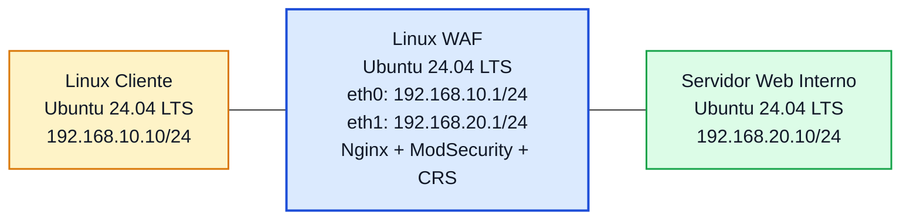

# Laboratório 13 - Testes de Ataques Web e Análise de Logs no WAF

- **Instituição:** Universidade de Brasília (UnB)
- **Departamento:** Departamento de Engenharia Elétrica (ENE)
- **Curso:** Engenharia de Redes de Comunicação
- **Disciplina:** ENE0025 - Protocolos de Transporte e Roteamento
- **Professor responsável:** Prof. Dr. Laerte Peotta de Melo
- **Tema:** Validação prática de proteção web com WAF e análise forense de logs

> **Pré-requisito:** Este laboratório é continuação direta do **Laboratório 12**, reutilizando o ambiente montado com máquinas Linux baseadas em **Ubuntu 24.04 LTS**.

---

## 1. Objetivos

Dar continuidade ao **Lab 12**, realizando testes controlados de requisições HTTP legítimas e maliciosas contra o ambiente protegido por **Nginx + ModSecurity + OWASP CRS**, de modo que o estudante consiga:

- observar o comportamento do WAF diante de tráfego normal e suspeito;
- identificar bloqueios gerados por regras do OWASP CRS;
- analisar logs do Nginx e do ModSecurity;
- compreender, na prática, a diferença entre:
  - firewall de pacotes;
  - firewall stateful;
  - WAF.

---

## 2. Introdução e Fundamentação Teórica

### 2.1 Introdução

No **Lab 12**, o aluno implantou um **proxy reverso com WAF**, posicionando o Linux WAF entre o cliente e o servidor web interno. Nessa etapa, o foco foi a instalação, a publicação do serviço e a validação do acesso legítimo.

No **Lab 13**, o foco passa a ser o **comportamento do WAF diante de diferentes tipos de requisição HTTP**. O objetivo é mostrar que, mesmo com a porta 80 liberada e a comunicação TCP funcionando normalmente, ainda assim uma requisição pode ser bloqueada quando apresenta sinais de ataque na camada de aplicação.

Este laboratório é importante porque torna visível a principal diferença entre os mecanismos estudados até aqui:

- o firewall de pacotes decide com base em IP, protocolo e porta;
- o firewall stateful acompanha o estado da conexão;
- o WAF inspeciona o conteúdo da requisição HTTP.

### 2.2 Relação com os Labs 10, 11 e 12

| Laboratório | Tecnologia | Foco principal |
|---|---|---|
| Lab 10 | Firewall de pacotes sem estado (stateless) | Filtragem por IP, protocolo e porta |
| Lab 11 | Firewall stateful | Filtragem com rastreamento de conexão |
| Lab 12 | WAF em proxy reverso | Publicação e inspeção HTTP |
| Lab 13 | WAF com testes práticos | Bloqueio e análise de requisições maliciosas |

### 2.3 Situação-problema

Uma aplicação web já está publicada por meio de um proxy reverso com WAF. A equipe de segurança precisa verificar se essa proteção consegue identificar padrões suspeitos em requisições HTTP e registrar adequadamente os eventos para investigação.

Para isso, serão realizados acessos normais e testes controlados com padrões frequentemente associados a:

- **SQL Injection:** Ataque em que o invasor tenta inserir comandos SQL em campos ou parâmetros da aplicação para manipular consultas ao banco de dados.
- **Cross-Site Scripting (XSS):** Ataque em que código malicioso, geralmente JavaScript, é injetado em páginas web para ser executado no navegador da vítima.
- **path traversal:** Ataque em que o invasor tenta acessar arquivos ou diretórios indevidos no servidor usando caminhos como `../` para sair da pasta permitida.
- **Parâmetros suspeitos em URL:** São valores passados na própria URL que indicam tentativa de manipular o comportamento da aplicação ou acessar algo indevido.

#### 2.3.1 Exemplos comuns

- tentar inserir comandos em parâmetros, como em `?id=1' OR '1'='1`
- enviar scripts maliciosos, como em `?q=<script>alert(1)</script>`
- tentar acessar arquivos fora da pasta permitida, como em `?file=../../etc/passwd`

São chamados de suspeitos porque fogem do uso normal esperado pela aplicação e podem indicar tentativa de ataque, exploração ou varredura. Em um **WAF**, esses parâmetros são analisados para decidir se a requisição deve ser permitida, registrada ou bloqueada.

### 2.4 Funcionamento interno: pontuação de anomalia e famílias de regras

O OWASP CRS organiza as regras em arquivos por família de ataque. Cada regra acionada soma pontos de anomalia à transação, e a regra de avaliação (família `949`) decide pelo bloqueio quando o limiar de entrada é atingido. A tabela resume as famílias das versões 3.x do CRS (a numeração pode variar entre versões):

| Faixa de identificadores | Família | Exemplo de uso neste laboratório |
|---|---|---|
| `911xxx` / `913xxx` | Método HTTP / detecção de ferramentas de varredura | Agentes de usuário de scanners |
| `920xxx` / `921xxx` | Conformidade e ataques ao protocolo HTTP | Requisições malformadas |
| `930xxx` | Inclusão de arquivos locais e *path traversal* | `../../etc/passwd` |
| `931xxx` / `932xxx` / `933xxx` | Inclusão remota, execução de comandos e injeção de PHP | - |
| `941xxx` | *Cross-Site Scripting* (XSS) | `<script>alert(1)</script>` |
| `942xxx` | SQL Injection | `' OR '1'='1` |
| `949xxx` | Avaliação do limiar de bloqueio na entrada | Decisão de retornar `403` |

### 2.5 Exemplo concreto

A requisição `?id=1' OR '1'='1` aciona regras da família `942xxx`, acumulando pontos; ao ultrapassar o limiar, a regra `949110` bloqueia a transação e o Nginx responde `403 Forbidden`. No log de auditoria, a transação é registrada com os identificadores das regras acionadas, a pontuação e a mensagem correspondente.

### 2.6 Protocolos envolvidos

| Protocolo | Camada OSI | Camada TCP/IP | Transporte / porta |
|---|---|---|---|
| HTTP/1.1 | 7 (Aplicação) | Aplicação | TCP 80 |

---

## 3. Topologia e Cenário

### 3.1 Topologia lógica



### 3.2 Plano de endereçamento

| Dispositivo | Interface | Endereço IP | Máscara | Gateway |
|---|---|---|---|---|
| Linux Cliente | eth0 | 192.168.10.10 | 255.255.255.0 | 192.168.10.1 |
| Linux WAF | eth0 | 192.168.10.1 | 255.255.255.0 | - |
| Linux WAF | eth1 | 192.168.20.1 | 255.255.255.0 | - |
| Servidor Web Interno | eth0 | 192.168.20.10 | 255.255.255.0 | 192.168.20.1 |

### 3.3 Pré-requisitos

Este laboratório pressupõe que o **Lab 12** já esteja funcional, com os seguintes itens concluídos:

- endereçamento IP configurado;
- servidor web interno respondendo;
- Nginx em funcionamento no host WAF;
- ModSecurity habilitado;
- OWASP CRS habilitado;
- proxy reverso funcionando;
- acesso normal ao serviço via `http://192.168.10.1`.

---

## 4. Roteiro Prático Passo a Passo

### 4.1 Validação inicial do ambiente

Antes dos testes de ataque, confirme que o ambiente está operacional.

#### 4.1.1 No servidor web interno

```bash
curl http://127.0.0.1
```

#### 4.1.2 No cliente, via WAF

```bash
curl http://192.168.10.1
```

Resultado esperado: a página do servidor interno deve ser entregue normalmente.

### 4.2 Verificação dos serviços no WAF

```bash
sudo systemctl status nginx
sudo nginx -t
```

Verificar se o ModSecurity está ativo no Nginx:

```bash
sudo grep -R "modsecurity on" /etc/nginx/
```

Verificar o arquivo principal de regras:

```bash
sudo cat /etc/nginx/modsec/main.conf
```

### 4.3 Observação de logs

Durante os testes, mantenha ao menos um terminal aberto no WAF para acompanhar os registros.

#### 4.3.1 Log de acesso do Nginx

```bash
sudo tail -f /var/log/nginx/access.log
```

#### 4.3.2 Log de erro do Nginx

```bash
sudo tail -f /var/log/nginx/error.log
```

#### 4.3.3 Log do ModSecurity

Dependendo da configuração:

```bash
sudo tail -f /var/log/modsec_audit.log
```

ou verifique no `modsecurity.conf` o caminho configurado para auditoria.

### 4.4 Testes de tráfego legítimo

#### 4.4.1 Acesso normal à página inicial

No cliente:

```bash
curl http://192.168.10.1
```

#### 4.4.2 Acesso com parâmetro simples

```bash
curl "http://192.168.10.1/?id=10"
```

#### 4.4.3 Acesso com user-agent comum

```bash
curl -A "Mozilla/5.0" http://192.168.10.1
```

#### 4.4.4 Resultado esperado

- a resposta deve ser permitida;
- o acesso deve aparecer nos logs;
- não deve haver bloqueio para requisições normais.

### 4.5 Testes controlados de requisições suspeitas

> Execute os testes abaixo somente no ambiente de laboratório.

#### 4.5.1 Teste de padrão semelhante a SQL Injection

```bash
curl -G --data-urlencode "id=1' OR '1'='1" http://192.168.10.1/
```

#### 4.5.2 Teste de padrão semelhante a XSS

```bash
curl "http://192.168.10.1/?q=<script>alert(1)</script>"
```

#### 4.5.3 Teste de path traversal

```bash
curl --path-as-is "http://192.168.10.1/../../../etc/passwd"
```

Sem a opção `--path-as-is`, o `curl` normaliza os segmentos `../` antes do envio, e o servidor receberia uma requisição comum para `/etc/passwd`, e não a tentativa de travessia de diretórios. No teste de SQL Injection, a opção `-G --data-urlencode` codifica os espaços e as aspas do parâmetro, evitando uma requisição HTTP malformada (espaços literais na linha de requisição).

#### 4.5.4 Teste com URL codificada

```bash
curl "http://192.168.10.1/?file=%2e%2e%2f%2e%2e%2fetc%2fpasswd"
```

#### 4.5.5 Resultado esperado

Em parte dos casos, o WAF deverá:

- bloquear a requisição;
- registrar o evento no log;
- associar o evento a alguma regra do CRS;
- retornar resposta como `403 Forbidden` ou comportamento equivalente.

> Alguns testes podem não acionar bloqueio dependendo da versão do CRS, do modo configurado e do conjunto de regras habilitado. Isso também deve ser analisado pelos alunos.

---

## 5. Verificação e Diagnóstico

### 5.1 Comparação prática: rede funcionando, aplicação bloqueada

#### 5.1.1 Verificar que a conectividade IP continua válida

No cliente:

```bash
ping 192.168.10.1
```

#### 5.1.2 Verificar que a porta HTTP continua publicada

```bash
curl -I http://192.168.10.1
```

#### 5.1.3 Verificar que uma requisição maliciosa pode ser bloqueada mesmo com a porta aberta

```bash
curl -i "http://192.168.10.1/?q=<script>alert(1)</script>"
```

A opção `-i` exibe o código de status e os cabeçalhos da resposta (por exemplo, `403 Forbidden`).

#### 5.1.4 Interpretação

O aluno deve perceber que:

- a rede está operacional;
- a sessão TCP pode ser estabelecida;
- a porta 80 está acessível;
- mesmo assim, a requisição pode ser barrada por causa do conteúdo HTTP.

### 5.2 Atividade comparativa entre os modelos de firewall

Preencha a tabela abaixo após executar os testes.

| Situação | Firewall de pacotes | Firewall stateful | WAF |
|---|---|---|---|
| Liberar ou bloquear TCP/80 | Sim | Sim | Sim |
| Acompanhar conexão já estabelecida | Não | Sim | Indiretamente |
| Analisar conteúdo da URL | Não | Não | Sim |
| Identificar padrão de XSS | Não | Não | Sim |
| Identificar padrão de SQLi | Não | Não | Sim |
| Bloquear requisição web suspeita sem fechar a porta 80 | Não | Não | Sim |

### 5.3 Análise de logs

Após os testes, os alunos devem localizar nos logs:

- horário da requisição;
- IP de origem;
- recurso acessado;
- código HTTP retornado;
- regra acionada, quando disponível;
- mensagem de auditoria do ModSecurity.

#### 5.3.1 Exemplo de análise esperada

O aluno deve conseguir afirmar algo como:

- uma requisição legítima foi aceita e registrada no `access.log`;
- uma requisição suspeita gerou evento no `modsec_audit.log`;
- o WAF atuou antes do servidor processar normalmente o conteúdo.

### 5.4 Atividade opcional de tuning

Caso o ambiente esteja estável, propõe-se uma pequena atividade de ajuste:

- identificar uma regra que gerou bloqueio;
- analisar a mensagem registrada;
- discutir se o evento representa ataque real, falso positivo ou teste didático;
- propor ajuste futuro sem desabilitar a proteção inteira.

> Esta etapa é opcional.

### 5.5 Interpretação dos logs

| Origem | O que procurar |
|---|---|
| `/var/log/nginx/access.log` | Endereço de origem, horário, método e URL, código de status (`200` para tráfego legítimo e `403` para requisições bloqueadas) |
| `/var/log/nginx/error.log` | Mensagens do módulo ModSecurity, quando configurado para registrar nesse arquivo |
| `/var/log/modsec_audit.log` | Transação completa: requisição, identificadores das regras acionadas (`id`), mensagem (`msg`), pontuação de anomalia e ação tomada |

Para localizar eventos por família de regra, pesquisar o identificador no log de auditoria, por exemplo `sudo grep -n '942' /var/log/modsec_audit.log`.

### 5.6 Metodologia de diagnóstico

1. **Ambiente herdado:** confirmar a validação do Laboratório 12 (`curl http://192.168.10.1` retorna a página do backend);
2. **Ativação do motor de regras:** `SecRuleEngine On` em `/etc/modsecurity/modsecurity.conf`; em `DetectionOnly`, as requisições suspeitas são registradas, mas não bloqueadas;
3. **Carga do CRS:** `sudo nginx -t` e `main.conf` com os `Include` corretos;
4. **Requisições de teste:** conferir a codificação do comando (espaços, `--path-as-is`); uma requisição malformada pode ser rejeitada pelo Nginx (`400`) antes de chegar ao ModSecurity;
5. **Falta de bloqueio:** verificar o nível de paranoia e o limiar de anomalia do CRS; nem toda requisição suspeita atinge a pontuação necessária.

---

## 6. Segurança

### 6.1 Riscos associados

- **Autorização e legalidade:** a execução de testes de ataque contra sistemas sem autorização pode configurar crime de invasão de dispositivo informático (art. 154-A do Código Penal, incluído pela Lei nº 12.737/2012). Os testes devem ser realizados apenas no ambiente isolado do laboratório.
- **Evasão do WAF:** codificações alternativas, fragmentação e variações de sintaxe podem contornar regras; o teste `%2e%2e%2f` ilustra a necessidade de normalização das entradas.
- **Falsa sensação de segurança:** o WAF não corrige a vulnerabilidade da aplicação; ele reduz a exposição, mas não substitui o desenvolvimento seguro e a correção do código.
- **Dados pessoais em logs:** logs de auditoria podem conter parâmetros, cabeçalhos e corpos de requisições, sujeitos à LGPD (Lei nº 13.709/2018); devem ter acesso restrito e política de retenção.
- **Negação de serviço:** a inspeção profunda consome CPU; um volume elevado de requisições pode degradar o WAF.

### 6.2 Boas práticas (*hardening*)

```nginx
# Contexto http: define uma zona de limitação de taxa por endereço de origem
limit_req_zone $binary_remote_addr zone=waf:10m rate=10r/s;

# Bloco location /: aplica a limitação com tolerância de rajada
limit_req zone=waf burst=20 nodelay;
```

Recomenda-se ainda iniciar em `DetectionOnly`, analisar os falsos positivos e só então habilitar o bloqueio (`SecRuleEngine On`); ajustar o nível de paranoia gradualmente; e centralizar e proteger os logs.

---

## 7. Questões para Análise e Discussão

### 7.1 Questões para análise

1. O que diferencia um WAF de um firewall stateful?
2. Por que a requisição pode ser bloqueada mesmo com a porta 80 aberta?
3. O que o WAF consegue observar que o `iptables` não observa?
4. Qual foi o comportamento do ambiente diante de tráfego legítimo?
5. Qual foi o comportamento do ambiente diante de tráfego suspeito?
6. O que os logs do Nginx mostram?
7. O que os logs do ModSecurity mostram?
8. Um bloqueio HTTP significa necessariamente falha da rede? Explique.
9. O WAF substitui a necessidade de correção de vulnerabilidade na aplicação? Explique.
10. Qual foi a principal evidência prática de que o WAF atua na camada de aplicação?

### 7.2 Conclusão esperada

Ao final deste laboratório, o estudante deve concluir que:

- o WAF atua em um nível diferente dos firewalls estudados anteriormente;
- a proteção web depende da inspeção do conteúdo HTTP;
- é possível manter um serviço publicado e, ao mesmo tempo, bloquear padrões suspeitos;
- logs são parte essencial da operação e da investigação;
- o **Lab 13** torna visível, de forma prática, a diferença entre **permitir a conexão** e **permitir a requisição**.

---

## 8. Critérios de Avaliação e Entregáveis

### 8.1 Critérios de avaliação

| Critério | Pontuação |
|---|---:|
| Validação e operacionalidade do ambiente herdado do Lab 12 | 1,5 |
| Execução correta dos testes de tráfego legítimo (curl / HTTP) | 1,5 |
| Execução dos testes de tráfego malicioso (SQLi, XSS, Path Traversal) | 2,5 |
| Coleta, análise e correlação dos logs do Nginx e ModSecurity | 2,5 |
| Respostas técnicas às questões para análise e tabela comparativa | 2,0 |
| **Total** | **10,0** |

### 8.2 Entregáveis

Cada aluno deve entregar:

- print da topologia no PNetLab;
- print do acesso normal ao serviço via WAF;
- print de pelo menos um teste suspeito executado;
- print dos logs do Nginx;
- print dos logs do ModSecurity;
- tabela comparativa preenchida;
- relatório curto explicando:
  - o que foi permitido;
  - o que foi bloqueado;
  - por que isso demonstra a atuação do WAF;
- respostas completas às questões para análise.

---

## 9. Referências

- [**RFC 9110**](https://datatracker.ietf.org/doc/html/rfc9110) - *HTTP Semantics*.
- [**RFC 9112**](https://datatracker.ietf.org/doc/html/rfc9112) - *HTTP/1.1*.
- OWASP. *OWASP Core Rule Set*. Disponível em: https://coreruleset.org/docs/.
- OWASP. *OWASP Top 10*. Disponível em: https://owasp.org/www-project-top-ten/.
- *ModSecurity*. Disponível em: https://modsecurity.org/.
- Nginx. *Documentação oficial*. Disponível em: https://nginx.org/en/docs/.
- BRASIL. Lei nº 12.737, de 30 de novembro de 2012 (tipificação criminal de delitos informáticos).
- BRASIL. Lei nº 13.709, de 14 de agosto de 2018 (Lei Geral de Proteção de Dados Pessoais - LGPD).

---

[← Anterior: Laboratório 12](lab12.md) | [Índice Geral (README)](../README.md) | [Próximo: Laboratório 14 →](lab14.md)
