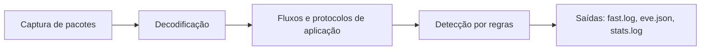
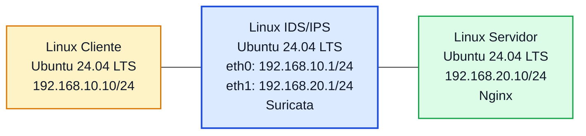

# Laboratório 14 - Implementação de IDS/IPS com Suricata no PNetLab

- **Instituição:** Universidade de Brasília (UnB)
- **Departamento:** Departamento de Engenharia Elétrica (ENE)
- **Curso:** Engenharia de Redes de Comunicação
- **Disciplina:** ENE0025 - Protocolos de Transporte e Roteamento
- **Professor responsável:** Prof. Dr. Laerte Peotta de Melo
- **Tema:** Detecção e prevenção de intrusões em tráfego de rede com Suricata

---

## 1. Objetivos

Implementar um ambiente de **IDS/IPS** no PNetLab utilizando **Suricata** em uma máquina Linux posicionada entre duas redes, permitindo ao estudante:

- compreender a diferença entre **firewall tradicional**, **WAF** e **IDS/IPS**;
- instalar e configurar o Suricata em modo de monitoramento;
- observar alertas gerados a partir da inspeção de tráfego;
- analisar logs e eventos de segurança;
- comparar proteção em camada de rede, transporte e aplicação.

---

## 2. Introdução e Fundamentação Teórica

### 2.1 Introdução

Nos laboratórios anteriores, a proteção foi evoluindo em camadas.

No **Lab 10**, foi implementado um **firewall de pacotes sem estado (*stateless*)**, capaz de tomar decisões com base em endereço IP, protocolo e porta. No **Lab 11**, esse modelo foi ampliado para um **firewall stateful**, com acompanhamento do estado das conexões. No **Lab 12** e no **Lab 13**, a proteção avançou para a **camada de aplicação**, com uso de **WAF**, capaz de inspecionar requisições HTTP e bloquear padrões suspeitos.

Neste **Lab 14**, o foco será um novo tipo de mecanismo: o **IDS/IPS**.

- **IDS (Intrusion Detection System)**: sistema que monitora o tráfego e gera alertas quando identifica padrões suspeitos.
- **IPS (Intrusion Prevention System)**: sistema que, além de detectar, também pode atuar para bloquear ou prevenir tráfego considerado malicioso.


*Imagem gerada com uso de inteligência artificial (OpenAI, ChatGPT).*

O **Suricata** é uma ferramenta amplamente usada nesse contexto, pois permite:

- inspeção de tráfego em tempo real;
- uso de regras de detecção;
- geração de alertas e logs estruturados;
- identificação de eventos em protocolos como IP, TCP, UDP, ICMP, DNS e HTTP.

Neste laboratório, a ênfase será a **implantação do Suricata** e a **observação de alertas em modo IDS**.

### 2.2 Relação com os laboratórios anteriores

| Laboratório | Tecnologia | Foco principal |
|---|---|---|
| Lab 10 | Firewall de pacotes sem estado (stateless) | Filtragem por IP, protocolo e porta |
| Lab 11 | Firewall stateful | Rastreamento de conexões |
| Lab 12 | WAF | Publicação protegida via proxy reverso |
| Lab 13 | WAF | Testes de ataques web e análise de logs |
| Lab 14 | IDS/IPS com Suricata | Detecção e análise de tráfego suspeito |

### 2.3 Situação-problema

Uma organização já possui firewall e WAF para proteger sua infraestrutura. Mesmo assim, a equipe de segurança precisa de uma camada adicional que permita **detectar padrões suspeitos no tráfego da rede**, registrar eventos e apoiar a investigação de incidentes.

Para isso, será implantado um **sensor IDS/IPS** entre duas redes, de forma que o tráfego passe por inspeção e gere alertas quando forem identificadas assinaturas suspeitas.

### 2.4 Diferença entre IDS e IPS

#### 2.4.1 IDS
- monitora;
- detecta;
- registra;
- alerta.

#### 2.4.2 IPS
- monitora;
- detecta;
- pode bloquear ou descartar tráfego.

Neste laboratório, o ambiente está inicialmente configurado como **IDS**.

### 2.5 Comparação didática com os laboratórios anteriores

| Recurso | Firewall de pacotes | Stateful | WAF | IDS/IPS |
|---|---|---|---|---|
| Filtrar por IP e porta | Sim | Sim | Não é o foco | Pode observar |
| Acompanhar estado de conexão | Não | Sim | Parcialmente | Pode analisar |
| Inspecionar conteúdo HTTP | Não | Não | Sim | Sim, dependendo das regras |
| Gerar alerta de comportamento suspeito | Limitado | Limitado | Sim | Sim |
| Bloquear automaticamente | Sim | Sim | Sim | Somente em modo IPS |

### 2.6 Funcionamento interno do Suricata

O Suricata processa o tráfego em um *pipeline*: captura dos pacotes (por exemplo, `AF_PACKET`), decodificação das camadas de rede e transporte, reconstrução de fluxos e análise de protocolos de aplicação (HTTP, DNS, TLS, entre outros), comparação com as regras de detecção e geração de saídas (`fast.log`, `eve.json`, `stats.log`).



Uma regra do Suricata é composta por cabeçalho (ação, protocolo, origem, direção, destino) e opções entre parênteses. Na regra do Laboratório (`alert icmp any any -> any any (msg:"..."; sid:1000001; rev:1;)`), `alert` é a ação, `icmp` o protocolo, `any any` representam endereço e porta de origem, `->` indica a direção, e `msg`, `sid` e `rev` são, respectivamente, a mensagem, o identificador único da assinatura e a revisão.

### 2.7 Modos IDS e IPS

| Característica | IDS | IPS |
|---|---|---|
| Posição | Observa uma cópia do tráfego ou a passagem pela interface | Em linha com o tráfego (*inline*) |
| Ação sobre o pacote | Gera alerta (`alert`) | Pode descartar (`drop`) ou rejeitar (`reject`) |
| Impacto de falha do sensor | Perda de visibilidade | Pode interromper a rede (falha fechada) ou deixar passar tráfego sem inspeção (falha aberta) |
| Exemplo de integração no Linux | `suricata -i eth0` | Fila `NFQUEUE` do Netfilter (`suricata -q 0`) |

Para fins informativos, o modo IPS com `NFQUEUE` utiliza uma regra do tipo `sudo iptables -I FORWARD -j NFQUEUE --queue-num 0 --queue-bypass` e a execução do Suricata com `-q 0`; a opção `--queue-bypass` evita a interrupção do tráfego se o Suricata não estiver em execução. Esse modo não faz parte do roteiro deste laboratório.

### 2.8 Exemplo concreto

Uma varredura `nmap -sS 192.168.20.10` envia pacotes `SYN` para várias portas do servidor; as regras de detecção de varredura, quando presentes no conjunto de regras ativo, geram alertas associados ao endereço de origem. Já uma requisição HTTP com `<script>` na URL pode acionar assinaturas de XSS.

### 2.9 Protocolos envolvidos

| Protocolo | Camada OSI | Camada TCP/IP | Observação |
|---|---|---|---|
| IP, ICMP | 3 (Rede) | Internet | Inspecionados pelas assinaturas de rede |
| TCP, UDP | 4 (Transporte) | Transporte | Reconstrução de fluxos |
| HTTP | 7 (Aplicação) | Aplicação | TCP 80 neste laboratório |

---

## 3. Topologia e Cenário

### 3.1 Topologia lógica



### 3.2 Plano de endereçamento

| Dispositivo | Interface | Endereço IP | Máscara | Gateway |
|---|---|---|---|---|
| Linux Cliente | eth0 | 192.168.10.10 | 255.255.255.0 | 192.168.10.1 |
| Linux IDS/IPS | eth0 | 192.168.10.1 | 255.255.255.0 | - |
| Linux IDS/IPS | eth1 | 192.168.20.1 | 255.255.255.0 | - |
| Linux Servidor | eth0 | 192.168.20.10 | 255.255.255.0 | 192.168.20.1 |

### 3.3 Premissas do laboratório

Neste laboratório, considere que:

- todos os nós utilizam preferencialmente o **Ubuntu Server 24.04 LTS** (`linux-ubuntu-24.04-server`) no PNetLab;
- os equipamentos **já estão com a rede configurada**;
- o **Nginx já está instalado** no servidor;
- o tráfego entre cliente, sensor e servidor já pode ser testado;
- o foco será exclusivamente na **implantação do Suricata** e na **análise dos eventos gerados**.

> Neste primeiro momento, a proposta principal é trabalhar com **detecção**. O uso de **IPS com bloqueio ativo** pode ser explorado depois, com integração ao `iptables` ou `NFQUEUE`.

---

## 4. Roteiro Prático Passo a Passo

### 4.1 Validação inicial do ambiente

Antes de instalar o Suricata, valide se o cenário já está funcional.

#### 4.1.1 No cliente

```bash
ping 192.168.10.1
ping 192.168.20.10
curl http://192.168.20.10
```

#### 4.1.2 No servidor

```bash
ping 192.168.20.1
ping 192.168.10.10
curl http://127.0.0.1
```

#### 4.1.3 No IDS/IPS

```bash
ping 192.168.10.10
ping 192.168.20.10
```

Resultado esperado:

- conectividade IP entre os elementos;
- resposta HTTP do servidor;
- ambiente pronto para monitoramento.

### 4.2 Verificação do encaminhamento IP no sensor

No Linux IDS/IPS:

```bash
cat /proc/sys/net/ipv4/ip_forward
```

Se o valor não for `1`, habilite:

```bash
sudo sysctl -w net.ipv4.ip_forward=1
```

Para persistência:

```bash
echo "net.ipv4.ip_forward = 1" | sudo tee -a /etc/sysctl.conf
sudo sysctl -p
```

### 4.3 Verificação do serviço web

Como o **Nginx já está instalado**, apenas confirme se o serviço está ativo no servidor:

```bash
sudo systemctl status nginx
curl http://127.0.0.1
```

### 4.4 Instalação do Suricata

No Linux IDS/IPS:

```bash
sudo apt update
sudo apt install -y suricata
```

Verificar versão:

```bash
suricata --build-info
```

Verificar serviço:

```bash
sudo systemctl status suricata
```

### 4.5 Localização dos arquivos principais

Em instalações típicas no Ubuntu:

- configuração principal: `/etc/suricata/suricata.yaml`
- regras: `/var/lib/suricata/rules/`
- logs: `/var/log/suricata/`

### 4.6 Atualização das regras

Atualize as regras do Suricata:

```bash
sudo suricata-update
```

Após a atualização, reinicie o serviço:

```bash
sudo systemctl restart suricata
```

### 4.7 Interfaces de captura

Antes de iniciar testes, identifique os nomes corretos das interfaces:

```bash
ip -br addr
```

Exemplo esperado:

- `eth0` voltada para a rede 192.168.10.0/24
- `eth1` voltada para a rede 192.168.20.0/24

### 4.8 Execução do Suricata em modo IDS

Para testes controlados, você pode parar o serviço e executar manualmente o Suricata em foreground.

```bash
sudo systemctl stop suricata
```

Executar na interface desejada:

```bash
sudo suricata -i eth0 -v
```

> Dependendo do cenário, pode ser mais interessante monitorar `eth0`, `eth1` ou ambas em configuração mais avançada. Neste laboratório inicial, uma interface já é suficiente para observar o comportamento da ferramenta.

---

## 5. Verificação e Diagnóstico

### 5.1 Testes de tráfego legítimo

#### 5.1.1 Ping

No cliente:

```bash
ping 192.168.20.10
```

#### 5.1.2 HTTP

No cliente:

```bash
curl http://192.168.20.10
```

#### 5.1.3 Conexão simples na porta 80

```bash
nc -vz 192.168.20.10 80
```

#### 5.1.4 Resultado esperado

- o tráfego deve continuar funcionando normalmente;
- o Suricata deve registrar fluxos e possivelmente eventos, dependendo das regras ativas;
- os alunos devem perceber que o IDS monitora sem necessariamente bloquear.

### 5.2 Observação dos logs

Abra outro terminal no Linux IDS/IPS.

#### 5.2.1 Alertas simples

```bash
sudo tail -f /var/log/suricata/fast.log
```

#### 5.2.2 Eventos estruturados

```bash
sudo tail -f /var/log/suricata/eve.json
```

#### 5.2.3 Estatísticas

```bash
sudo tail -f /var/log/suricata/stats.log
```

### 5.3 Testes de tráfego suspeito controlado

> Execute somente em ambiente de laboratório.

#### 5.3.1 Varredura simples com Nmap

No cliente, se o `nmap` estiver disponível:

```bash
sudo apt install -y nmap
nmap -sS 192.168.20.10
```

ou

```bash
nmap -sV 192.168.20.10
```

#### 5.3.2 Requisição HTTP suspeita

```bash
curl "http://192.168.20.10/?q=<script>alert(1)</script>"
```

#### 5.3.3 Tentativa de path traversal

A opção `--path-as-is` impede que o `curl` normalize os segmentos `../` antes do envio.

```bash
curl --path-as-is "http://192.168.20.10/../../../etc/passwd"
```

#### 5.3.4 Interpretação esperada

- o Suricata pode gerar alertas dependendo do conjunto de regras ativo;
- os eventos devem aparecer em `fast.log` e/ou `eve.json`;
- nem todo tráfego suspeito necessariamente acionará uma regra, e isso também faz parte da análise.

### 5.4 Exemplo de leitura de evento

Os alunos devem observar nos logs informações como:

- horário do evento;
- IP de origem;
- IP de destino;
- protocolo envolvido;
- mensagem da assinatura;
- severidade e categoria, quando disponíveis.

No caso do `eve.json`, pode ser útil filtrar:

```bash
sudo grep '"alert"' /var/log/suricata/eve.json
```

ou usar `jq`, se disponível.

### 5.5 Atividade opcional: criação de regra local simples

Como atividade opcional, propõe-se uma regra local para detectar um ping.

Exemplo de regra local em:

```bash
/etc/suricata/rules/local.rules
```

Conteúdo:

```conf
alert icmp any any -> any any (msg:"ICMP detectado no laboratorio"; sid:1000001; rev:1;)
```

Depois, incluir o arquivo na lista `rule-files` do `suricata.yaml` (caminhos relativos são resolvidos a partir de `default-rule-path`; caminhos absolutos são aceitos):

```yaml
rule-files:
  - suricata.rules
  - /etc/suricata/rules/local.rules
```

Validar a configuração e reiniciar o Suricata:

```bash
sudo suricata -T -c /etc/suricata/suricata.yaml
sudo systemctl restart suricata
```

Gerar tráfego ICMP:

```bash
ping 192.168.20.10
```

Resultado esperado: alerta correspondente nos logs.

> Esta etapa é opcional, mostra como assinaturas podem ser personalizadas.

### 5.6 Interpretação do `fast.log`

Cada linha do `fast.log` segue a estrutura:

```text
<data-hora>  [**] [<gid>:<sid>:<rev>] <mensagem> [**] [Classification: <classe>] [Priority: <n>] {<protocolo>} <origem>:<porta> -> <destino>:<porta>
```

| Campo | Significado |
|---|---|
| `gid:sid:rev` | Grupo, identificador único e revisão da assinatura |
| `mensagem` | Descrição da assinatura (opção `msg`) |
| `Classification` e `Priority` | Categoria e prioridade da assinatura |
| `{protocolo}` | Protocolo do pacote que acionou a regra |
| `origem -> destino` | Endereços e portas envolvidos |

No `eve.json`, cada evento é um objeto JSON; o campo `event_type` distingue alertas (`alert`), fluxos (`flow`), HTTP (`http`), DNS (`dns`) e estatísticas (`stats`).

### 5.7 Metodologia de diagnóstico

1. **Ambiente e encaminhamento:** `ping` entre os nós e `ip_forward` igual a `1` no sensor;
2. **Interface de captura:** confirmar com `ip -br addr` o nome da interface por onde o tráfego passa e se o Suricata foi iniciado nela;
3. **Regras carregadas:** `sudo suricata -T -c /etc/suricata/suricata.yaml` e a mensagem de total de regras carregadas na inicialização;
4. **Geração de tráfego:** o tráfego precisa atravessar a interface monitorada; a captura em `eth0` observa os pacotes enviados e recebidos nessa interface, ou seja, todo o tráfego entre o Cliente e a rede `192.168.20.0/24`, mas não o tráfego local entre o sensor e o servidor;
5. **Logs:** `fast.log` e `eve.json`; a ausência de alertas não significa que o tráfego seja legítimo, e sim que nenhuma assinatura ativa foi acionada;
6. **Desempenho:** `stats.log` para pacotes descartados pelo mecanismo de captura (indicador de sobrecarga do sensor).

---

## 6. Segurança

### 6.1 Riscos associados

- **Autorização e legalidade:** varreduras e testes de ataque só podem ser realizados em redes e sistemas próprios ou expressamente autorizados (art. 154-A do Código Penal, incluído pela Lei nº 12.737/2012). Neste laboratório, devem ocorrer apenas no ambiente isolado.
- **Cegueira em tráfego cifrado:** o conteúdo de sessões TLS não é inspecionado sem terminação ou decifração prévia; o IDS observa apenas metadados.
- **Falsos negativos e falsos positivos:** o desempenho depende do conjunto de regras e do ajuste ao ambiente.
- **Atualização de regras:** `suricata-update` obtém regras de fontes externas por HTTPS; em redes isoladas, as regras devem ser transferidas por mídia confiável, com verificação de integridade.
- **Sensor em linha:** em modo IPS, a falha ou a sobrecarga do sensor pode interromper o tráfego ou deixá-lo sem inspeção.
- **Dados pessoais em logs:** os eventos podem registrar endereços e conteúdo de requisições (LGPD, Lei nº 13.709/2018); o acesso aos logs deve ser restrito.

### 6.2 Boas práticas (*hardening*)

```bash
# Restringir o acesso aos logs do sensor
sudo chmod 750 /var/log/suricata
# Validar a configuração e as regras antes de reiniciar o serviço
sudo suricata -T -c /etc/suricata/suricata.yaml
# Manter o sistema e as regras atualizados
sudo apt update && sudo apt upgrade -y
sudo suricata-update
```

Recomenda-se ainda executar o Suricata com usuário sem privilégios após a inicialização (opção `run-as` no `suricata.yaml`), configurar a rotação dos logs e integrar os alertas a uma plataforma centralizada de análise. O IDS/IPS complementa, e não substitui, o firewall de rede e o WAF.

---

## 7. Questões para Análise e Discussão

### 7.1 Questões para análise

1. O que diferencia IDS de IPS?
2. Qual o papel do Suricata neste laboratório?
3. Por que o IDS/IPS complementa o firewall e o WAF?
4. O que os logs do `fast.log` mostram?
5. O que o arquivo `eve.json` oferece de vantagem em relação ao `fast.log`?
6. Todo tráfego suspeito gera alerta automaticamente? Explique.
7. Qual a diferença entre detectar e bloquear?
8. Por que uma varredura de portas pode ser relevante para um IDS?
9. O IDS substitui firewall ou WAF? Explique.
10. Qual foi a principal evidência prática da utilidade de um IDS no laboratório?

### 7.2 Conclusão esperada

Ao final deste laboratório, o estudante deve perceber que:

- o **IDS/IPS** acrescenta visibilidade e capacidade de detecção à segurança da rede;
- o **Suricata** pode monitorar tráfego real e gerar eventos detalhados;
- a análise de logs é parte essencial da operação de segurança;
- firewall, WAF e IDS/IPS não competem entre si, mas se complementam;
- a segurança em redes modernas exige múltiplas camadas de proteção e observabilidade.

---

## 8. Critérios de Avaliação e Entregáveis

### 8.1 Critérios de avaliação

| Critério | Pontuação |
|---|---:|
| Validação e operacionalidade da topologia base | 1,5 |
| Instalação, configuração de interfaces e modo de operação do Suricata | 2,0 |
| Atualização e configuração de regras de detecção de assinaturas | 2,0 |
| Geração e análise de tráfego legítimo vs. tráfego suspeito/malicioso | 2,5 |
| Análise forense de logs (`fast.log`, `eve.json`) e respostas às questões para análise | 2,0 |
| **Total** | **10,0** |

### 8.2 Entregáveis

Cada aluno deve entregar:

- print da topologia no PNetLab;
- print da configuração IP dos hosts;
- print da versão ou status do Suricata;
- print do `fast.log`;
- print do `eve.json` ou de trecho relevante;
- evidência de pelo menos um tráfego legítimo;
- evidência de pelo menos um teste suspeito;
- relatório curto explicando:
  - o que foi detectado;
  - o que não foi detectado;
  - por que IDS/IPS complementa as outras tecnologias estudadas;
- respostas completas às questões para análise.

---

## 9. Referências

- Suricata. *Suricata User Guide*. Disponível em: https://docs.suricata.io/.
- Proofpoint. *Emerging Threats Open Rules*. Disponível em: https://rules.emergingthreats.net/.
- NIST. *SP 800-94: Guide to Intrusion Detection and Prevention Systems (IDPS)*.
- [**RFC 2979**](https://datatracker.ietf.org/doc/html/rfc2979) - *Behavior of and Requirements for Internet Firewalls*.
- Projeto Netfilter. *Documentação do Netfilter (NFQUEUE)*. Disponível em: https://www.netfilter.org/documentation/.
- LYON, G. *Nmap Network Scanning*. Nmap Project.
- BRASIL. Lei nº 12.737, de 30 de novembro de 2012 (tipificação criminal de delitos informáticos).
- BRASIL. Lei nº 13.709, de 14 de agosto de 2018 (Lei Geral de Proteção de Dados Pessoais - LGPD).

---

[← Anterior: Laboratório 13](lab13.md) | [Índice Geral (README)](../README.md)
